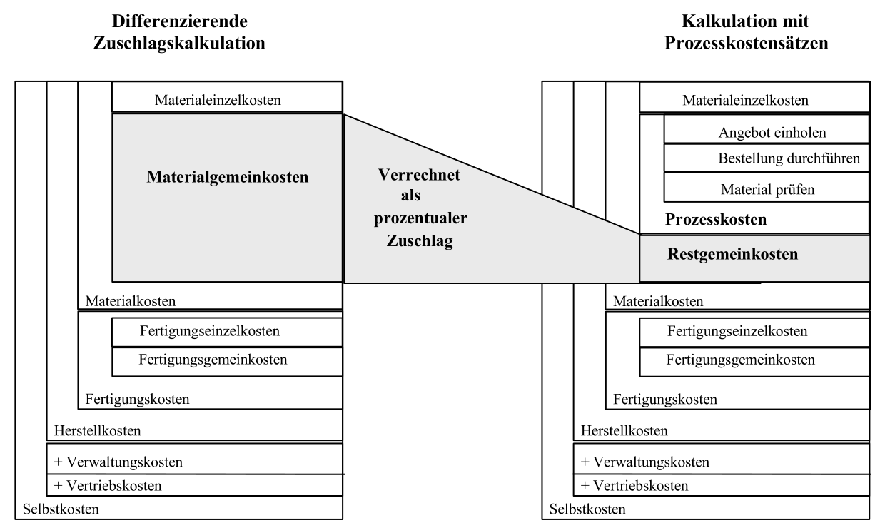
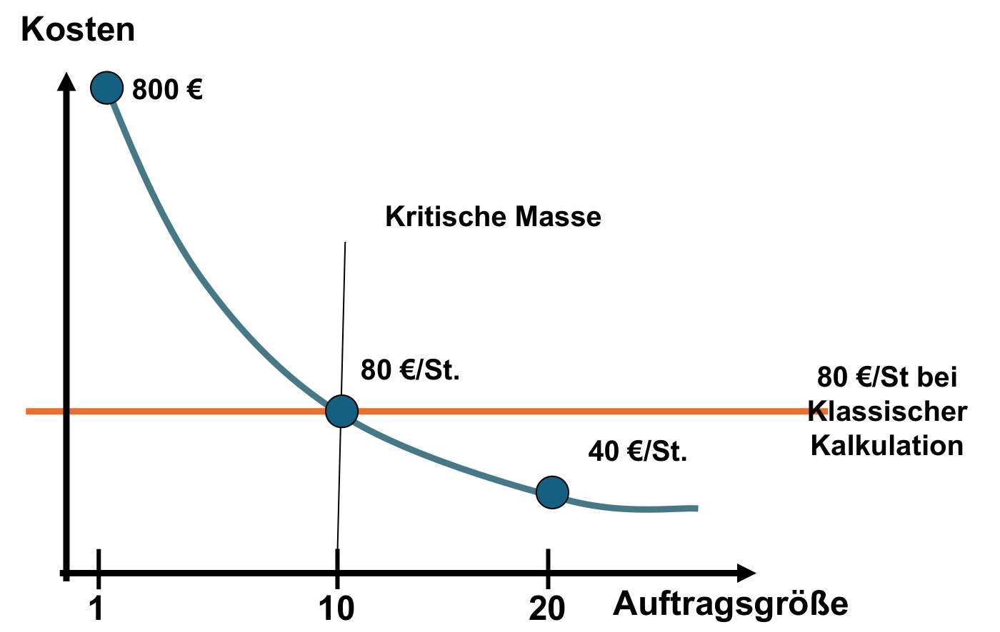

# Prozesskostenrechnung

## Kalkulation mit Prozesskostensätzen

Aufbau der beiden Kalkulationen (Schachtelung wie im Bild):

Differenzierende Zuschlagskalkulation

- Selbstkosten
  - Herstellkosten
    - Materialkosten
      - Materialeinzelkosten
      - Materialgemeinkosten (grau)
    - Fertigungskosten
      - Fertigungseinzelkosten
      - Fertigungsgemeinkosten
  - \+ Verwaltungskosten
  - \+ Vertriebskosten

Kalkulation mit Prozesskostensätzen

- Selbstkosten
  - Herstellkosten
    - Materialkosten
      - Materialeinzelkosten
      - Prozesskosten
        - Angebot einholen
        - Bestellung durchführen
        - Material prüfen
      - Restgemeinkosten (grau)
    - Fertigungskosten
      - Fertigungseinzelkosten
      - Fertigungsgemeinkosten
  - \+ Verwaltungskosten
  - \+ Vertriebskosten

Zwischen den beiden Kalkulationen: grauer Keil „Verrechnet als prozentualer Zuschlag“, er führt vom großen Kasten Materialgemeinkosten (links) zum kleinen Kasten Restgemeinkosten (rechts).

## Prozesskosten

| Prozesse | Prozesskosten | Prozessmengen | Prozesskostensatz (mi) | Umlagesatz (pmn) | Gesamtprozesskosten |
|---|---|---|---|---|---|
| Angebote einholen (mi) | 200.000 | 1 000 | 200,00 | 20,00 | 220,00 |
| Bestellungen durchführen (mi) | 50.000 | 5 000 | 10,00 | 1,00 | 11,00 |
| Material prüfen (mi) | 50 000 | 100 | 500,00 | 50,00 | 550,00 |
| Summe (mi) Prozesskosten | 300 000 | | | | |
| Abteilung leiten (pmn) | 30 000 | | | | |

Umlagesatz = Prozesskosten (pmn) / Σ Prozesskosten (mi) = 30 000 Euro / 300 000 Euro = 10%

## Allokationseffekt (Zuordnung)

Zwei Bilder mit Preis:

| Bild | Preis |
|---|---|
| Goldbarren (Aufschrift: Degussa, Feingold, 1000 g) | Preis: 121.000 €/kg |
| Silberbarren (Aufschrift: Heraeus, Feinsilber, 1000 g) | Preis: 1.800 €/kg |

Stand Monat 09. 2026

Kostenarten

- Einlagerung
- Auslagerung
- Lagerung
- Buchhaltung
- Beschaffung
- Transport
- Versicherung

Beispiel Steckkarten:

| | Materialeinzelkosten | Materialgemeinkosten: Zuschlag 25% | Materialgemeinkosten: Prozeßkostensatz | Allokationseffekt (Gemeinko.-Differenz) |
|---|---|---|---|---|
| Steckkarte A | 38.- | 9,50 | 12.- | + 2,50 |
| Steckkarte B | 64.- | 16,00 | 12.- | - 4,00 |
| Steckkarte C | 115.- | 28,75 | 12.- | - 16,75 |

## Komplexitätseffekt

Abbildung (Scan) mit dem Briefkopf zweier Ärzte (Dr. med. Thomas Graeve: Allgemeinarzt, Palliativmedizin, Bade- und Kurarzt, Akupunktur; Dr. med. Ludwig Sieroslawski: Internist, Kardiologe, Notfallmedizin, Naturheilverfahren) und einer Liste. Vor der ersten Zeile steht das Datum 09.02.09.

| Prozess | Faktor | Bezeichnung | Preis |
|---|---|---|---|
| 3583.H1 | 1.150 | Harnsäure | 2.68 |
| 3587.H1 | 1.150 | Alkalische Phosphatase | 2.68 |
| 3594.H1 | 1.150 | Glutamatoxalazetattransaminase (GOT) | 2.68 |
| 3595.H1 | 1.150 | Glutamatpyruvattransaminase (GPT), ALAT, ALT, Alaninaminotransferase | 2.68 |
| 3592.H1 | 1.150 | Gamma-Glutamyltranspeptidase (Gamma-GT) Gamma-Glutamyltransferase | 2.68 |
| 3590.H1 | 1.150 | Creatinkinase (CK) | 2.68 |
| 3558 | 1.150 | Natrium | 2.01 |
| 3557 | 1.150 | Kalium | 2.01 |
| 3555 | 1.150 | Calcium | 2.68 |
| 3620 | 1.150 | Eisen im Serum oder Plasma | 2.68 |
| 3565.H1 | 1.150 | Triglyzeride | 2.68 |
| 3562.H1 | 1.150 | Cholesterin | 2.68 |
| 3564.H1 | 1.150 | LDL-Cholesterin | 2.68 |
| 3563.H1 | 1.150 | HDL-Cholesterin | 2.68 |
| 3560 | 1.150 | Glukose | 2.68 |
| 3561 | 1.150 | Glykierte Hämoglobine (HbA1, HbA1c) | 13.41 |
| 3585.H1 | 1.150 | Kreatinin | 2.68 |
| 3584.H1 | 1.150 | Harnstoff (Harnstoff-N, BUN) | 2.68 |

Beispiel Erzeugnis A und B:

| Erzeugnis | A | B |
|---|---|---|
| Anzahl Teile | 10 | 20 |
| Einzelkosten | 60,00 € | 60,00 € |
| Gemeinkostenzuschlag | 35% | 35% |
| Prozessschritte | 10 | 20 |
| Prozesskostensatz pro Schritt | 1,40 € | 1,40 € |

Farben auf der Folie: Gemeinkostenzuschlag in der Farbe der Klassischen Zuschlagskalkulation, Prozessschritte und Prozesskostensatz pro Schritt in der Farbe der Prozesskostenrechnung.

| Kalkulation | Klassische Zuschlagskalkulation: A | Klassische Zuschlagskalkulation: B | Prozesskostenrechnung: A | Prozesskostenrechnung: B |
|---|---|---|---|---|
| Einzelkosten | 60,00 € | 60,00 € | 60,00 € | 60,00 € |
| Gemeinkosten | 21,00 € | 21,00 € | 14,00 € | 28,00 € |
| Gesamtkosten | 81,00 € | 81,00 € | 74,00 € | 88,00 € |

## Degressionseffekt

Beschriftung der Grafik:

- Achsen: Kosten über Auftragsgröße (1, 10, 20)
- Fallende Kurve mit drei Punkten: 800 € bei Auftragsgröße 1, 80 €/St. bei Auftragsgröße 10, 40 €/St. bei Auftragsgröße 20
- Waagerechte Linie: 80 €/St bei Klassischer Kalkulation
- Senkrechte Linie bei Auftragsgröße 10 (Schnittpunkt von Kurve und waagerechter Linie): Kritische Masse

Zahlenbeispiel: Zuschlagskalkulation (Zuschlagsatz = 20 %) und Prozeßkostenrechnung (Prozeßkosten = 800)

| Stück | Zuschlagskalkulation: HK | Zuschlagskalkulation: VGK | Zuschlagskalkulation: Stückk. | Prozeßkostenrechnung: HK | Prozeßkostenrechnung: VGK | Prozeßkostenrechnung: Stückk. | Gemeinkostendifferenz |
|---|---|---|---|---|---|---|---|
| 1 | 400 | 80 | 480 | 400 | 800 | 1.200 | -720 |
| 5 | 2.000 | 400 | 480 | 2.000 | 800 | 560 | -80 |
| 10 | 4.000 | 800 | 480 | 4.000 | 800 | 480 | +/- 0 |
| 15 | 6.000 | 1.200 | 480 | 6.000 | 800 | 453 | 27 |
| 20 | 8.000 | 1.600 | 480 | 8.000 | 800 | 440 | 40 |

## Notizen

### Prozesskostenrechnung

- Auf der Titelfolie: „wissen und beschreiben: Allokation, Komplexität, Degressionseffekt“ (Vorjahr)

### Prozesskosten

- Links neben den Prozessen mit (mi): „mi“, darunter „kv“ (Vorjahr)
- Links neben „Abteilung leiten (pmn)“: „pmn“, darunter „KF“ (Vorjahr)
- In der Spalte Prozesskosten ergänzt: bei Angebote einholen „3 Pers.“, bei Bestellungen durchführen „1. Pers.“, bei Material prüfen „1. Pers“ (Vorjahr)
- Eingekreist: Prozessmenge 1 000 (Angebote einholen), die drei Prozesskostensätze (mi) 200,00, 10,00 und 500,00, das Ergebnis 10% beim Umlagesatz (Vorjahr)
- Haken rechts neben der Zeile Angebote einholen und am Bruch 30 000 Euro / 300 000 Euro (Vorjahr)

### Allokationseffekt (Zuordnung)

- Die Vorjahresfolie hat andere Werte: Goldbarren Preis: 35.000 €/kg, Silberbarren Preis: 430 €/kg, Stand 05.03.2018. Die folgenden Notizen rechnen mit diesen Werten. (Vorjahr)
- Oben rechts: „Zuschlagsatz 10 %“ (Vorjahr)
- Goldbarren: „EK“ 35.000, „GK“ 3.500 (Klammer „10 %“), Summe 38 500 (Vorjahr)
- Silberbarren: 430, darunter 43 (Klammer „10 %“), Summe 473 (Vorjahr)
- Bei Kostenart Lagerung: „Zinsen (Wert)“ (Vorjahr)
- Bei Kostenart Versicherung: „(Wert)“ (Vorjahr)

Quelle: kostenrechnung/origin/mitschriebt_3_von_5_aktuell.pdf, Folien 107-115

Vorjahr: kostenrechnung/origin/mitschrieb_letzte_jahr.pdf, Folien 110-118
