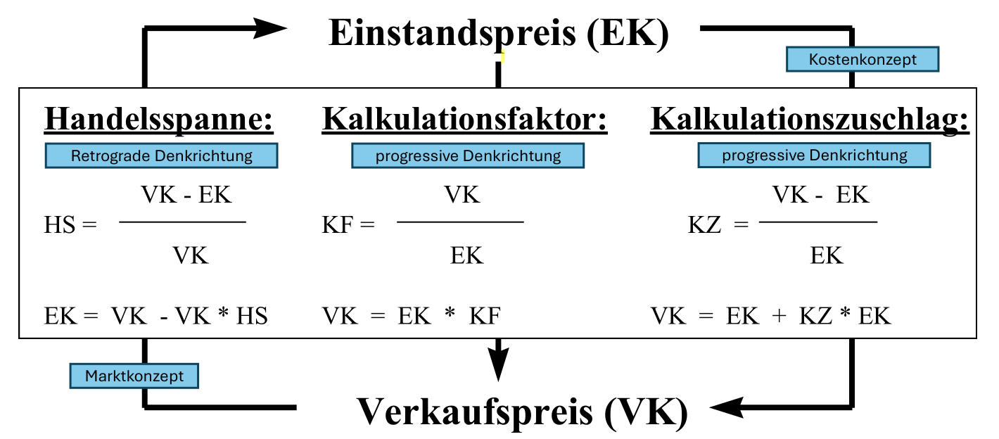
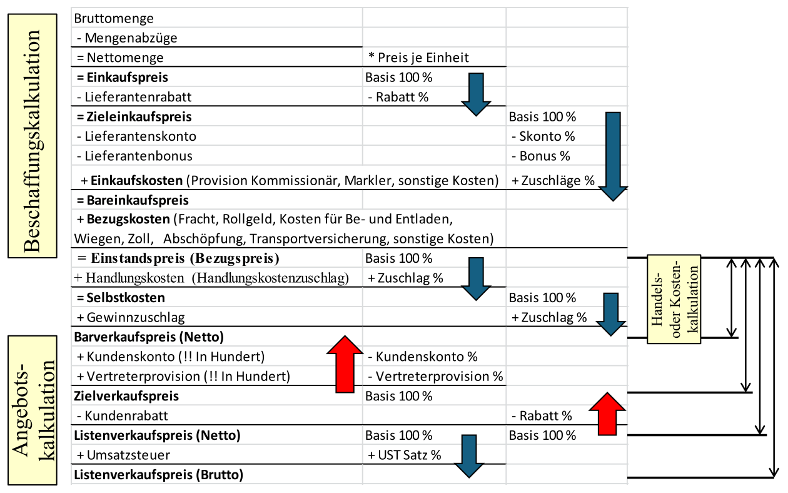

# Handelskalkulation

## Grundkalkulation Handel

| | Position |
|---|---|
| | Einkaufspreis |
| ↓ | Beschaffungskalkulation |
| | Einstandspreis |
| + | Handlungskosten |
| = | Selbstkosten |
| + | Gewinnzuschlag |
| = | Verkaufspreis |
| ↓ | Angebotskalkulation |
| | Angebotspreis |

Rechts neben dem Schema: Doppelpfeil „Handelsspanne absolut“ zwischen einer Linie auf Höhe des Einstandspreises und einer Linie auf Höhe des Verkaufspreises. Daneben in Rot: Rohgewinn, Deckungsbeitrag, Marge (Spanne).

## Aufschlagskalkulation

| Hauptrechnung | Eingerückt |
|---|---|
| **Wareneinstandspreis (Basis)** | |
| | + Personalkosten |
| | + Mieten |
| | + Mietnebenkosten |
| | + Sachkosten Geschäftsräume |
| | + Werbung |
| | + Reisen |
| | + Fuhrpark |
| | + Fremdkapitalzinsen |
| | + Eigenkapitalzinsen |
| | + Abschreibungen |
| | + sonstige Kosten |
| + | **= Handlungskosten** |
| = Selbstkosten | |
| + Gewinnzuschlag | |
| **= Preis (Barverkaufspreis - netto)** | |

Ein großer Pfeil zeigt vom Wareneinstandspreis nach unten bis zum Preis. Rechts daneben steht senkrecht „Handelsspanne (absolut)“, begrenzt durch eine Linie oben auf Höhe des Wareneinstandspreises und eine Linie unten auf Höhe des Preises.

## Einstandspreis (EK) und Verkaufspreis (VK): Handelsspanne, Kalkulationsfaktor, Kalkulationszuschlag **[K Vorjahr]**

| | Handelsspanne | Kalkulationsfaktor | Kalkulationszuschlag |
|---|---|---|---|
| Denkrichtung | Retrograde Denkrichtung | progressive Denkrichtung | progressive Denkrichtung |
| Formel | HS = (VK - EK) / VK | KF = VK / EK | KZ = (VK - EK) / EK |
| Aufgelöst nach EK bzw. VK | EK = VK - VK \* HS | VK = EK \* KF | VK = EK + KZ \* EK |

Pfeile im Bild:

- Marktkonzept: Pfeil links vom Verkaufspreis (VK) nach oben zum Einstandspreis (EK), auf der Seite der Handelsspanne
- Kostenkonzept: Pfeil rechts vom Einstandspreis (EK) nach unten zum Verkaufspreis (VK), auf der Seite des Kalkulationszuschlags
- Pfeil in der Mitte vom Einstandspreis (EK) nach unten zum Verkaufspreis (VK), beim Kalkulationsfaktor

## Beispiel: Handelskalkulation I

- Der Verkaufspreis einer Fahrradtour beträgt im Reisebüro 400.- €.
- Der Veranstalter bietet eine Handelsspanne von 60%.
- Wie hoch ist der Einstandspreis, der Kalkulationszuschlag und der Kalkulationsfaktor ?

Die Rechnung dazu steht nur handschriftlich im Vorjahr, siehe Notizen.

## Tipps + Tricks

1. KF = 1 + KZ
2. KZ = KF - 1
3. HS = KZ / KF

## Kalkulation im Handel

### Beispiel: Schmuckwarengroßhändler Perlenglanz

Der Schmuckwarengroßhändler Perlenglanz, Pforzheim, kalkuliert mit einer **Handelsspanne von 45 %** (auf der Folie gelb markiert).

Überprüfen Sie, ob das nachstehende Angebot noch gewinnbringend ist. Gegeben sind:

| | |
|---|---|
| Listeneinkaufspreis | 420,00 € |
| Lieferantenrabatt | 10,00 % |
| Lieferantenskonti | 2,00 % |
| Bezugskosten | 10,60 € |
| Netto-Verkaufspreis | 680,00 € |

Aus einer Prüfung der IHK zum Handelsfachwirt.

Auf den Folien steht dazu keine Lösung.

### Kalkulationsschema

| Abschnitt | Position | Prozentspalte 1 | Prozentspalte 2 |
|---|---|---|---|
| Beschaffungskalkulation | Bruttomenge | | |
| Beschaffungskalkulation | - Mengenabzüge | | |
| Beschaffungskalkulation | = Nettomenge | \* Preis je Einheit | |
| Beschaffungskalkulation | **= Einkaufspreis** | Basis 100 % | |
| Beschaffungskalkulation | - Lieferantenrabatt | - Rabatt % | |
| Beschaffungskalkulation | **= Zieleinkaufspreis** | | Basis 100 % |
| Beschaffungskalkulation | - Lieferantenskonto | | - Skonto % |
| Beschaffungskalkulation | - Lieferantenbonus | | - Bonus % |
| Beschaffungskalkulation | + **Einkaufskosten** (Provision Kommissionär, Markler, sonstige Kosten) | | + Zuschläge % |
| Beschaffungskalkulation | **= Bareinkaufspreis** | | |
| Beschaffungskalkulation | + **Bezugskosten** (Fracht, Rollgeld, Kosten für Be- und Entladen, Wiegen, Zoll, Abschöpfung, Transportversicherung, sonstige Kosten) | | |
| Handels- oder Kostenkalkulation | **= Einstandspreis (Bezugspreis)** | Basis 100 % | |
| Handels- oder Kostenkalkulation | + Handlungskosten (Handlungskostenzuschlag) | + Zuschlag % | |
| Handels- oder Kostenkalkulation | **= Selbstkosten** | | Basis 100 % |
| Handels- oder Kostenkalkulation | + Gewinnzuschlag | | + Zuschlag % |
| Angebotskalkulation | **Barverkaufspreis (Netto)** | | |
| Angebotskalkulation | + Kundenskonto (!! In Hundert) | - Kundenskonto % | |
| Angebotskalkulation | + Vertreterprovision (!! In Hundert) | - Vertreterprovision % | |
| Angebotskalkulation | **Zielverkaufspreis** | Basis 100 % | |
| Angebotskalkulation | - Kundenrabatt | | - Rabatt % |
| Angebotskalkulation | **Listenverkaufspreis (Netto)** | Basis 100 % | Basis 100 % |
| Angebotskalkulation | + Umsatzsteuer | + UST Satz % | |
| Angebotskalkulation | **Listenverkaufspreis (Brutto)** | | |

Pfeile im Bild:

- Blaue Pfeile nach unten, jeweils ab „Basis 100 %“: vom Einkaufspreis (Rabatt), vom Zieleinkaufspreis (Skonto, Bonus, Zuschläge), vom Einstandspreis (Zuschlag Handlungskosten), von den Selbstkosten (Gewinnzuschlag), vom Listenverkaufspreis (Netto) (UST Satz)
- Rote Pfeile nach oben, jeweils ab „Basis 100 %“: vom Zielverkaufspreis (Kundenskonto, Vertreterprovision), vom Listenverkaufspreis (Netto) (Kundenrabatt)
- Rechts beim Kasten „Handels- oder Kostenkalkulation“: vier Doppelpfeile, alle ab der Linie des Einstandspreises (Bezugspreis). Sie reichen bis zum Barverkaufspreis (Netto), bis zum Zielverkaufspreis, bis zum Listenverkaufspreis (Netto) und bis zum Listenverkaufspreis (Brutto).

## Notizen

### Grundkalkulation Handel

- Oben rechts: Ausrufezeichen und „Folie 108“. Im Foliensatz des Vorjahres ist Folie 108 „Kalkulation mit Maschinenstunden“ (im aktuellen Foliensatz Folie 105). (Vorjahr)
- An den Pfeilen: „1)“ bei Beschaffungskalkulation, „3)“ bei Angebotskalkulation (Vorjahr)
- Links neben dem Schema untereinander: „HS“, „KF“, „KZ“ (Vorjahr)
- Einstandspreis gelb markiert, daneben „EK“. Verkaufspreis gelb markiert, daneben „VK“. (Vorjahr)
- Neben + Handlungskosten: „40 %“. Neben + Gewinnzuschlag: „30 %“. (Vorjahr)
- Rechts neben Rohgewinn, Deckungsbeitrag, Marge (Spanne): „82 %“ (Vorjahr)

### Einstandspreis (EK) und Verkaufspreis (VK): Handelsspanne, Kalkulationsfaktor, Kalkulationszuschlag

- Oben links auf der Folie: rotes „K“, direkt dahinter „100 %“ (Vorjahr)
- „KF“ in KF = VK / EK ist eingekreist (Vorjahr)
- „KZ \* EK“ in VK = EK + KZ \* EK ist eingekreist, daneben „Zuschlag“ (Vorjahr)
- Gelb markiert: das „\*“ in VK = EK \* KF und das „+“ in VK = EK + KZ \* EK (Vorjahr)
- In der Übung 1 „Fit wie Turnschuh“ (bei den Aufgaben in origin-tasks) steht ein rotes „K“ vor den Teilaufgaben e) Kalkulationsfaktor, f) Kalkulationszuschlag, g) Handelsspanne (Vorjahr)

### Beispiel: Handelskalkulation I

- Oben rechts gerechnet: EK 160 + HS abs 240 = VK 400 (Vorjahr)
- „60%“ gelb markiert, darunter „Basis VK“ (Vorjahr)
- „Einstandspreis“ gelb markiert, darüber „160“ (Vorjahr)
- Kalkulationszuschlag: KZ = (VK - EK) / EK = 240 / 160 = 150 % = 1,5 (Vorjahr)
- Kalkulationsfaktor: = VK / EK = 400 / 160 = 2,5 (Vorjahr)

### Kalkulation im Handel

- Im Kalkulationsschema gelb markiert: „= Einstandspreis (Bezugspreis)“ und „Barverkaufspreis (Netto)“ (Vorjahr)
- Großer gelber Haken oben rechts neben dem Kalkulationsschema (Vorjahr)

Quelle: kostenrechnung/origin/mitschriebt_3_von_5_aktuell.pdf, Folien 116-123

Vorjahr: kostenrechnung/origin/mitschrieb_letzte_jahr.pdf, Folien 119-126
