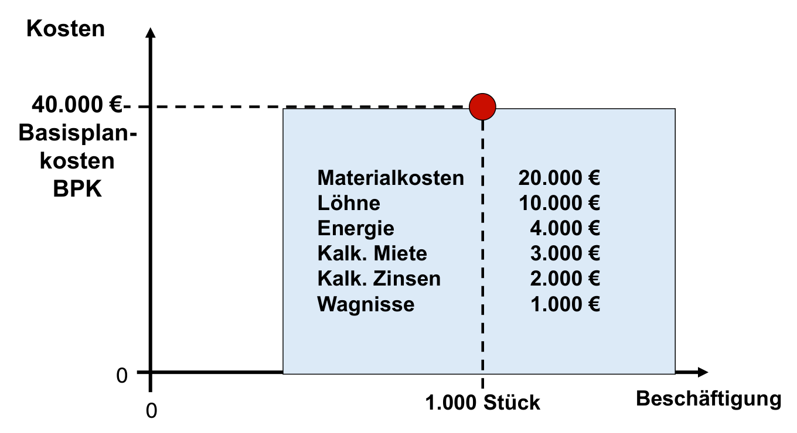
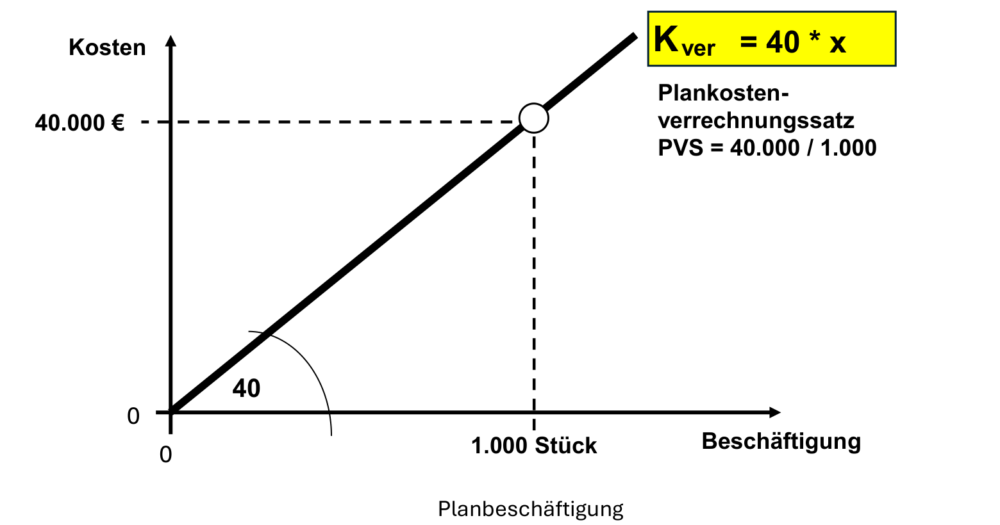
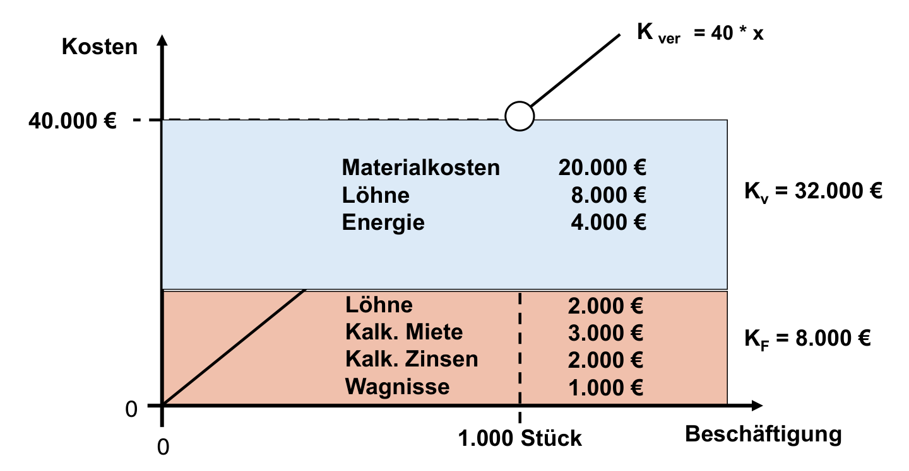
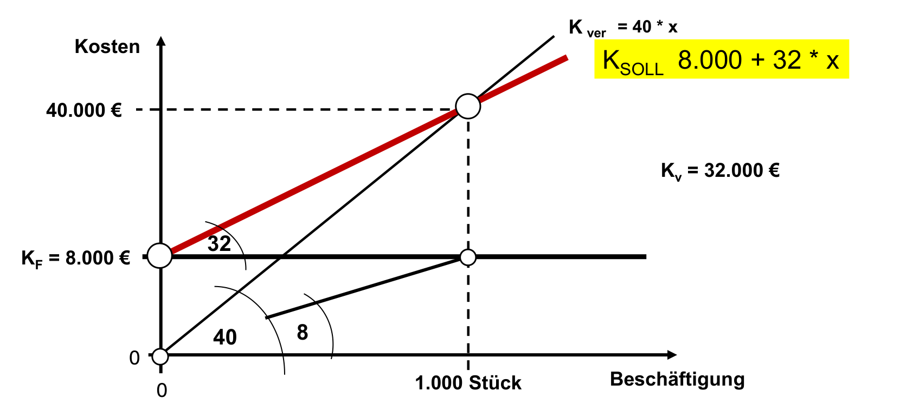
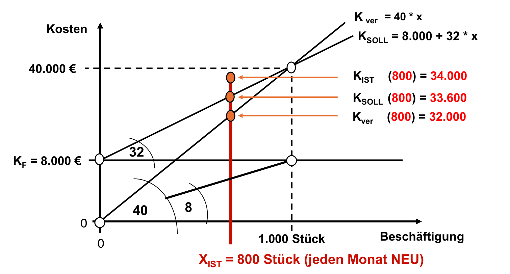

# Plankosten, Sollkostenfunktion und Istkosten

## Ermittlung der Basisplankosten

- Achsen: Kosten über Beschäftigung
- Basisplankosten BPK = 40.000 € bei 1.000 Stück

| Kostenart | Betrag |
|---|---|
| Materialkosten | 20.000 € |
| Löhne | 10.000 € |
| Energie | 4.000 € |
| Kalk. Miete | 3.000 € |
| Kalk. Zinsen | 2.000 € |
| Wagnisse | 1.000 € |

## Schritt 3: Ermittlung der verrechnenden Vollkosten

- K_ver = 40 * x
- Plankostenverrechnungssatz PVS = 40.000 / 1.000
- Gerade durch den Ursprung und den Punkt 1.000 Stück / 40.000 €, Steigung 40
- 1.000 Stück = Planbeschäftigung

## Schritt 4: Kostenspaltung

| Kosten | Kostenart | Betrag |
|---|---|---|
| K_v = 32.000 € | Materialkosten | 20.000 € |
| | Löhne | 8.000 € |
| | Energie | 4.000 € |
| K_F = 8.000 € | Löhne | 2.000 € |
| | Kalk. Miete | 3.000 € |
| | Kalk. Zinsen | 2.000 € |
| | Wagnisse | 1.000 € |

- Im Diagramm liegt K_F unten (0 bis 8.000 €), K_v darüber (bis 40.000 €)
- K_ver = 40 * x am Punkt 1.000 Stück / 40.000 €

## Schritt 5: Bestimmung der Sollkostenfunktion

- K_SOLL = 8.000 + 32 * x (rote Gerade, beginnt bei K_F = 8.000 €, Steigung 32)
- K_ver = 40 * x (Gerade aus dem Ursprung, Steigung 40)
- K_F = 8.000 € (waagerechte Linie), K_v = 32.000 €
- Linie zum Punkt 1.000 Stück / K_F = 8.000 €: Steigung 8
- K_SOLL und K_ver schneiden sich bei 1.000 Stück / 40.000 €

## Ergebnisse der Planung

1. Planbeschäftigung: x_plan = 1.000 Stück
2. Plankosten: K (x_plan = 1.000) = 40.000 €
3. Kostenspaltung: K = K_F (8.000) + K_v (32.000)
4. Vollkosten: K_Ver (x) = 40 * x
5. Sollkosten: K_SOLL(x_IST) = 8.000 + 32 * x_IST

## Kosten in der flexiblen Plankostenrechnung

- X_IST = 800 Stück (jeden Monat NEU)
- K_IST (800) = 34.000
- K_SOLL (800) = 33.600
- K_ver (800) = 32.000
- Geraden wie in Schritt 5: K_ver = 40 * x, K_SOLL = 8.000 + 32 * x, K_F = 8.000 €

## SOLL-, IST- und verrechnete Kosten 12 * im Jahr

- K_IST kommt aus der Buchhaltung -> entsteht aus IST-Mengen und IST-Preisen
  - K_IST (800) = 34.000
- Hier müssen Sie rechnen
  - K_SOLL (800) = 8.000 + 32 * 800 = 33.600
  - K_Verr (800) = 40 * 800 = 32.000

Quelle: kostenrechnung/origin/mitschriebt_3_von_5_aktuell.pdf, Folien 169-175
