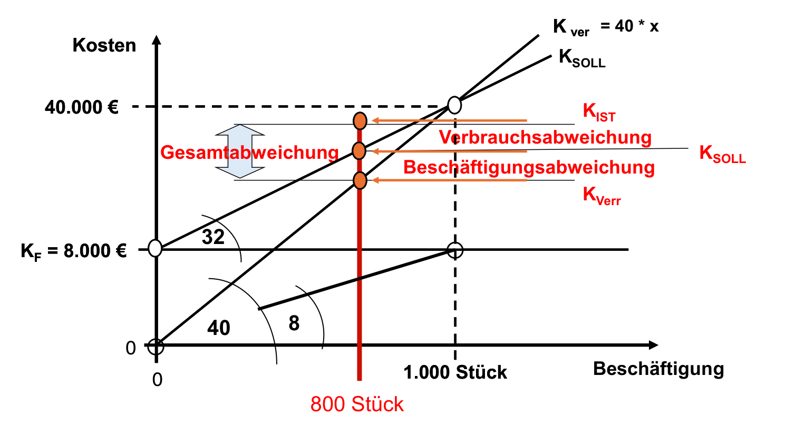
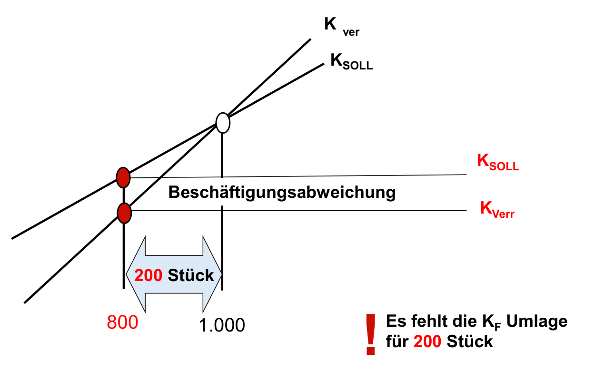
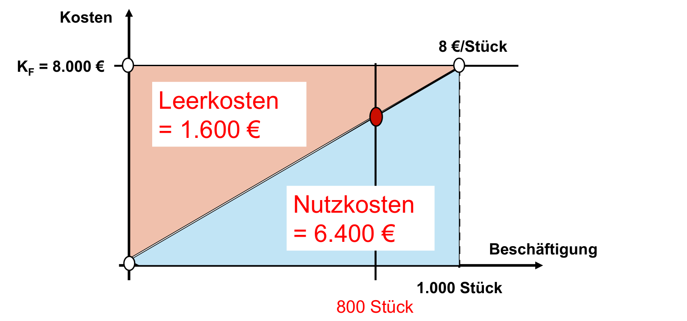
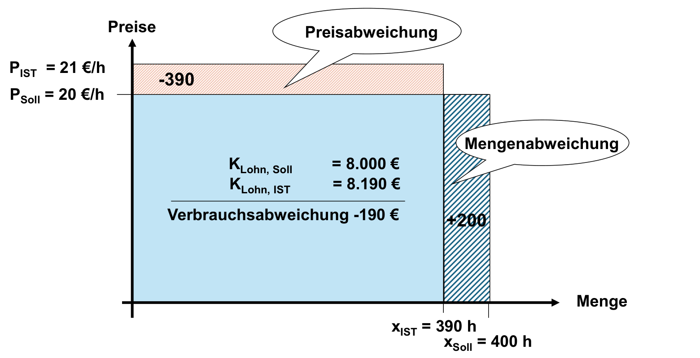
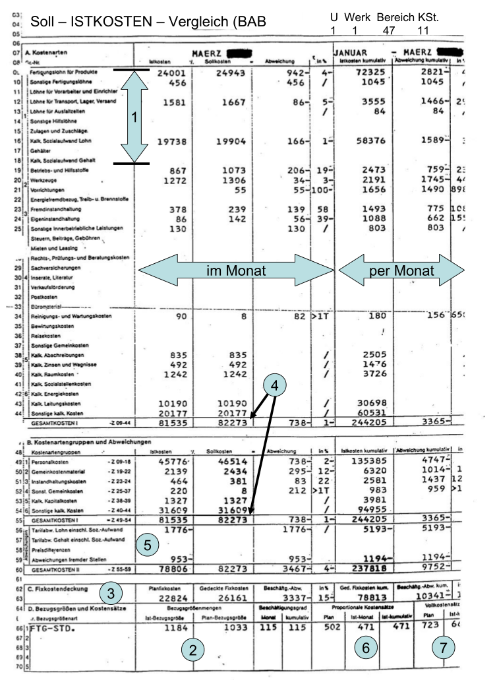

# Kostenanalyse und Abweichungen

## 7. Schritt: Kostenanalyse 12 * im Jahr

- Bei 800 Stück liegen drei Punkte übereinander: K_IST (oben), K_SOLL (Mitte), K_Verr (unten)
- Gesamtabweichung: Abstand zwischen K_IST und K_Verr
- Verbrauchsabweichung: Abstand zwischen K_IST und K_SOLL
- Beschäftigungsabweichung: Abstand zwischen K_SOLL und K_Verr
- Geraden: K_ver = 40 * x (Steigung 40), K_SOLL (Steigung 32), K_F = 8.000 €, Linie mit Steigung 8; Schnittpunkt bei 1.000 Stück / 40.000 €

## Gesamtabweichung

- Vergleich der verrechneten Vollkosten mit den tatsächlich angefallenen IST-Kosten
- Gesamtabweichung = K_Verr. – K_IST = 32.000 – 34.000 = - 2.000

## Beschäftigungsabweichung

- Zeigt den Einfluss von Über- und Unterbeschäftigung auf die Vollkosten (Leer- und Nutzkosten).
- Beschäftigungsabweichung = K_Verr. – K_SOLL = 32.000 – 33.600 = - 1.600
- Beschäftigungsabweichung = k_F * ( x_IST – x_PLAN) = 8 * (800 – 1.000) = - 1.600

- Geraden K_ver und K_SOLL schneiden sich bei 1.000
- Bei 800: Punkt auf K_SOLL (oben) und Punkt auf K_Verr (unten), der Abstand dazwischen ist die Beschäftigungsabweichung
- Zwischen 800 und 1.000: 200 Stück
- **!** Es fehlt die K_F Umlage für 200 Stück

### Nutz- und Leerkosten

- K_F = 8.000 € (waagerechte Linie)
- Gerade aus dem Ursprung bis 1.000 Stück / K_F: 8 €/Stück
- Senkrechte bei 800 Stück, roter Punkt auf der Geraden
- Fläche über der Geraden: Leerkosten = 1.600 €
- Fläche unter der Geraden: Nutzkosten = 6.400 €

## Verbrauchsabweichung

- Zeigt die Soll / Ist - Abweichung
- Verbrauchsabweichung = K_SOLL. – K_IST = 33.600 – 34.000 = - 400
- und setzt sich zusammen aus
  - Mengenabweichung
  - Preisabweichung

### Verbrauchsabweichung (Löhne)

- Achsen: Preise über Menge
- P_IST = 21 €/h, P_Soll = 20 €/h
- x_IST = 390 h, x_Soll = 400 h
- K_Lohn, Soll = 8.000 €
- K_Lohn, IST = 8.190 €
- Verbrauchsabweichung -190 €
- Preisabweichung: -390 (Fläche zwischen P_Soll und P_IST bis x_IST)
- Mengenabweichung: +200 (Fläche zwischen x_IST und x_Soll bis P_Soll)

## flexibler BAB

- Kopf: "Soll – ISTKOSTEN – Vergleich (BAB", U 1, Werk 1, Bereich 47, KSt. 11
- im Monat: Spalten MAERZ (Istkosten, Sollkosten, Abweichung, in %)
- per Monat: Spalten JANUAR - MAERZ (Istkosten kumulativ, Abweichung kumulativ, in %)
- Abschnitte im Formular: A. Kostenarten, B. Kostenartengruppen und Abweichungen, C. Fixkostendeckung, D. Bezugsgrößen und Kostensätze
- Markierungen 1 bis 7 (auf der Folie ohne Legende):
  - 1: Doppelpfeil über die Zeilen Fertigungslohn für Produkte bis Kalk. Sozialaufwand Gehalt (A. Kostenarten)
  - 2: bei D. Bezugsgrößen und Kostensätze, Bezugsgrößenmengen (Ist-Bezugsgröße, Plan-Bezugsgröße)
  - 3: bei C. Fixkostendeckung
  - 4: zwei Pfeile in die Spalte Sollkosten, zur Zeile GESAMTKOSTEN I in A. und in B.
  - 5: bei den Zeilen Abweichungen in B. (Tarifabw. Lohn einschl. Soz.-Aufwand, Tarifabw. Gehalt einschl. Soz.-Aufwand, Preisdifferenzen, Abweichungen fremder Stellen)
  - 6: bei D., Proportionale Kostensätze (Ist-Monat)
  - 7: bei D., Vollkostensätze (Plan)

Quelle: kostenrechnung/origin/mitschriebt_3_von_5_aktuell.pdf, Folien 176-180, 183-184, 188
