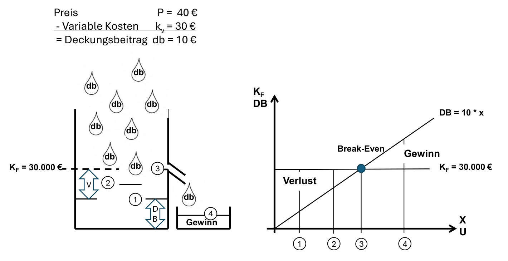
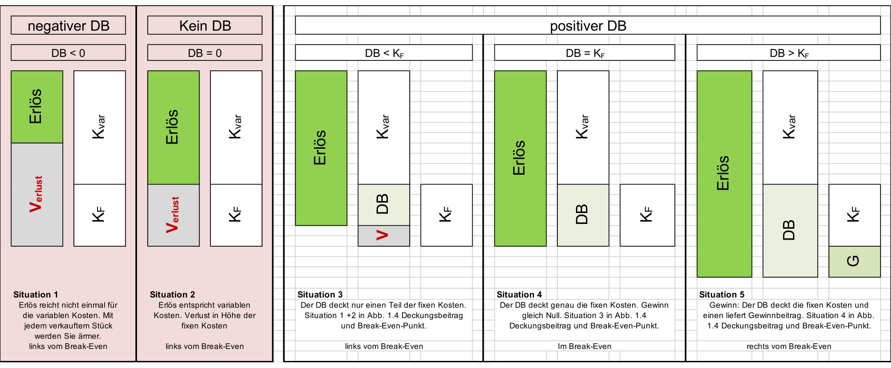
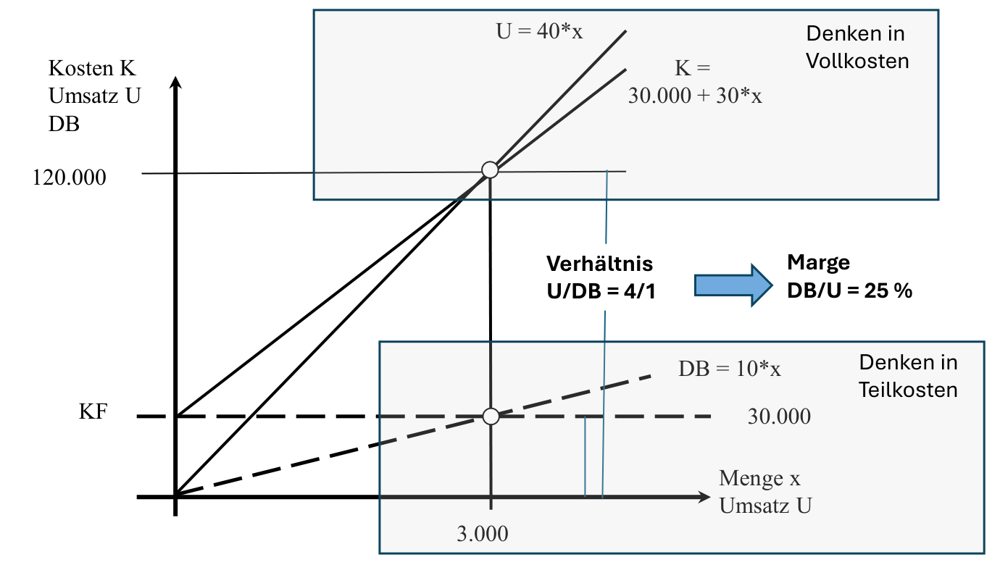
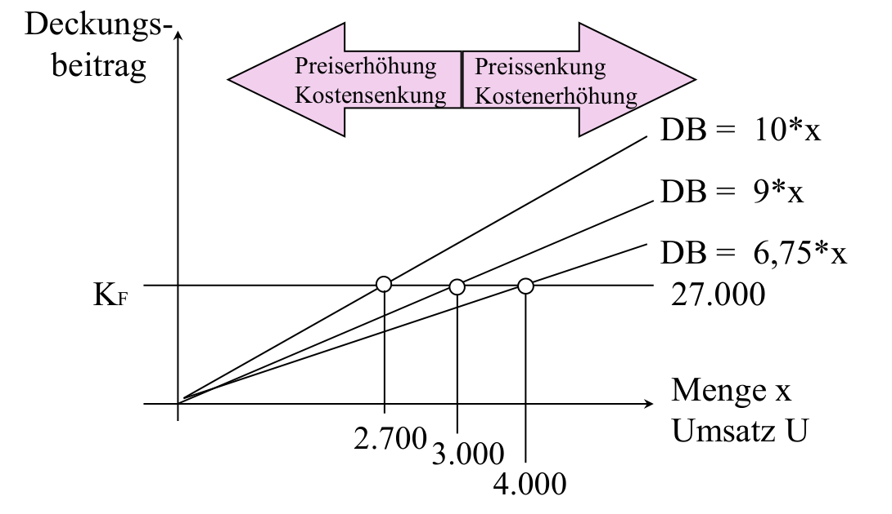

# Break-Even-Analyse

## Beispiel: Spielzeughersteller Kindy

- Der Spielzeughersteller Kindy fertigt Häuser für Schlümpfe.
- Die Fixkosten betragen pro Monat 30.000 €.
- Pro Haus fallen variable Kosten für Material, Energie und Löhne in Höhe von 30 € an.
- Die Geschäftsleitung fragt nach der Mindestmenge, welche zu einem Preis von 40 € verkauft werden muss, um alle Kosten zu decken.

## Deckungsbeitrag und Break-even-Punkt

| | |
|---|---|
| Preis | P = 40 € |
| - Variable Kosten | k_v = 30 € |
| = Deckungsbeitrag | db = 10 € |

- Linkes Bild: Tropfen "db" fallen in einen Eimer mit der gestrichelten Marke K_F = 30.000 €
  - ①: Füllstand unterhalb der Marke; Pfeil "DB" vom Boden bis zum Füllstand ①, Pfeil "V" vom Füllstand ① bis zur Marke K_F
  - ②: höherer Füllstand, noch unterhalb der Marke
  - ③: Überlauf auf Höhe der Marke K_F
  - ④: zweites Gefäß "Gewinn", in das die db-Tropfen über den Überlauf fallen
- Rechtes Bild: Achsen K_F / DB über X / U
  - DB = 10 * x (Gerade aus dem Ursprung)
  - K_F = 30.000 € (waagerechte Linie)
  - Schnittpunkt = Break-Even bei ③
  - ① und ② liegen links davon im Bereich Verlust, ④ rechts davon im Bereich Gewinn

## Deckungsbeitragssituationen

| | Situation 1 | Situation 2 | Situation 3 | Situation 4 | Situation 5 |
|---|---|---|---|---|---|
| Gruppe | negativer DB | Kein DB | positiver DB | positiver DB | positiver DB |
| Bedingung | DB < 0 | DB = 0 | DB < K_F | DB = K_F | DB > K_F |
| Text | Erlös reicht nicht einmal für die variablen Kosten. Mit jedem verkauftem Stück werden Sie ärmer. | Erlös entspricht variablen Kosten. Verlust in Höhe der fixen Kosten | Der DB deckt nur einen Teil der fixen Kosten. Situation 1 + 2 in Abb. 1.4 Deckungsbeitrag und Break-Even-Punkt. | Der DB deckt genau die fixen Kosten. Gewinn gleich Null. Situation 3 in Abb. 1.4 Deckungsbeitrag und Break-Even-Punkt. | Gewinn: Der DB deckt die fixen Kosten und liefert einen Gewinnbeitrag. Situation 4 in Abb. 1.4 Deckungsbeitrag und Break-Even-Punkt. |
| Lage | links vom Break-Even | links vom Break-Even | links vom Break-Even | Im Break-Even | rechts vom Break-Even |
| Balken | Erlös + Verlust neben K_var + K_F; Erlös ist kürzer als K_var | Erlös + Verlust neben K_var + K_F; Erlös so hoch wie K_var, Verlust so hoch wie K_F | Erlös neben K_var + DB + V neben K_F; DB + V so hoch wie K_F | Erlös neben K_var + DB neben K_F; DB so hoch wie K_F | Erlös neben K_var + DB neben K_F + G; DB so hoch wie K_F + G |

- Abb. 1.4 Deckungsbeitrag und Break-Even-Punkt = Bild im Abschnitt davor mit den Punkten ① bis ④

## Break-even-Analyse im System der Vollkosten- und der Teilkostenrechnung

- Achsen: Kosten K, Umsatz U, DB über Menge x, Umsatz U
- Denken in Vollkosten: U = 40 * x und K = 30.000 + 30 * x schneiden sich bei Menge 3.000 und 120.000
- Denken in Teilkosten: DB = 10 * x schneidet K_F (30.000) bei Menge 3.000
- Verhältnis U/DB = 4/1 -> Marge DB/U = 25 %

## Wirkung einer Änderung der Preise oder der variablen Kosten auf den Break-even-Punkt

- Achsen: Deckungsbeitrag über Menge x, Umsatz U
- K_F = 27.000 (waagerechte Linie)

| DB-Gerade | Schnittpunkt mit K_F bei |
|---|---|
| DB = 10 * x | 2.700 |
| DB = 9 * x | 3.000 |
| DB = 6,75 * x | 4.000 |

- Doppelpfeil über den Geraden: nach links Preiserhöhung, Kostensenkung; nach rechts Preissenkung, Kostenerhöhung

## Rabattgewährung

- Die Firma Profitable hat eine Umsatzrentabilität von 40 Prozent und befindet sich rechts vom Break-Even-Punkt.
- In diesem Fall ist der Deckungsbeitrag Gewinn. Hier entspricht der Quotient aus Deckungsbeitrag und Umsatz der Umsatzrentabilität.
- Da die Firma ihr 25jähriges Jubiläum feiert, gewährt sie einen Jubiläumsrabatt von 20 Prozent.
- Die Geschäftsleitung möchte vorab wissen, welche Wirkung die Rabattgewährung auf den Gewinn hat.

| | | vor Rabattgewährung | nach Rabattgewährung |
|---|---|---|---|
| Einstandspreis | EK | 60 € | 60 € |
| + Handelsspanne | HS | 40 € | 20 € |
| = Verkaufspreis | VK | 100 € | 80 € |
| HS (%) = db / VK, mit db = VK - EK | | 40 / 100 = 40% | 20 / 80 = 25% |

- Pfeile zwischen den beiden Rechnungen: 20 % auf VK, 20 €

## Wirkung von Rabattgewährung auf den Umsatz

Wirkung von Rabatt (Zeilen: DB / U, Spalten: Rabatt):

| DB / U | 5% | 10% | 20% | 25% |
|---|---|---|---|---|
| 50% | 105,6% | 112,5% | 133,3% | 150,0% |
| 40% | 108,6% | 120,0% | **160,0%** | 200,0% |
| 30% | 114,0% | 135,0% | 240,0% | 450,0% |
| 25% | 118,8% | 150,0% | 400,0% | (dunkles Feld, kein Wert) |
| 20% | 126,7% | 180,0% | (dunkles Feld, kein Wert) | Verlust |
| 15% | 142,5% | 270,0% | Verlust | Verlust |
| 10% | 190,0% | (dunkles Feld, kein Wert) | Verlust | Verlust |

- Auf der Folie hervorgehoben: 160,0% (DB / U 40%, Rabatt 20%)

## Wirkung von Preiserhöhung auf den Umsatz

Wirkung von Preiserhöhung (Zeilen: DB / U, Spalten: Preiserhöhung):

| DB / U | 5% | 10% | 20% | 25% |
|---|---|---|---|---|
| 50% | -4,5% | -8,3% | -14,3% | -16,7% |
| 40% | -6,7% | -12,0% | -20,0% | -23,1% |
| 30% | -10,0% | -17,5% | -28,0% | -31,8% |
| 25% | -12,5% | -21,4% | -33,3% | -37,5% |
| 20% | -16,0% | -26,7% | -40,0% | -44,4% |
| 15% | -21,3% | -34,0% | -48,6% | -53,1% |
| 10% | **-30,0%** | -45,0% | -60,0% | -64,3% |

- Auf der Folie hervorgehoben: -30,0% (DB / U 10%, Preiserhöhung 5%)

## Notizen

### Deckungsbeitrag und Break-even-Punkt

- Im Eimer: 20.000 am Pfeil "V", 10.000 am Pfeil "DB" (Vorjahr)
- Unter ①: 1.000, darunter 40.000 (Vorjahr)
- Unter ③: 3.000, darunter 120.000 (Vorjahr)
- An der Achse U ergänzt: U = p * x (Vorjahr)
- Im Titel "Break-even-Punkt" gelb markiert (Vorjahr)

### Deckungsbeitragssituationen

- Über Situation 1: p < k_v (Vorjahr)
- Über Situation 2: p = k_v (Vorjahr)
- Oben rechts auf der Folie: U = K, G = 0 (Vorjahr)
- Situation 2: Verlust und K_F zusammen rot umrandet (Vorjahr)
- Situation 4: DB und K_F zusammen rot umrandet, dazwischen ein "=" (Vorjahr)
- Situation 4: zwei rote Zeichen unten im Erlös-Balken, das obere [unleserlich], das untere eine 0 (Vorjahr)
- Situation 4: "Im Break-Even" gelb markiert und rot eingekreist, darunter: "Was gilt im" (Vorjahr)
- Situation 5: G rot eingekreist; unter "rechts vom Break-Even": "besser" (Vorjahr)

### Break-even-Analyse im System der Vollkosten- und der Teilkostenrechnung

- 120.000 rot eingekreist (Vorjahr)
- Schnittpunkt von U und K eingekreist: U = K (Vorjahr)
- Schnittpunkt von DB und K_F eingekreist: DB = K_F, darunter 30000 (Vorjahr)
- Ursprung an beiden Achsen mit 0 beschriftet (Vorjahr)
- Links vom Break-Even eine senkrechte rote Strecke von der x-Achse bis zur Umsatzgeraden, beschriftet mit "U"; ihr Abschnitt bis zur DB-Geraden beschriftet mit "DB" (Vorjahr)
- Kasten "Verhältnis U/DB = 4/1 -> Marge DB/U = 25 %" blau umrandet (Vorjahr)

### Wirkung einer Änderung der Preise oder der variablen Kosten auf den Break-even-Punkt

- x* = K_F / db (Vorjahr)
- Beide Seiten in Blau mit p multipliziert: p * x* = K_F / db * p (Vorjahr)
- U* = K_F / (db / p) (Vorjahr)
- "db / p" blau eingekreist, daneben: marge DB/U (Vorjahr)

### Rabattgewährung

- G alt = G neu (Vorjahr)
- HS alt * U alt - K_F = HS neu * U neu - K_F, K_F auf beiden Seiten blau gestrichen (Vorjahr)
- Unter U alt: = 1 € (Vorjahr)
- => U neu = HS alt / HS neu = 40 % / 25 % = 1,6 (Vorjahr)

### Wirkung von Rabattgewährung auf den Umsatz

- Rote Linien durch die Zeile 40% und die Spalte 20%, sie kreuzen sich im Feld 160,0% (Vorjahr)

### Aufgaben zum Break - Even

- Großes rotes K links neben dem Folientitel "Aufgaben zum Break - Even" (Aufgabenfolie mit A4 9 bis A4 11, steht bei den Aufgaben) **[K Vorjahr]** (Vorjahr)

Quelle: kostenrechnung/origin/mitschriebt_3_von_5_aktuell.pdf, Folien 131-139

Vorjahr: kostenrechnung/origin/mitschrieb_letzte_jahr.pdf, Folien 134-142
