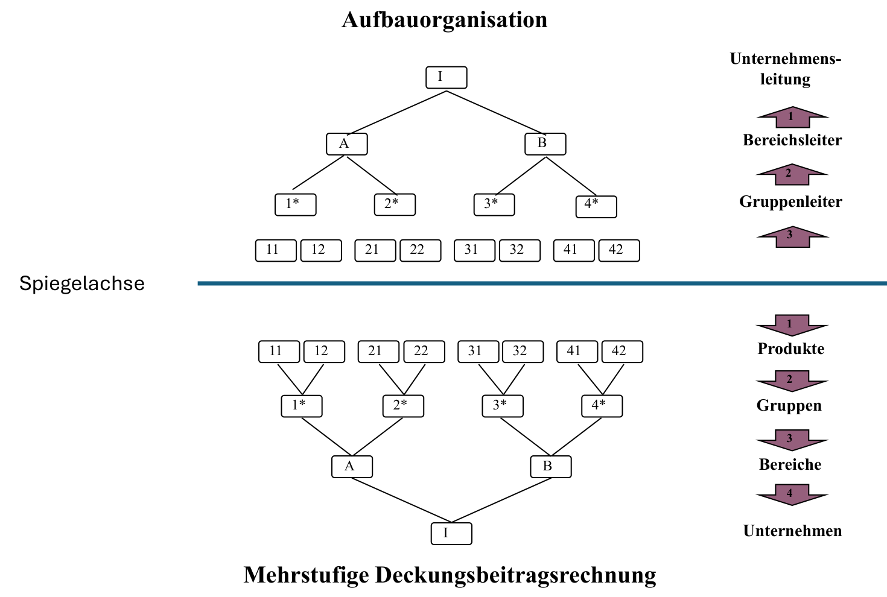
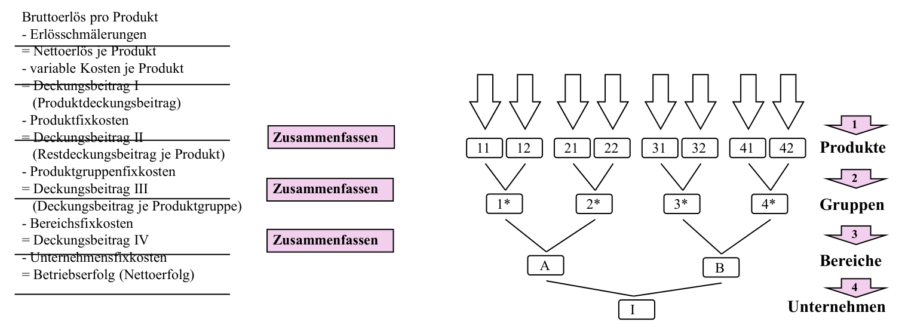

# Direct Costing im Mehrproduktunternehmen und mehrstufige Deckungsbeitragsrechnung

## Direct Costing im Mehrproduktunternehmen

Ein Unternehmen produziert und verkauft drei Produkte. Die gesamten Fixkosten betragen 30.000 €.

| Produktart | A | B | C |
|---|---|---|---|
| Preis/Stück | 4,00 | 6,50 | 5,50 |
| - variable Kosten/Stück | 2,00 | 3,50 | 3,00 |
| = Deckungsbeitrag pro Stück | | | |
| * Menge in Stück | 3.000 | 4.000 | 6.000 |
| = Deckungsbeitrag pro Sorte | | | |

| | |
|---|---|
| Gesamtdeckungsbeitrag | |
| - Fixkosten | |
| = Betriebsergebnis | |

Die Ergebnisfelder sind auf der Folie leer, die eingetragenen Werte stehen unter Notizen.

## Aufbauorganisation und mehrstufige Deckungsbeitragsrechnung

- Oben, Aufbauorganisation: I -> A, B -> 1*, 2*, 3*, 4* -> 11, 12, 21, 22, 31, 32, 41, 42
  - A führt zu 1* und 2*, B zu 3* und 4*
  - Ebenen am Rand, Pfeile zeigen nach oben; von unten nach oben: Pfeil 3, Gruppenleiter, Pfeil 2, Bereichsleiter, Pfeil 1, Unternehmensleitung
- Spiegelachse
- Unten, Mehrstufige Deckungsbeitragsrechnung (gespiegelt): 11, 12, 21, 22, 31, 32, 41, 42 -> 1*, 2*, 3*, 4* -> A, B -> I
  - 11 und 12 führen zu 1*, 21 und 22 zu 2*, 31 und 32 zu 3*, 41 und 42 zu 4*
  - Ebenen am Rand, Pfeile zeigen nach unten; von oben nach unten: Pfeil 1, Produkte, Pfeil 2, Gruppen, Pfeil 3, Bereiche, Pfeil 4, Unternehmen

## Kalkulationsschema eines mehrstufigen Direct Costing

| | | |
|---|---|---|
| | Bruttoerlös pro Produkt | |
| - | Erlösschmälerungen | |
| = | Nettoerlös je Produkt | |
| - | variable Kosten je Produkt | |
| = | Deckungsbeitrag I (Produktdeckungsbeitrag) | |
| - | Produktfixkosten | |
| = | Deckungsbeitrag II (Restdeckungsbeitrag je Produkt) | Zusammenfassen |
| - | Produktgruppenfixkosten | |
| = | Deckungsbeitrag III (Deckungsbeitrag je Produktgruppe) | Zusammenfassen |
| - | Bereichsfixkosten | |
| = | Deckungsbeitrag IV | Zusammenfassen |
| - | Unternehmensfixkosten | |
| = | Betriebserfolg (Nettoerfolg) | |

- Rechts im Bild: Pfeile in die Produkte 11, 12, 21, 22, 31, 32, 41, 42 (1 Produkte), diese laufen zusammen in 1*, 2*, 3*, 4* (2 Gruppen), dann in A und B (3 Bereiche), dann in I (4 Unternehmen)
- Die drei Kästen "Zusammenfassen" stehen zwischen Schema und Bild auf Höhe von Deckungsbeitrag II, III und IV

## Beispiel: Mehrstufige DB - Rechnung

Ein Unternehmen produziert und verkauft folgende Produkte:

| Produktart | A | B | C |
|---|---|---|---|
| Menge in Stück | 3.000 | 4.000 | 7.200 |
| Preis / Stück | 4,50 | 6,50 | 5,50 |
| variable Kosten / Stück | 2,40 | 3,80 | 2,80 |

- a) Die gesamten Fixkosten betragen 32.800.- €. Ermitteln Sie das Betriebsergebnis.
- b) Welche Art der Deckungsbeitragsrechnung liegt hier vor?
- c) Produkt A verursacht produktfixe Kosten von 7.000€, B von 3.000€, C von 10.000€, die restlichen Kosten sind Unternehmensfix. Nehmen Sie eine mehrstufige Deckungsbeitragsrechnung vor und beraten Sie die Geschäftsleitung.

Die Folie zeigt keine Lösung, die handschriftliche Rechnung steht unter Notizen.

## Notizen

### Direct Costing im Mehrproduktunternehmen

In die leeren Felder eingetragen (Vorjahr):

| Produktart | A | B | C |
|---|---|---|---|
| = Deckungsbeitrag pro Stück | 2 | 3 | 2,5 |
| = Deckungsbeitrag pro Sorte | 6000 | 12000 | 15000 |

| | |
|---|---|
| Gesamtdeckungsbeitrag | 33.000 |
| - Fixkosten | - 30.000 |
| = Betriebsergebnis | 3.000 |

- Die drei Deckungsbeiträge pro Sorte sind mit einer Klammer zum Gesamtdeckungsbeitrag zusammengefasst (Vorjahr)

### Aufbauorganisation und mehrstufige Deckungsbeitragsrechnung

- In der Aufbauorganisation rot eingekreist: I, A, B, 1*, 2*; rote Striche von 1* zu 11 und 12 (Vorjahr)

### Beispiel: Mehrstufige DB - Rechnung

Rechnung zu a) (Vorjahr):

| | A | B | C | |
|---|---|---|---|---|
| db | 2,10 | 2,70 | 2,70 | |
| DB = db * x | 6.300 | + 10.800 | + 19.440 | = Σ 36.540 |
| - K_F | | | | 32.800 |
| BE | | | | 3.740 |

Rechnung zu c) (Vorjahr):

| | A | B | C |
|---|---|---|---|
| DB I | 6.300 | 10.800 | 19.440 |
| K_F | 7.000 | 3.000 | 10.000 |
| DB II | - 700 (in Blau) | 7.800 | 9.440 |

| | |
|---|---|
| Σ DB II | 16.540 |
| - K_F | 12.800 |
| BE | 3 700 (so notiert; die Rechnung zu a) nennt BE 3.740) |

- Links neben dem Titel: DB_A ↑ + 700 -> K_F = 6300, mit Haken (Vorjahr)
- In c) gelb markiert: "produktfixe Kosten von 7.000€, B von 3.000€, C von 10.000€," (Vorjahr)
- Zu b) steht keine Notiz auf der Folie (Vorjahr)

Quelle: kostenrechnung/origin/mitschriebt_3_von_5_aktuell.pdf, Folien 140-143

Vorjahr: kostenrechnung/origin/mitschrieb_letzte_jahr.pdf, Folien 143-146
