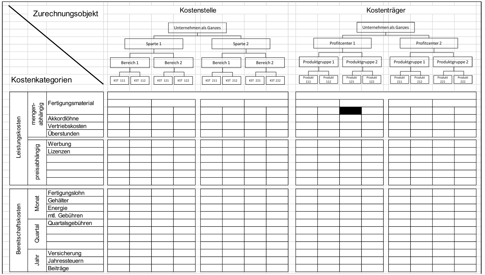

# Riebelsches System, Artikel- und Kundendeckungsbeitragsrechnung

## Kostenspaltung im Riebelschen System

| Kostenart Hilfsstoffe | | Kostenträgereinzelkosten | Kostenstelleneinzelkosten |
|---|---|---|---|
| 4 0 4 0 | ~~K_F = 0~~ k_v = 1 | (vier leere Felder) | 0 8 1 5 |

- Jede Ziffer steht in einem eigenen Feld.
- "K_F = 0" ist auf der Folie durchgestrichen, darunter steht "k_v = 1".

## Sachbezogene Bezugsgrößenhierarchie

- Unternehmen als Ganzes
  - Profitcenter 1
    - Produktgruppe 1
      - Produkt 111
      - Produkt 112
    - Produktgruppe 2
      - Produkt 121
      - Produkt 122
  - Profitcenter 2
    - Produktgruppe 1
      - Produkt 211
      - Produkt 212
    - Produktgruppe 2
      - Produkt 221
      - Produkt 222

## Aufbau der Grundrechnung

- Matrix: Zeilen = Kostenkategorien, Spalten = Zurechnungsobjekt
- Zurechnungsobjekt Kostenstelle: Unternehmen als Ganzes -> Sparte 1, Sparte 2 -> je Bereich 1, Bereich 2 -> KST 111, KST 112, KST 121, KST 122, KST 211, KST 212, KST 221, KST 222
- Zurechnungsobjekt Kostenträger: Unternehmen als Ganzes -> Profitcenter 1, Profitcenter 2 -> je Produktgruppe 1, Produktgruppe 2 -> Produkt 111, 112, 121, 122, 211, 212, 221, 222

| Kostenkategorie | Unterteilung | Kostenarten |
|---|---|---|
| Leistungskosten | mengenabhängig | Fertigungsmaterial, Akkordlöhne, Vertriebskosten, Überstunden |
| Leistungskosten | preisabhängig | Werbung, Lizenzen (dazu vier leere Zeilen) |
| Bereitschaftskosten | Monat | Fertigungslohn, Gehälter, Energie, mtl. Gebühren |
| Bereitschaftskosten | Quartal | Quartalsgebühren (dazu drei leere Zeilen) |
| Bereitschaftskosten | Jahr | Versicherung, Jahressteuern, Beiträge |

- Die Felder der Matrix sind leer. Ein Feld ist schwarz gefüllt: Zeile Fertigungsmaterial, Spalte Kostenträger Produkt 121.

## Kalkulationsschema einer Artikel- und Kundendeckungsbeitragsrechnung

| Artikeldeckungsbeitragsrechnung | Kundendeckungsbeitragsrechnung |
|---|---|
| Bruttoumsatz zu Listenpreis | Bruttoumsatz zu Listenpreis |
| - Umsatzsteuer | - Umsatzsteuer |
| **= Nettoumsatz zu Listenpreis** | **= Nettoumsatz zu Listenpreis** |
| - Rabatte | - Rabatte |
| - preisabhängige Vertriebseinzelkosten (Provision) | - preisabhängige Vertriebseinzelkosten |
| **= Nettoerlös I** | **= Nettoerlös I** |
| - mengenabhängige Vertriebseinzelkosten (Fracht) | - mengenabhängige Vertriebseinzelkosten |
| **= Nettoerlös II** | **= Nettoerlös II** |
| - Rohstoffe, sofern Artikeleinzelkosten | - Kunden Sonderkonditionen |
| - Verpackung | - Kundenwerbung |
| - Artikelsondereinzelkosten | - Kundenaußendienst |
| **= Deckungsbeitrag I** | - kundenvariable Verwaltungskosten |
| - Fertigungslöhne, sofern Artikeleinzelkosten | - Rohstoffe, sofern Artikeleinzelkosten |
| **= Deckungsbeitrag II** | - Verpackung |
| | - Artikelsondereinzelkosten |
| | **= Kundendeckungsbeitrag I** |
| | - Fertigungslöhne, sofern Artikeleinzelkosten |
| | **= Kundendeckungsbeitrag II** |

- Die beiden Spalten sind zwei getrennte Schemata, jede Spalte wird von oben nach unten gelesen.

## Notizen

### Kostenspaltung im Riebelschen System

- Rote senkrechte Linie zwischen dem Feld "K_F = 0 / k_v = 1" und "Kostenträgereinzelkosten" (Vorjahr)

### Aufbau der Grundrechnung

- Links neben Leistungskosten: k_v (Vorjahr)
- Links neben Bereitschaftskosten: K_F (Vorjahr)

Quelle: kostenrechnung/origin/mitschriebt_3_von_5_aktuell.pdf, Folien 144-147

Vorjahr: kostenrechnung/origin/mitschrieb_letzte_jahr.pdf, Folien 147-150
