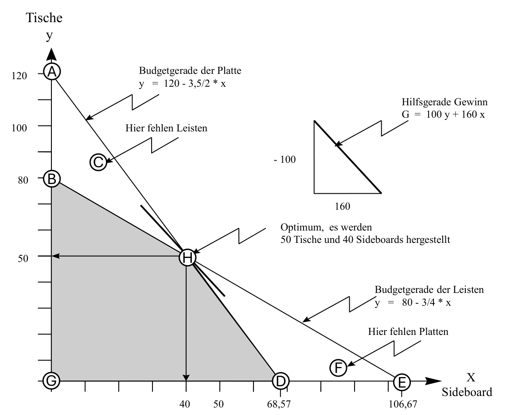
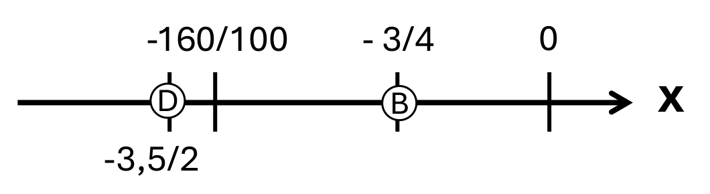
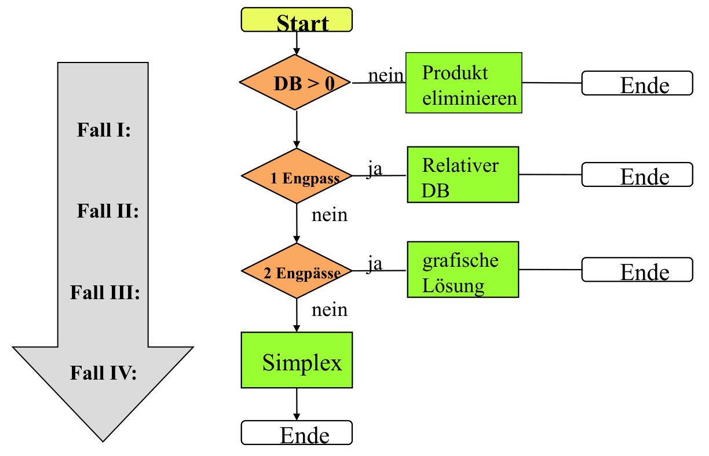

# Optimierung des Produktionsprogramms

## Optimierung des Produktionsprogramms, wenn keinerlei Engpässe existieren

Horst Sparsam, Hersteller flauschiger Wollpullover, hat in den letzten Jahren die Vollkostenrechnung mit gutem Erfolg angewendet. Stets brachten seine drei Produkte „Flauschy“ (A), „Pully“ (B) und „Rolly“ (C) gute Erfolge. Da hochwertige Wolle im Preis stark anstieg und er die Kostensteigerung nicht weitergeben kann, muss er sein Produktionsprogramm überdenken. Seine neue Kalkulation auf Basis der Vollkosten zeigt folgende Stückerfolge:

| Produkt | A | B | C |
|---|---|---|---|
| Einzelkosten | 50 | 20 | 30 |
| + Gemeinkostenzuschlag 200% | 100 | 40 | 60 |
| Selbstkosten | 150 | 60 | 90 |
| Verkaufspreis | 145 | 80 | 95 |
| Stückerfolg | -5 | 20 | 5 |

Herr Sparsam verkauft von „Flauschy“ (A), „Pully“ (B) und „Rolly“ (C) je 100 Pullover. Wie schaut die Ergebnisrechnung aus?

## FALSCH: Sortimentsbereinigung auf Basis der Vollkostenrechnung

Schweren Herzens trennt sich Herr Sparsam von „Flauschy“.

| Produkt | A | B | C | Alt | Neu |
|---|---|---|---|---|---|
| Umsatzerlös | 14.500 | 8.000 | 9.500 | 32.000 | 17.500 |
| - variable Kosten | 5.000 | 2.000 | 3.000 | 10.000 | 5.000 |
| Deckungsbeitrag | 9.500 | 6.000 | 6.500 | 22.000 | 12.500 |
| - fixe Kosten | | | | 20.000 | 20.000 |
| Gesamterfolg | | | | 2.000 | **-7.500** |
| | | | | ∑ alt | ∑ neu |

Die Spalte A ist auf der Folie durchgestrichen.

## Optimierung bei einem Engpass und Absatzrestriktionen (relativer Deckungsbeitrag)

Pro Produkt können maximal 2.000 Stück abgesetzt werden.

| Nr. | Produkt | Gehäusebau [Min./Stck.] | Lackiererei [Min./Stck.] | Montage [Min./Stck.] | Kontrolle [Min./Stck.] | Marktpreis [€/Stck.] | Materialkosten [€/Stck.] |
|---|---|---|---|---|---|---|---|
| | Kapazitätsrestriktion [Min] | | | | 12.000 | | |
| | Preis/Fertig.min.[€/Stck.] | 0,20 | 0,10 | 0,10 | 0,15 | | |
| 1 | Scheinwerfer eingebaut | 5 | | 10 | 2 | 15,00 | 5,70 |
| 2 | Scheinwerfer aufgesetzt | 8 | 2 | 12 | 2 | 20,00 | 6,70 |
| 3 | Blinkleuchte vorne | 2 | | 3 | 1 | 3,00 | 0,65 |
| 4 | Blinkleuchte hinten | 3 | 2 | 4 | 1 | 4,00 | 0,65 |
| 5 | Heckleuchte LKW | 5 | | 15 | 2 | 8,00 | 1,20 |
| 6 | Heckleuchte Anhänger | 5 | 2 | 16 | 2 | 9,00 | 1,40 |
| 7 | Rückfahrscheinwerfer | 4 | 2 | 5 | 1 | 10,00 | 3,35 |
| 8 | Nummernschildbeleuchtung | 2 | | | 1 | 2,00 | 0,45 |
| 9 | Innenleuchte | 2 | | | 1 | 5,00 | 1,95 |
| 10 | Positionsleuchte | 3 | 2 | 4 | 1 | 6,00 | 1,65 |

Die Tabelle der Folie hat rechts weitere Spalten, die auf der Folie leer sind: Gehäusebau [€/Stck.], Lackiererei [€/Stck.], Montage [€/Stck.], Kontrolle [€/Stck.], db [€/Stck.], Relativer db (Speed) und eine letzte Spalte ohne Überschrift.

Die Werte dieser Spalten sind im Foliensatz in weißer Schrift hinterlegt (auf der Folie nicht sichtbar, die letzte Spalte ohne Überschrift bleibt leer):

| Nr. | Produkt | Gehäusebau [€/Stck.] | Lackiererei [€/Stck.] | Montage [€/Stck.] | Kontrolle [€/Stck.] | db [€/Stck.] | Relativer db (Speed) |
|---|---|---|---|---|---|---|---|
| 1 | Scheinwerfer eingebaut | 1,00 | 0,00 | 1,00 | 0,30 | 7,00 | 3,50 |
| 2 | Scheinwerfer aufgesetzt | 1,60 | 0,20 | 1,20 | 0,30 | 10,00 | 5,00 |
| 3 | Blinkleuchte vorne | 0,40 | 0,00 | 0,30 | 0,15 | 1,50 | 1,50 |
| 4 | Blinkleuchte hinten | 0,60 | 0,20 | 0,40 | 0,15 | 2,00 | 2,00 |
| 5 | Heckleuchte LKW | 1,00 | 0,00 | 1,50 | 0,30 | 4,00 | 2,00 |
| 6 | Heckleuchte Anhänger | 1,00 | 0,20 | 1,60 | 0,30 | 4,50 | 2,25 |
| 7 | Rückfahrscheinwerfer | 0,80 | 0,20 | 0,50 | 0,15 | 5,00 | 5,00 |
| 8 | Nummernschildbeleuchtung | 0,40 | 0,00 | 0,00 | 0,15 | 1,00 | 1,00 |
| 9 | Innenleuchte | 0,40 | 0,00 | 0,00 | 0,15 | 2,50 | 2,50 |
| 10 | Positionsleuchte | 0,60 | 0,20 | 0,40 | 0,15 | 3,00 | 3,00 |

## Produktionsprogramm bei zwei Engpässen

Folientitel: „Produktionsprogramms bei zwei Engpässen“

- Der Schreinermeister Holzwurm ist gezwungen, seine Produktion infolge eines Lieferboykotts von Tropenholz zu optimieren.
- Für seine luxuriöse Serie Tropica hat er noch 240 Quadratmeter Platten und 320 Meter Leisten auf Lager.
- Pro Sideboard De Lux benötigt man 3,5 Quadratmeter Platten und 3 Meter Leisten.
- Für einen Tisch De Lux werden 2 Quadratmeter Platten und 4 Meter Leisten benötigt.
- Der Deckungsbeitrag pro Sideboard beträgt 160 € und pro Tisch 100 €.

### Grafische Lösung des Produktionsprogramms bei zwei Engpässen

- Achsen: y = Tische, X = Sideboard
- Budgetgerade der Platte: y = 120 - 3,5/2 * x (von Punkt A bei y = 120 bis Punkt D bei x = 68,57)
- Budgetgerade der Leisten: y = 80 - 3/4 * x (von Punkt B bei y = 80 bis Punkt E bei x = 106,67)
- Hilfsgerade Gewinn: G = 100 y + 160 x (Dreieck an der Hilfsgerade beschriftet mit - 100 und 160)
- Punkt H: Optimum, es werden 50 Tische und 40 Sideboards hergestellt
- Punkt C: Hier fehlen Leisten
- Punkt F: Hier fehlen Platten
- Grau gefüllt ist die Fläche G - B - H - D (G liegt im Ursprung).
- Beschriftete Achsenwerte: y: 50, 80, 100, 120; x: 40, 50, 68,57, 106,67

### Lage des Optimums

Auf der Achse x sind eingetragen (von links nach rechts): Punkt D bei -3,5/2, ein Strich bei -160/100, Punkt B bei - 3/4, ein Strich bei 0.

## Lineare Programmierung und Simplex-Methode

**Deckungsbeitrag** = 160 * x + 100 * y

**Nebenbedingungen**

- Platten: 240 = 3,5 * x + 2 * y
- Leisten: 320 = 3 * x + 4 * y.

**Nicht-Negativitätsbedingungen:**

- x, y   0 erfüllt. (so auf der Folie: zwischen „x, y“ und „0“ steht kein Zeichen)

### Ausgangstableau eines Simplex

| S1 | S2 | x | y | Kapazität |
|---|---|---|---|---|
| 1 | 0 | 3,5 | 2 | 240 |
| 0 | 1 | 3 | 4 | 320 |
| 0 | 0 | -160 | -100 | 0 |

### Interpretation eines Simplex-Tableau

| S1 | S2 | x | y | Kapazität |
|---|---|---|---|---|
| 0,2857142 | 0 | 1 | 0,5714284 | 68,57 |
| -0,8571426 | 1 | 0 | 2,2857148 | 114,28578 |
| 45,7142272 | 0 | 0 | -8,57146 | 10.971 |

Die Pfeile der Folie zeigen auf folgende Felder:

- Kapazität 68,57 (Zeile 1): Im aktuellen Punkt werden 68,57 ME von Produkt x hergestellt.
- Kapazität 114,28578 (Zeile 2): Von Rohstoff 2 liegen 114,28 ME noch auf Lager
- S1 45,7142272 (Zeile 3): Rohstoff 1 ist verbraucht. Der Schattenpreis beträgt 47,71 GE (so auf der Folie, im Tableau steht 45,7142272)
- y -8,57146 (Zeile 3): Durch Produktion durch y anstelle von x lassen sich weiter DB (8,57 GE) erwirtschaften.
- Kapazität 10.971 (Zeile 3): 68,57 ME bringen 10.971 GE Deckungsbeitrag

## Flussdiagramm: Optimales Produktionsprogramm

Ablauf von oben nach unten:

1. Start
2. DB > 0: nein → Produkt eliminieren → Ende. Sonst weiter nach unten (dieser Pfeil ist auf der Folie nicht beschriftet).
3. 1 Engpass: ja → Relativer DB → Ende. nein → weiter
4. 2 Engpässe: ja → grafische Lösung → Ende. nein → weiter
5. Simplex → Ende

Links neben dem Ablauf steht ein Pfeil nach unten mit der Beschriftung (von oben nach unten): Fall I:, Fall II:, Fall III:, Fall IV:

## Notizen

### Optimierung des Produktionsprogramms, wenn keinerlei Engpässe existieren

- Rot über den Spalten A, B, C der Tabelle: VK - EK = db: 95 (A), 60 (B), 65 (C) (Vorjahr)
- Rot rechts neben der Tabelle: Σ KF = 20.000 (Vorjahr)
- Gelb markiert: „Vollkostenrechnung“, „+ Gemeinkostenzuschlag 200%“, „je 100 Pullover.“ (Vorjahr)

### Optimierung bei einem Engpass und Absatzrestriktionen (relativer Deckungsbeitrag)

- Gelb markiert und blau eingekreist: „2.000 Stück abgesetzt“ (Vorjahr)
- Rot eingekreist: 12.000 (Kapazitätsrestriktion, Kontrolle), 0,20 (Preis/Fertig.min., Gehäusebau), 5 (Gehäusebau, Produkt 1), 2 (Kontrolle) bei den Produkten 1, 5 und 6 (Vorjahr)
- Blau eingekreist: 2 (Kontrolle) bei den Produkten 1 und 2 (Vorjahr)
- Die leeren Spalten sind von Hand rot ausgefüllt. Rechts neben der Tabelle stehen zwei weitere handschriftliche Spalten mit den Überschriften „Rest“ und „DB“ (Vorjahr):

| Nr. | Produkt | Gehäusebau [€/Stck.] | Lackiererei [€/Stck.] | Montage [€/Stck.] | Kontrolle [€/Stck.] | db [€/Stck.] | Relativer db (Speed) | letzte Spalte ohne Überschrift | Rest | DB |
|---|---|---|---|---|---|---|---|---|---|---|
| 1 | Scheinwerfer eingebaut | 1 | - | 1 | 0,3 | 7 | 3,5 | 3 | 2.000 | 14.000 |
| 2 | Scheinwerfer aufgesetzt | | | | | 10 | 5 | 1 | 8000 | 20.000 |
| 3 | Blinkleuchte vorne | | | | | 1,5 | | | | |
| 4 | Blinkleuchte hinten | | | | | 2 | | | | |
| 5 | Heckleuchte LKW | | | | | 4 | 2 | | | |
| 6 | Heckleuchte Anhänger | | | | | 4,5 | 2,25 | | | |
| 7 | Rückfahrscheinwerfer | | | | | 5 | | 1 | 6000 | 10.000 |
| 8 | Nummernschildbeleuchtung | | | | | 1 | | | | |
| 9 | Innenleuchte | | | | | 2,5 | | 5 | | |
| 10 | Positionsleuchte | | | | | 3 | | 4 | 0 | 6000 |

- Unter der Spalte „DB“ ein Strich und darunter 50.000 (Vorjahr)
- In der Zeile von Produkt 2 sind „1“ und „8000“ zusammen blau eingekreist. (Vorjahr)
- Blau oben rechts über der Tabelle: „Kap 12.000“, darunter „P2 4.000 Verb“, darunter ein Strich und „8000“. Von dieser 8000 führt eine blaue Linie zur eingekreisten „1 8000“ in der Zeile von Produkt 2. (Vorjahr)

Quelle: kostenrechnung/origin/mitschriebt_3_von_5_aktuell.pdf, Folien 148-157

Vorjahr: kostenrechnung/origin/mitschrieb_letzte_jahr.pdf, Folien 151-154
