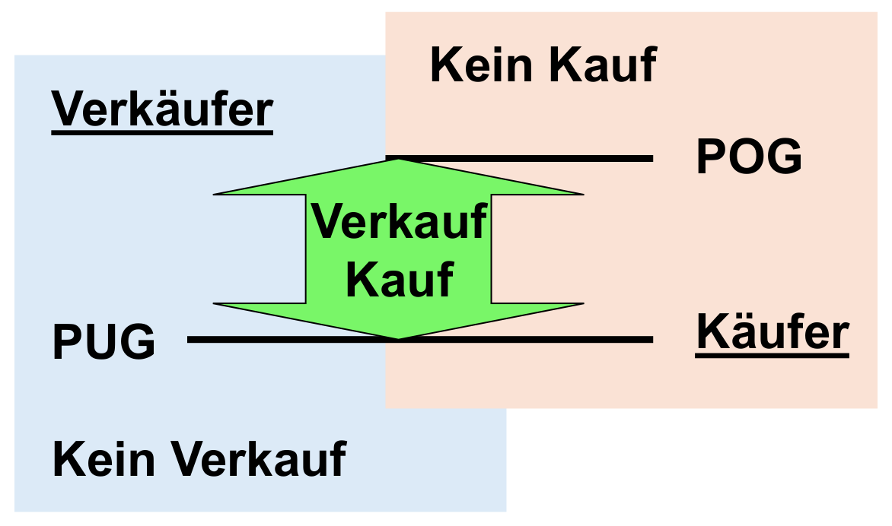

# Zusatzauftrag und Preisuntergrenze

## Zusatzauftrag

- Ein mittelständiges Unternehmen der optischen Industrie fertigt Sonnenbrillen und verkauft diese an namhafte Deutsche Marktführer.
- Die Kapazität ist zurzeit mit 70 % ausgelastet, die entsprechende Fertigungsmenge pro Monat beträgt 16.240 Stück.
- Die Menge kann bei einem Preis von 55 €/Stück vollständig abgesetzt werden.
- Zurzeit betragen die monatlichen Fixkosten 509.000 € und für variable Kosten wandte das Unternehmen 349.160 € auf.
- Ein französisches Modehaus möchte genau 9.000 Brillen zu 42.50 €/St. ordern.

Entscheiden Sie über den Zusatzauftrag. Diskutieren Sie allgemein die Zweckmäßigkeit von Zusatzaufträgen.

(Auf den Folien steht dazu keine Lösung.)

## Käufer - Verkäuferdenken

- Verkäufer: Linie PUG, unterhalb davon „Kein Verkauf“
- Käufer: Linie POG, oberhalb davon „Kein Kauf“
- Zwischen PUG (unten) und POG (oben) steht ein Doppelpfeil mit „Verkauf“ und „Kauf“

## Ermittlung von Preisuntergrenze

Der Schreinermeister Holzwurm kalkuliert auf Basis der Vollkostenrechnung Stühle für die Kantine der Schlemmer AG.

| | |
|---|---|
| Einzelkosten: Holz und Löhne | 50 € |
| + Gemeinkostenzuschlag 200% | 100 € |
| Selbstkosten | 150 € |
| + Gewinnzuschlag 30% | 45 € |
| Angebotspreis | 195 € |

Der Kunde verhandelt hart und bietet für eine Abnahmemenge von 500 Stück lediglich 145 €/Stück an. Herr Holzwurm empfindet dieses Preisgebot als zu niedrig. „Ich verkaufe meine Stühle doch nicht unter Selbstkosten“, denkt er und lehnt natürlich ab. Ein grober Fehler?

**Was empfehlen Sie als Berater?** (auf der Folie rot)

(Auf den Folien steht dazu keine Lösung.)

Quelle: kostenrechnung/origin/mitschriebt_3_von_5_aktuell.pdf, Folien 158-160

Vorjahr: kostenrechnung/origin/mitschrieb_letzte_jahr.pdf, Folien 155-157
