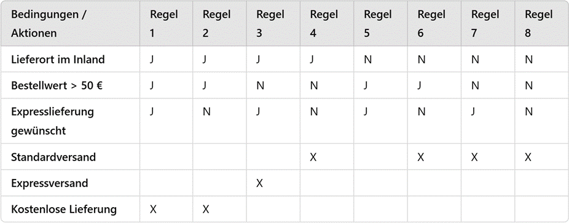
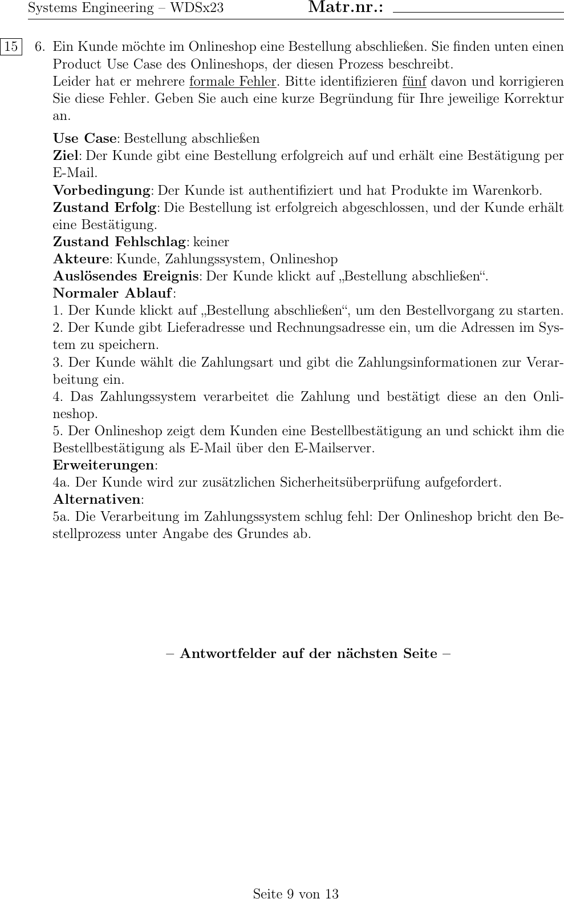

# Systems Engineering – WDSx23 – 18. Dezember 2024

Studiengang: Data Science und Künstliche Intelligenz
Modul: W3WI_101.2
Klausurteil: Systems Engineering
Kurse: WDSx23 – 3. Semester
Datum: 18. Dezember 2024
Dauer: 120 Minuten
Max. Punkte: 100
Anzahl der Seiten: 13 (ohne diese Seite. Bitte überprüfen!)
Hilfsmittel: keine Hilfsmittel
Hinweis: Antworten nur auf diesen Klausurblättern!

Wichtige Hinweise

- Schreiben Sie Ihre Antworten nur auf die Klausurblätter. Sollte der Platz nicht ausreichen, schreiben Sie auf der Rückseite weiter. Antworten auf anderen Blättern werden nicht gewertet!
- Die Klausur ist geheftet abzugeben!

Viel Erfolg!

| Aufgabe Nr.: | 1 | 2 | 3 | 4 | 5 | 6 | 7 | ∑ |
|---|---|---|---|---|---|---|---|---|
| max. Punktzahl: | 36 | 6 | 8 | 10 | 5 | 15 | 20 | 100 |

## 1. Bitte beantworten Sie die nachfolgenden Fragen aus BSDS.

**(a) [4 Punkte]** Ihr Auftraggeber formuliert folgende Anforderung im Gespräch mit Ihnen: „Die Kontaktaufnahme mit dem Kunden durch unseren First-Level-Support findet über Microsoft Teams statt“. Ist diese Anforderung essentiell? Begründen Sie Ihre Antwort.

**(b) [3 Punkte]** Nennen und erläutern Sie zwei Gründe für das Scheitern von FISCUS.

**(c) [3 Punkte]** Nennen und erläutern Sie die Arten von Akteuren eines Product Use Cases.

**(d) [6 Punkte]** Erläutern Sie den Begriff INVEST.

**(e) [2 Punkte]** Erläutern Sie, was ein Area Product Owner tut.

**(f) [3 Punkte]** Ist die Sprint Retrospektive eine konstruktive oder analytische QS-Maßnahme? Begründen Sie kurz Ihre Antwort.

**(g) [2 Punkte]** Nennen Sie die Arten von Ereignissen, die im Requirements Engineering relevant sind.

**(h) [3 Punkte]** Nennen und erläutern Sie die Schablone für eine User Story.

**(i) [4 Punkte]** Erläutern Sie die beiden Begriffe Definition of Done und Definition of Ready.

**(j) [6 Punkte]** Nennen und erläutern Sie drei Dimensionen für die Auswahl, ob man klassisch oder agil entwickeln sollte.

## 2. [6 Punkte]

Erläutern Sie, welche Bedeutung das Kano-Modell in der Priorisierung von Anforderungen hat und wie Basis-, Leistungs- und Begeisterungsfaktoren voneinander unterschieden werden.

## 3. [8 Punkte]

Erläutern Sie die Arten von Anforderungen und nennen Sie jeweils ein Beispiel.

## 4. [10 Punkte]

Ein Onlineshop bietet Kunden die Möglichkeit, Rabatt auf ihre Bestellungen zu erhalten, abhängig von bestimmten Bedingungen.

Erstellen Sie eine konsolidierte und widerspruchsfreie Entscheidungstabelle, die den Rabattgewährungsprozess basierend auf den folgenden drei Bedingungen modelliert:

1. Kundenstatus: Der Kunde ist entweder ein Stammkunde oder ein Neukunde.
2. Bestellwert: Die Bestellung überschreitet einen Wert von 100 € oder nicht.
3. Saisonales Angebot: Es ist aktuell ein Sonderangebot aktiv oder nicht.

Regeln für die Rabattvergabe:

- Wenn der Kunde ein Stammkunde ist und der Bestellwert über 100 € liegt, erhält er immer einen Rabatt, unabhängig davon, ob ein Sonderangebot aktiv ist.
- Neukunden erhalten nur dann einen Rabatt, wenn der Bestellwert über 100 € liegt und ein Sonderangebot aktiv ist.
- Alle anderen Kombinationen führen zu keiner Rabattgewährung.

Konsolidierte und widerspruchsfreie Entscheidungstabelle:

## 5. [5 Punkte]

Ihr neuer DHBW-Studierender im Unternehmen stellt Ihnen voller Stolz seine erste, selbsterstellte Entscheidungstabelle vor. Dabei behauptet er, dass er sie konsolidiert habe und sie widerspruchsfrei sei. Leider stimmt das so nicht.
Bitte korrigieren Sie die Entscheidungstabelle, sodass sie wirklich konsolidiert und widerspruchsfrei ist.

| Bedingungen / Aktionen | Regel 1 | Regel 2 | Regel 3 | Regel 4 | Regel 5 | Regel 6 | Regel 7 | Regel 8 |
|---|---|---|---|---|---|---|---|---|
| Lieferort im Inland | J | J | J | J | N | N | N | N |
| Bestellwert > 50 € | J | J | N | N | J | J | N | N |
| Expresslieferung gewünscht | J | N | J | N | J | N | J | N |
| Standardversand |  |  |  | X |  | X | X | X |
| Expressversand |  |  | X |  |  |  |  |  |
| Kostenlose Lieferung | X | X |  |  |  |  |  |  |

## 6. [15 Punkte]

Ein Kunde möchte im Onlineshop eine Bestellung abschließen. Sie finden unten einen Product Use Case des Onlineshops, der diesen Prozess beschreibt.
Leider hat er mehrere formale Fehler. Bitte identifizieren fünf davon und korrigieren Sie diese Fehler. Geben Sie auch eine kurze Begründung für Ihre jeweilige Korrektur an.

Use Case: Bestellung abschließen
Ziel: Der Kunde gibt eine Bestellung erfolgreich auf und erhält eine Bestätigung per E-Mail.
Vorbedingung: Der Kunde ist authentifiziert und hat Produkte im Warenkorb.
Zustand Erfolg: Die Bestellung ist erfolgreich abgeschlossen, und der Kunde erhält eine Bestätigung.
Zustand Fehlschlag: keiner
Akteure: Kunde, Zahlungssystem, Onlineshop
Auslösendes Ereignis: Der Kunde klickt auf „Bestellung abschließen“.
Normaler Ablauf :
1. Der Kunde klickt auf „Bestellung abschließen“, um den Bestellvorgang zu starten.
2. Der Kunde gibt Lieferadresse und Rechnungsadresse ein, um die Adressen im System zu speichern.
3. Der Kunde wählt die Zahlungsart und gibt die Zahlungsinformationen zur Verarbeitung ein.
4. Das Zahlungssystem verarbeitet die Zahlung und bestätigt diese an den Onlineshop.
5. Der Onlineshop zeigt dem Kunden eine Bestellbestätigung an und schickt ihm die Bestellbestätigung als E-Mail über den E-Mailserver.
Erweiterungen:
4a. Der Kunde wird zur zusätzlichen Sicherheitsüberprüfung aufgefordert.
Alternativen:
5a. Die Verarbeitung im Zahlungssystem schlug fehl: Der Onlineshop bricht den Bestellprozess unter Angabe des Grundes ab.

– Antwortfelder auf der nächsten Seite –

Formaler Fehler 1

Formaler Fehler 2

Formaler Fehler 3

Formaler Fehler 4

Formaler Fehler 5

## 7.

Die All-for-You AG ist ein IT-Dienstleister, der das Outsourcing von ERP-Systemen als Software-as-a-Service großen Unternehmenskunden anbietet. Für den Support der Unternehmenskunden wird ein neues Ticketsystem eingeführt. Sie sollen dafür die Systemanalyse übernehmen und die Product Use Cases modellieren.

In einem Gespräch mit der All-for-You AG zum **PUC #001 Ticket im First-Level-Support bearbeiten** haben Sie folgende Informationen für diesen Use Case erhalten:

„Damit ein Mitarbeiter ein Ticket im First-Level-Support bearbeiten kann, muss durch den Kunden im Ticketsystem ein Ticket mit niedriger Priorität angelegt und anschließend automatisch durch das Ticketsystem einem Mitarbeiter zugewiesen worden sein.

Ist das passiert, sieht die Ticketbearbeitung wie folgt aus: Der Mitarbeiter schaut sich das Ticket im Ticketsystem erst einmal an und informiert sich über das vom Kunden beschriebene Problem. Dann sucht der Mitarbeiter nach gleichen/ähnlichen Problemen in der Wissensdatenbank der All-for-You AG. Wenn keine Lösung in der Wissensdatenbank dokumentiert ist, dann schiebt der Mitarbeiter das Ticket zum Second-Level-Support weiter. Damit wäre dann der Fall für ihn erledigt. Hat er aber Erfolg und findet in der Wissensdatenbank einen Lösungsvorschlag, dann nimmt er Kontakt mit dem Kunden auf, um ihm den Lösungsvorschlag mitzuteilen. Der Kunde testet den Lösungsvorschlag und wenn alles klappt, schließt der Mitarbeiter das Ticket. Sollte das Problem beim Kunden mit dem Lösungsvorschlag nicht gelöst werden können, dann schiebt der Mitarbeiter das Ticket zum Second-Level-Support.“

Erstellen Sie dazu bitte

**(a) [15 Punkte]** den Product Use Case „PUC #001 Ticket im First-Level-Support bearbeiten“

**(b) [5 Punkte]** und erstellen Sie das zugehörige BPMN-Modell (ohne Swimlanes, bitte).

Platz für Ihre Lösungen haben Sie auf den nächsten Seiten!
Lösungen auf dieser Seite werden nicht gewertet!

Quelle: systems-engineering/origin/WDS125 - Systems Engineering (BäM)/15 Alte Klausuren/WDSx23.Systems-Engineering.Klausur/WDSx23.Systems-Engineering.Klausur.pdf
