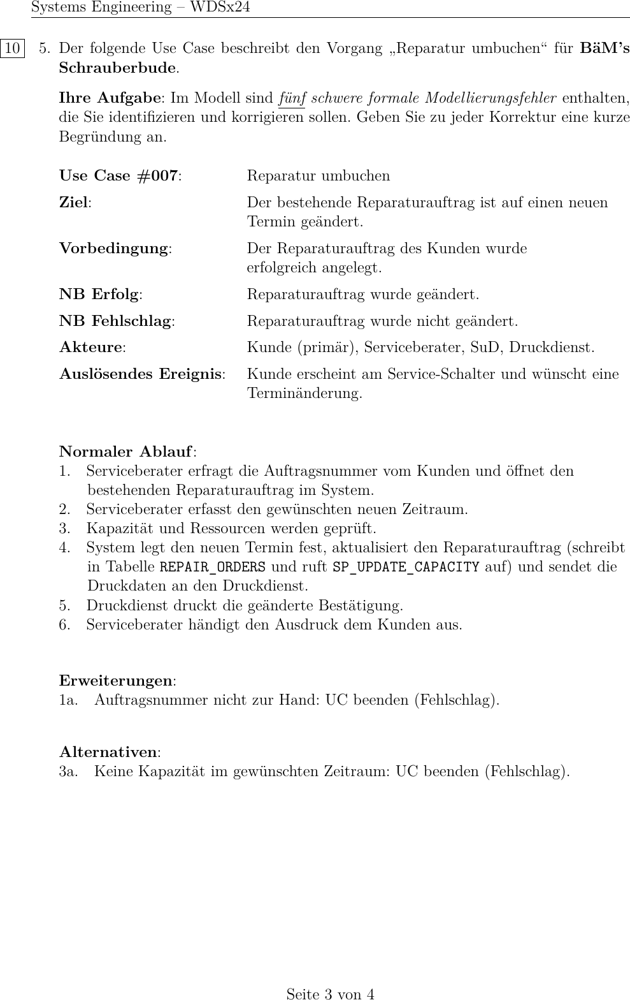

# Systems Engineering – WDSx24 – 22. Dezember 2025

Studiengang: Data Science und Künstliche Intelligenz
Modul: W3WI_101.2
Klausurteil: Systems Engineering
Kurse: WDSx24 – 3. Semester
Datum: 22. Dezember 2025
Dauer: 120 Minuten
Max. Punkte: 100
Anzahl der Seiten: 4 (ohne diese Seite. Bitte überprüfen!)
Hilfsmittel: keine Hilfsmittel
Hinweis: Antworten nur auf DHBW-Bögen zulässig!

Viel Erfolg!

| Aufgabe Nr.: | 1 | 2 | 3 | 4 | 5 | 6 | ∑ |
|---|---|---|---|---|---|---|---|
| max. Punktzahl: | 34 | 19 | 8 | 19 | 10 | 10 | 100 |

## 1. Bitte beantworten Sie die nachfolgenden Fragen aus BSDS.

**(a) [4 Punkte]** Erläutern Sie, was eine User Story ist und wie sie formuliert wird.

**(b) [2 Punkte]** Erläutern Sie den Begriff der Essenz.

**(c) [4 Punkte]** Nennen und erläutern Sie die vier zu modellierenden Sichten eines SuD.

**(d) [2 Punkte]** Erläutern Sie, was man unter dem Begriff der semantischen Lücke versteht.

**(e) [4 Punkte]** Nennen und erläutern Sie Brook’s Law.

**(f) [2 Punkte]** Nennen und erläutern Sie drei Arten der Zerlegung für Anforderungen im Systems Engineering.

**(g) [4 Punkte]** Nennen und erläutern Sie die Gründe für das Scheitern von FISCUS im zweiten Anlauf.

**(h) [4 Punkte]** Erläutern Sie die analytische und die konstruktive Qualitätssicherung.

**(i) [8 Punkte]** Nennen und erläutern Sie das Agile Manifest.

## 2. In der agilen Softwareentwicklung spielt Scrum eine wichtige Rolle.

**(a) [9 Punkte]** Beschreiben Sie die drei zentralen Rollen in Scrum (Product Owner, Scrum Master und Entwicklungsteam) und deren Verantwortlichkeiten.

**(b) [4 Punkte]** Was ist der Zweck der Sprint-Retrospektive, und wie kann sie zur kontinuierlichen Verbesserung des Teams beitragen?

**(c) [6 Punkte]** Erklären Sie den Unterschied zwischen der Definition of Done (DoD) und der Definition of Ready (DoR). Welche Rolle spielt jede im Scrum-Prozess?

## 3. Erläutern Sie die folgenden Grundlagen der Use-Case-Modellierung.

**(a) [4 Punkte]** Nennen und erläutern Sie die Beziehungsarten bei Use Cases.

**(b) [4 Punkte]** Erläutern Sie, was ein Use-Case-Diagramm modelliert.

## 4.

Ein Kunde erscheint am Service-Schalter der Kfz-Werkstatt BäM’s Schrauberbude mit Fahrzeugschein und Fahrzeug.

Der Serviceberater ruft im Werkstattsystem die Funktion „Reparatur anmelden“ auf, prüft die Identität bzw. Stammdaten des Kunden und erfasst anschließend das Fahrzeug (z. B. per Kennzeichen oder Fahrzeugidentifikationsnummer, kurz: FIN). Das System prüft die Annahmefähigkeit für den gewünschten Zeitraum – insbesondere verfügbare Kapazitäten, passende Ressourcen (z. B. Hebebühne, Hochvolt-Spezialist) und Annahmefenster. Ist alles in Ordnung, legt das System einen Reparaturauftrag an, weist eine Annahmezeit bzw. einen Termin zu und erzeugt eine Auftragsbestätigung. Dazu sendet er die Auftragsbestätigungsdaten an den Netzwerkdrucker. Der Serviceberater händigt die Bestätigung als Ausdruck dem Kunden aus.

Tritt beim Erfassen der Fahrzeugdaten ein Problem auf (z. B. Barcode/FIN nicht lesbar), gibt der Serviceberater die Daten manuell ein und führt den Vorgang fort. Fehlen Pflichtangaben (z. B. Kontakt, Fahrzeugtyp, Fehlerbeschreibung), werden diese nacherfasst und die Prüfung wird fortgesetzt. Kann der Kunde nicht identifiziert werden, ist keine Kapazität im gewünschten Zeitraum verfügbar oder liegt das Fahrzeug außerhalb des Werkstattumfangs, wird keine Anmeldung durchgeführt und der Vorgang endet ohne Auftrag.

**(a) [15 Punkte]** Erstellen Sie mit der UC-Schablone aus der Vorlesung den zugehörigen Use Case „Reparatur anmelden“.

**(b) [4 Punkte]** Erstellen Sie das zugehörige BPMN-Modell.

## 5. [10 Punkte]

Der folgende Use Case beschreibt den Vorgang „Reparatur umbuchen“ für BäM’s Schrauberbude.
Ihre Aufgabe: Im Modell sind fünf schwere formale Modellierungsfehler enthalten, die Sie identifizieren und korrigieren sollen. Geben Sie zu jeder Korrektur eine kurze Begründung an.

| Use Case #007: | Reparatur umbuchen |
|---|---|
| Ziel: | Der bestehende Reparaturauftrag ist auf einen neuen Termin geändert. |
| Vorbedingung: | Der Reparaturauftrag des Kunden wurde erfolgreich angelegt. |
| NB Erfolg: | Reparaturauftrag wurde geändert. |
| NB Fehlschlag: | Reparaturauftrag wurde nicht geändert. |
| Akteure: | Kunde (primär), Serviceberater, SuD, Druckdienst. |
| Auslösendes Ereignis: | Kunde erscheint am Service-Schalter und wünscht eine Terminänderung. |

Normaler Ablauf :

1. Serviceberater erfragt die Auftragsnummer vom Kunden und öffnet den bestehenden Reparaturauftrag im System.
2. Serviceberater erfasst den gewünschten neuen Zeitraum.
3. Kapazität und Ressourcen werden geprüft.
4. System legt den neuen Termin fest, aktualisiert den Reparaturauftrag (schreibt in Tabelle REPAIR_ORDERS und ruft SP_UPDATE_CAPACITY auf) und sendet die Druckdaten an den Druckdienst.
5. Druckdienst druckt die geänderte Bestätigung.
6. Serviceberater händigt den Ausdruck dem Kunden aus.

Erweiterungen:

1a. Auftragsnummer nicht zur Hand: UC beenden (Fehlschlag).

Alternativen:

3a. Keine Kapazität im gewünschten Zeitraum: UC beenden (Fehlschlag).

## 6. [10 Punkte]

Ein registrierter Studierender bringt ein physisches Buch und seinen Ausweis an den Ausleihschalter der DHBW-Bibliothek. Die Mitarbeiterin erfasst das Exemplar durch Scannen des Barcodes. Unmittelbar danach entscheidet das Bibliothekssystem, wie weiter verfahren wird:

1. Die Ausleihe kann direkt fortgesetzt werden (Verbuchung, Rückgabedatum, Quittungsdruck),
2. es müssen zunächst offene Gebühren bezahlt werden (Auswahl der Funktion „Gebühr bezahlen“) und danach wird sofort mit der Ausleihe fortgefahren, oder
3. die Ausleihe wird aufgrund von Bestandsregeln (z. B. Präsenzbestand) oder einer aktiven Vormerkung verweigert.

Hinweis: Der Fehlerfall beim Barcode-Scan (manuelle Eingabe bei Lesefehler) wird vor dieser Entscheidung behandelt und ist nicht Teil der Entscheidung selbst.
Ihre Aufgabe: Erstellen Sie die konsolidierte, redundanz- und widerspruchsfreie Entscheidungstabelle.

Quelle: systems-engineering/origin/WDS125 - Systems Engineering (BäM)/15 Alte Klausuren/WDSx24.Systems-Engineering.Klausur/WDSx24.Systems-Engineering.Klausur.pdf
