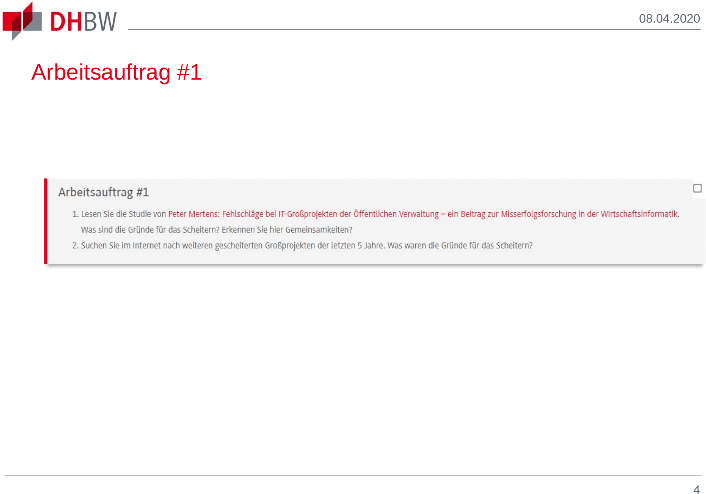

# Arbeitsauftrag #1

1. Lesen Sie die Studie von Peter Mertens: Fehlschläge bei IT-Großprojekten der Öffentlichen Verwaltung – ein Beitrag zur Misserfolgsforschung in der Wirtschaftsinformatik.
   Was sind die Gründe für das Scheitern? Erkennen Sie hier Gemeinsamkeiten?
2. Suchen Sie im Internet nach weiteren gescheiterten Großprojekten der letzten 5 Jahre. Was waren die Gründe für das Scheitern?

## Dateien in diesem Ordner

- `TASKS.md`
- `01_Mertens.Fehlschlaege.pdf` — Peter Mertens: Fehlschläge bei IT-Großprojekten der Öffentlichen Verwaltung – ein Beitrag zur Misserfolgsforschung in der Wirtschaftsinformatik
- `images/arbeitsauftrag-1-04.png`

Quelle: systems-engineering/origin/WDS125 - Systems Engineering (BäM)/04 LE 1_ Black Swans - Warum Softwareprojekte scheitern/Folien der Lerneinheit/01.RE-BlackSwansOhneLoesung.pdf, Seite 4
