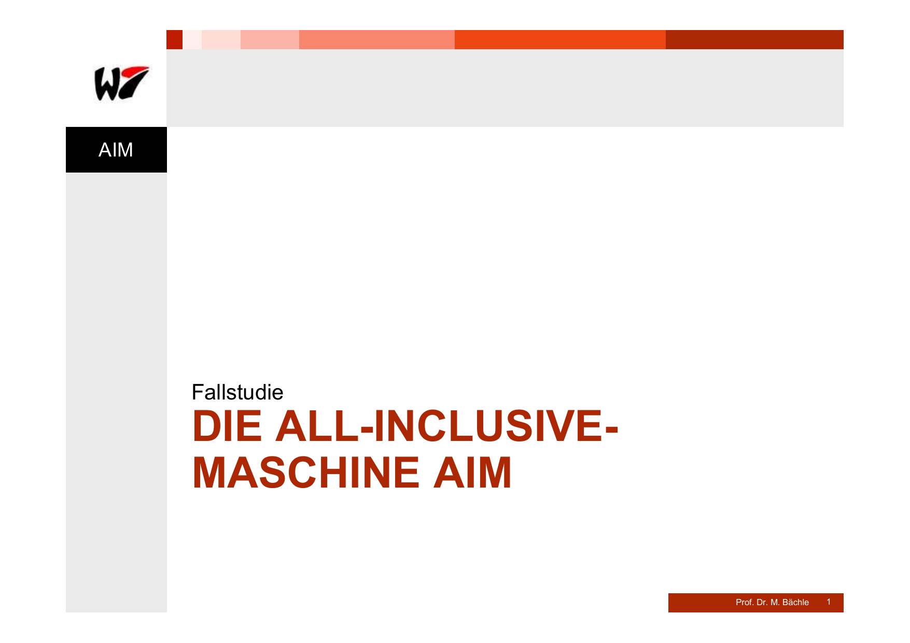
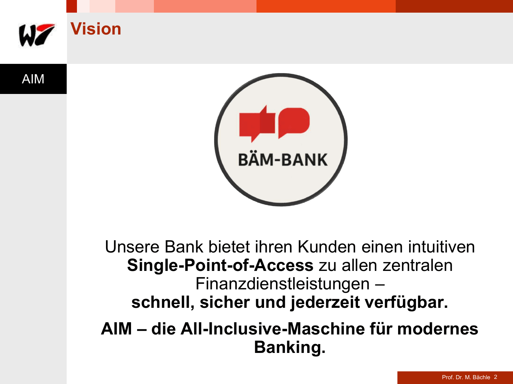
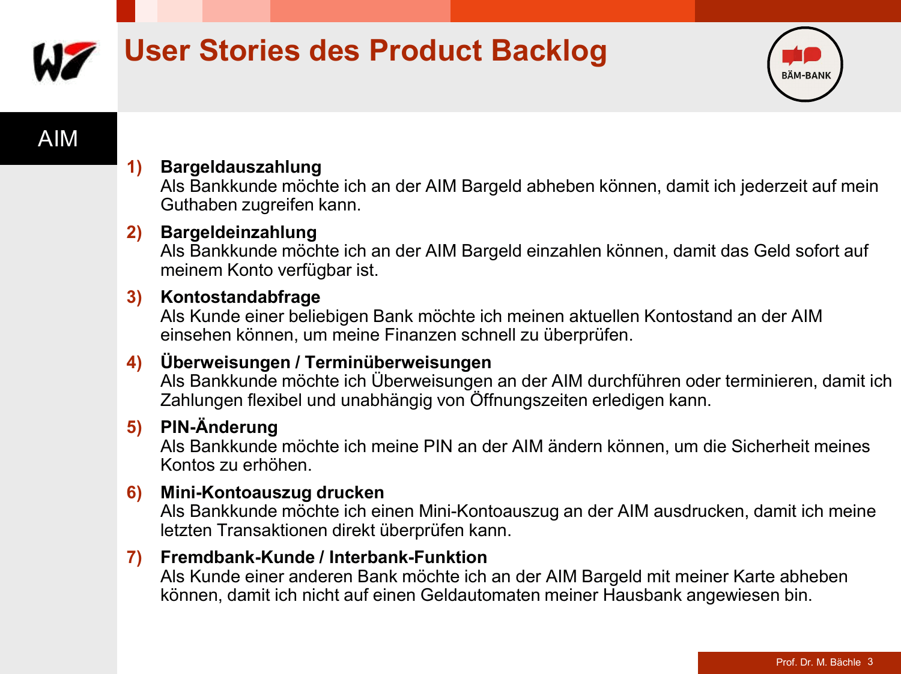
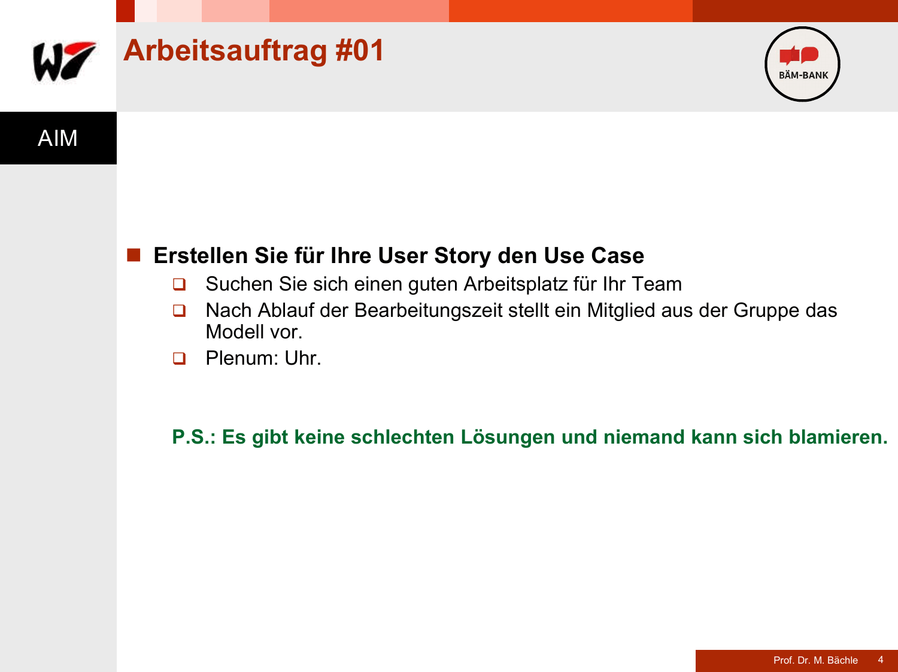
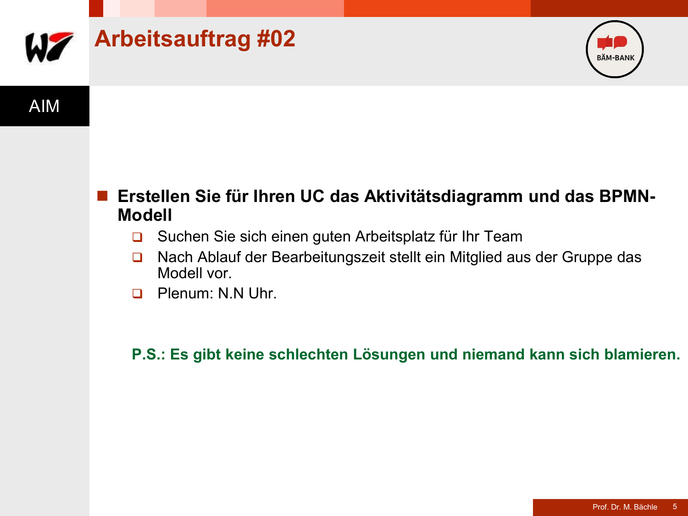
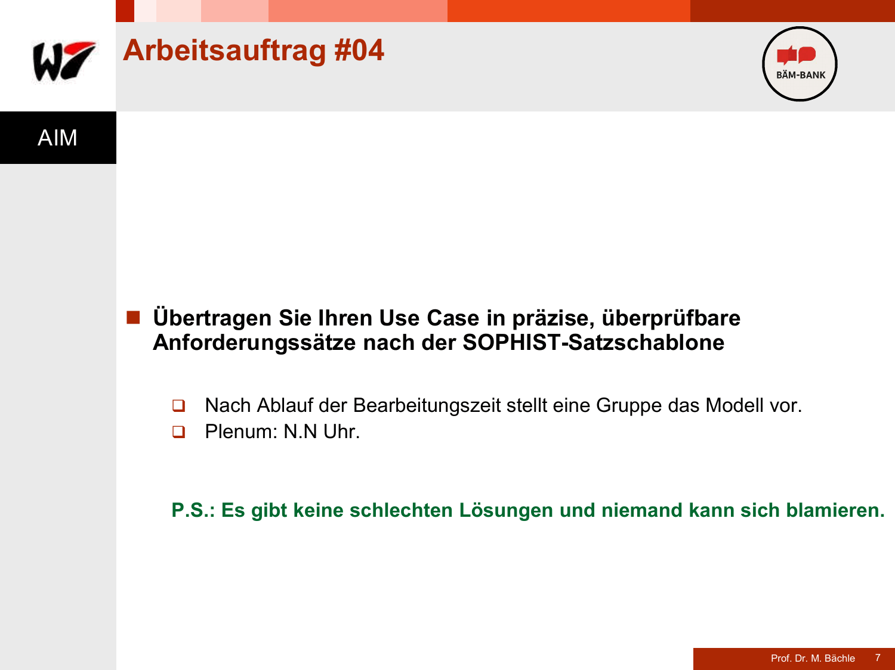

# Fallstudie DIE ALL-INCLUSIVE-MASCHINE AIM



## Vision

Unsere Bank bietet ihren Kunden einen intuitiven Single-Point-of-Access zu allen zentralen Finanzdienstleistungen – schnell, sicher und jederzeit verfügbar.

AIM – die All-Inclusive-Maschine für modernes Banking.



## User Stories des Product Backlog

1) Bargeldauszahlung
   Als Bankkunde möchte ich an der AIM Bargeld abheben können, damit ich jederzeit auf mein Guthaben zugreifen kann.
2) Bargeldeinzahlung
   Als Bankkunde möchte ich an der AIM Bargeld einzahlen können, damit das Geld sofort auf meinem Konto verfügbar ist.
3) Kontostandabfrage
   Als Kunde einer beliebigen Bank möchte ich meinen aktuellen Kontostand an der AIM einsehen können, um meine Finanzen schnell zu überprüfen.
4) Überweisungen / Terminüberweisungen
   Als Bankkunde möchte ich Überweisungen an der AIM durchführen oder terminieren, damit ich Zahlungen flexibel und unabhängig von Öffnungszeiten erledigen kann.
5) PIN-Änderung
   Als Bankkunde möchte ich meine PIN an der AIM ändern können, um die Sicherheit meines Kontos zu erhöhen.
6) Mini-Kontoauszug drucken
   Als Bankkunde möchte ich einen Mini-Kontoauszug an der AIM ausdrucken, damit ich meine letzten Transaktionen direkt überprüfen kann.
7) Fremdbank-Kunde / Interbank-Funktion
   Als Kunde einer anderen Bank möchte ich an der AIM Bargeld mit meiner Karte abheben können, damit ich nicht auf einen Geldautomaten meiner Hausbank angewiesen bin.



## Arbeitsauftrag #01

- Erstellen Sie für Ihre User Story den Use Case
  - Suchen Sie sich einen guten Arbeitsplatz für Ihr Team
  - Nach Ablauf der Bearbeitungszeit stellt ein Mitglied aus der Gruppe das Modell vor.
  - Plenum: Uhr.

P.S.: Es gibt keine schlechten Lösungen und niemand kann sich blamieren.



## Arbeitsauftrag #02

- Erstellen Sie für Ihren UC das Aktivitätsdiagramm und das BPMN-Modell
  - Suchen Sie sich einen guten Arbeitsplatz für Ihr Team
  - Nach Ablauf der Bearbeitungszeit stellt ein Mitglied aus der Gruppe das Modell vor.
  - Plenum: N.N Uhr.

P.S.: Es gibt keine schlechten Lösungen und niemand kann sich blamieren.



## Arbeitsauftrag #03

- Erstellen Sie die konsolidierte Entscheidungstabelle ET #001 „Geld einzahlen“
  - Die Modellierungsaufgabe für ET #001 finden Sie im Moodle-Kursraum bei LE 11
  - Suchen Sie sich einen guten Arbeitsplatz für Ihr Team
  - Nach Ablauf der Bearbeitungszeit stellt eine Gruppe das Modell vor.
  - Plenum: N.N Uhr.

P.S.: Es gibt keine schlechten Lösungen und niemand kann sich blamieren.


## Arbeitsauftrag #04

- Übertragen Sie Ihren Use Case in präzise, überprüfbare Anforderungssätze nach der SOPHIST-Satzschablone
  - Nach Ablauf der Bearbeitungszeit stellt eine Gruppe das Modell vor.
  - Plenum: N.N Uhr.

P.S.: Es gibt keine schlechten Lösungen und niemand kann sich blamieren.



## UC-Template (für Arbeitsauftrag #01)

```
1. Use Case: Name, bestehend aus zwei oder drei Wörtern (was wird getan?)
2. Ziel: globale Zielsetzung bei erfolgreicher Ausführung des Use Case
3. Vorbedingung: Erwarteter Zustand, vor Beginn
4. Zustand Erfolg: Erwarteter Zustand nach erfolgreicher Ausführung, d.h. Ergebnis des Geschäftsprozesses
5. Zustand Fehlschlag: Erwarteter Zustand, wenn das Ziel nicht erreicht werden kann
6. Akteure: Rollen von Personen oder andere Systeme, die den Use Case auslösen oder daran beteiligt sind
7. Auslösendes Ereignis: Wenn dieses Ereignis eintritt, dann wird der Use Case initiiert
8. Normaler Ablauf:
	1 Erste Aktion
	2 Zweite Aktion
Erweiterungen:
	1a Erweiterung des Funktionsumfangs der erste Aktion
Alternativen:
	1a Alternative Ausführung der ersten Aktion
	1b Weitere Alternative zur ersten Aktion
```

Quelle: systems-engineering/origin/WDS125 - Systems Engineering (BäM)/10 LE 7_ Use Cases - Modellierung der Anwendungsfälle/UC-Template/UC-Template.txt (HTML-Entities aufgelöst, Moodle-`<pre><div>`-Rahmen entfernt)

## Dateien in diesem Ordner

- `TASKS.md`
- `00.ATMFallstudie.DSKI.pdf`
- `UC-Template.txt`
- `images/aim-fallstudie-1.png` bis `images/aim-fallstudie-7.png`

Quelle: systems-engineering/origin/WDS125 - Systems Engineering (BäM)/10 LE 7_ Use Cases - Modellierung der Anwendungsfälle/00.ATMFallstudie.DSKI/00.ATMFallstudie.DSKI.pdf, Seiten 1–7
