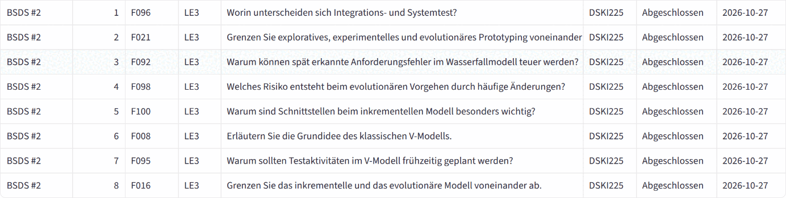

# BSDS #2

| BSDS | Nr. | ID | LE | Frage | Kurs | Status | Datum |
|---|---|---|---|---|---|---|---|
| BSDS #2 | 1 | F096 | LE3 | Worin unterscheiden sich Integrations- und Systemtest? | DSKI225 | Abgeschlossen | 2026-10-27 |
| BSDS #2 | 2 | F021 | LE3 | Grenzen Sie exploratives, experimentelles und evolutionäres Prototyping voneinander | DSKI225 | Abgeschlossen | 2026-10-27 |
| BSDS #2 | 3 | F092 | LE3 | Warum können spät erkannte Anforderungsfehler im Wasserfallmodell teuer werden? | DSKI225 | Abgeschlossen | 2026-10-27 |
| BSDS #2 | 4 | F098 | LE3 | Welches Risiko entsteht beim evolutionären Vorgehen durch häufige Änderungen? | DSKI225 | Abgeschlossen | 2026-10-27 |
| BSDS #2 | 5 | F100 | LE3 | Warum sind Schnittstellen beim inkrementellen Modell besonders wichtig? | DSKI225 | Abgeschlossen | 2026-10-27 |
| BSDS #2 | 6 | F008 | LE3 | Erläutern Sie die Grundidee des klassischen V-Modells. | DSKI225 | Abgeschlossen | 2026-10-27 |
| BSDS #2 | 7 | F095 | LE3 | Warum sollten Testaktivitäten im V-Modell frühzeitig geplant werden? | DSKI225 | Abgeschlossen | 2026-10-27 |
| BSDS #2 | 8 | F016 | LE3 | Grenzen Sie das inkrementelle und das evolutionäre Modell voneinander ab. | DSKI225 | Abgeschlossen | 2026-10-27 |

## Dateien in diesem Ordner

- `TASKS.md`
- `images/bsds1.png`

Quelle: systems-engineering/origin/WDS125 - Systems Engineering (BäM)/bsds1.png
