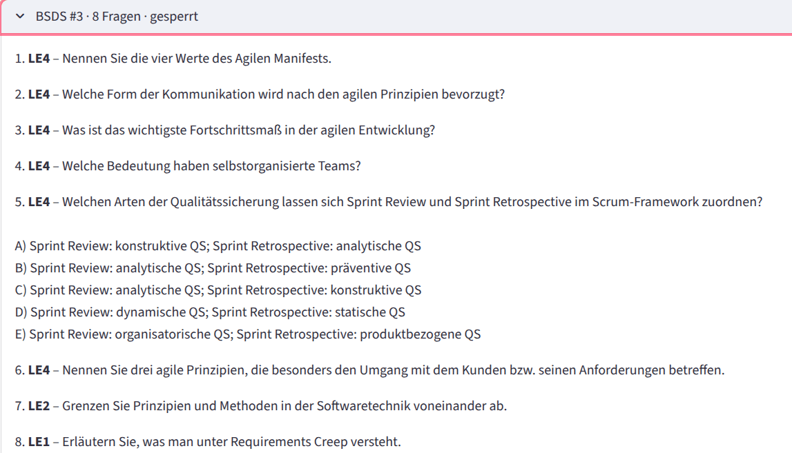

# BSDS #3 · 8 Fragen · gesperrt

1. **LE4** – Nennen Sie die vier Werte des Agilen Manifests.

2. **LE4** – Welche Form der Kommunikation wird nach den agilen Prinzipien bevorzugt?

3. **LE4** – Was ist das wichtigste Fortschrittsmaß in der agilen Entwicklung?

4. **LE4** – Welche Bedeutung haben selbstorganisierte Teams?

5. **LE4** – Welchen Arten der Qualitätssicherung lassen sich Sprint Review und Sprint Retrospective im Scrum-Framework zuordnen?

   A) Sprint Review: konstruktive QS; Sprint Retrospective: analytische QS
   B) Sprint Review: analytische QS; Sprint Retrospective: präventive QS
   C) Sprint Review: analytische QS; Sprint Retrospective: konstruktive QS
   D) Sprint Review: dynamische QS; Sprint Retrospective: statische QS
   E) Sprint Review: organisatorische QS; Sprint Retrospective: produktbezogene QS

6. **LE4** – Nennen Sie drei agile Prinzipien, die besonders den Umgang mit dem Kunden bzw. seinen Anforderungen betreffen.

7. **LE2** – Grenzen Sie Prinzipien und Methoden in der Softwaretechnik voneinander ab.

8. **LE1** – Erläutern Sie, was man unter Requirements Creep versteht.

## Dateien in diesem Ordner

- `TASKS.md`
- `images/bsds2.png`

Quelle: systems-engineering/origin/WDS125 - Systems Engineering (BäM)/bsds2.png
