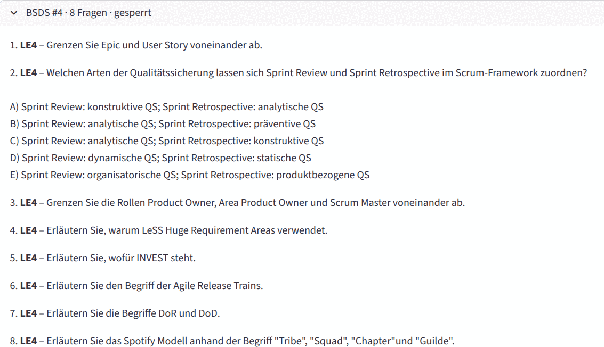

# BSDS #4 · 8 Fragen · gesperrt

1. **LE4** – Grenzen Sie Epic und User Story voneinander ab.

2. **LE4** – Welchen Arten der Qualitätssicherung lassen sich Sprint Review und Sprint Retrospective im Scrum-Framework zuordnen?

   A) Sprint Review: konstruktive QS; Sprint Retrospective: analytische QS
   B) Sprint Review: analytische QS; Sprint Retrospective: präventive QS
   C) Sprint Review: analytische QS; Sprint Retrospective: konstruktive QS
   D) Sprint Review: dynamische QS; Sprint Retrospective: statische QS
   E) Sprint Review: organisatorische QS; Sprint Retrospective: produktbezogene QS

3. **LE4** – Grenzen Sie die Rollen Product Owner, Area Product Owner und Scrum Master voneinander ab.

4. **LE4** – Erläutern Sie, warum LeSS Huge Requirement Areas verwendet.

5. **LE4** – Erläutern Sie, wofür INVEST steht.

6. **LE4** – Erläutern Sie den Begriff der Agile Release Trains.

7. **LE4** – Erläutern Sie die Begriffe DoR und DoD.

8. **LE4** – Erläutern Sie das Spotify Modell anhand der Begriff "Tribe", "Squad", "Chapter"und "Guilde".

## Dateien in diesem Ordner

- `TASKS.md`
- `images/bsds3.png`

Quelle: systems-engineering/origin/WDS125 - Systems Engineering (BäM)/bsds3.png
