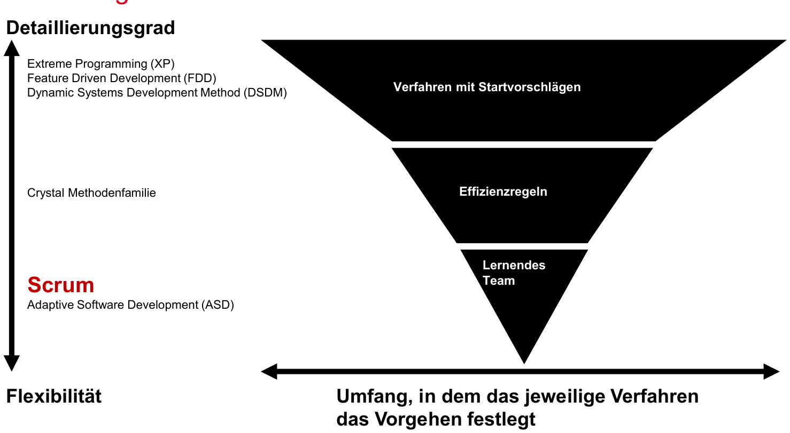
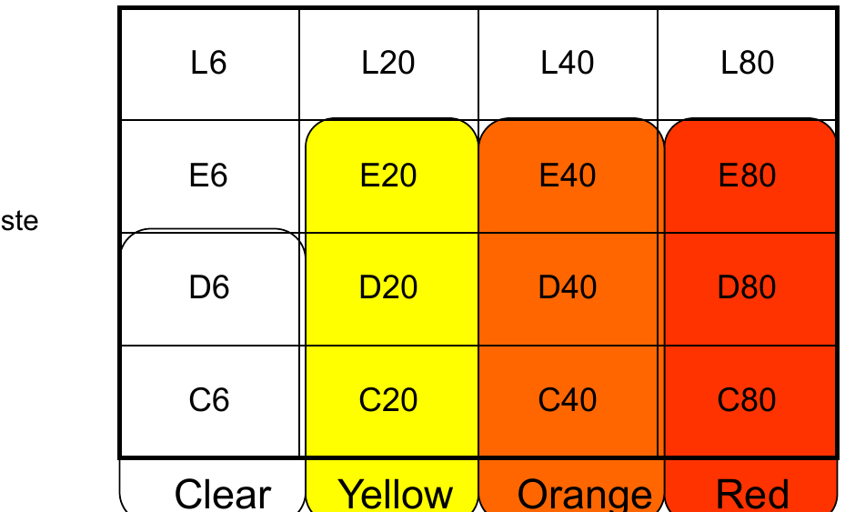
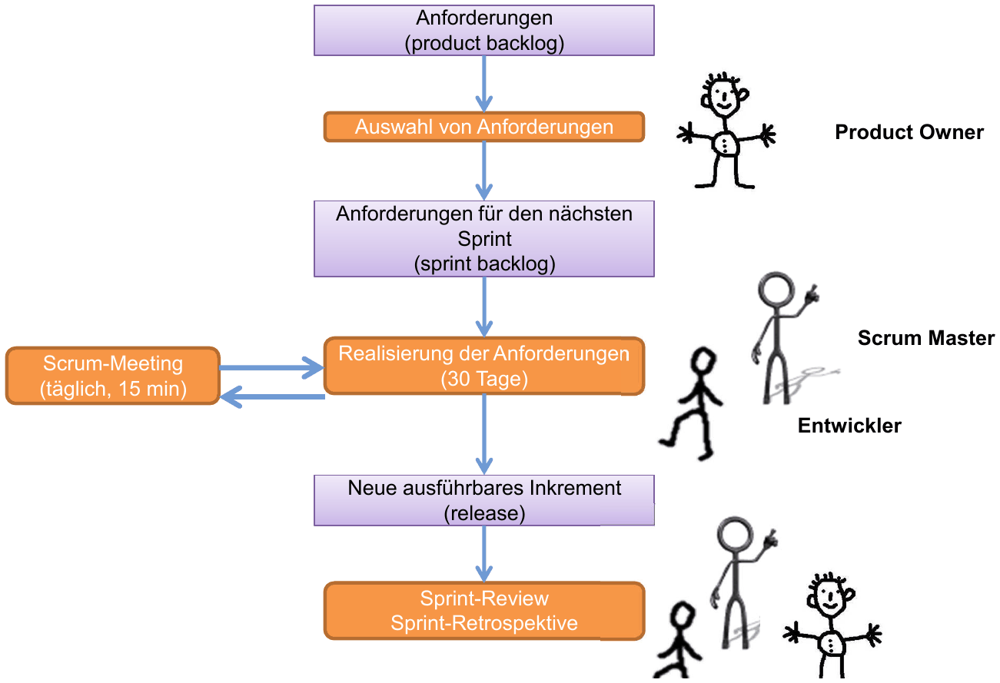
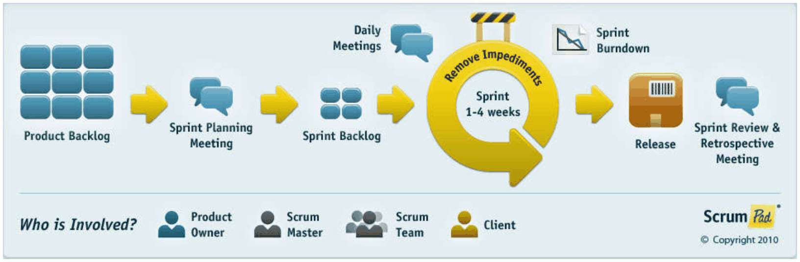

# Taxonomie agiler Verfahren

Coldewey, J.: Agile Entwicklung Web-basierter Systeme, in: Wirtschaftsinformatik 44 (2002) 3, S. 242.

## Crystal Methodenfamilie nach Cockburn

- „Crystal“ bedeutet nichts besonderes. Es ist lediglich eine Metapher.
- In Abhängigkeit der Projektgröße und Kritikalität des IS werden unterschiedliche Methoden eingesetzt.
- Cockburn versteht Crystal nicht als verbindlichen Methodensatz, der strikt einzuhalten ist.
- Crystal ist lediglich ein Beispiel für die Entwicklung einer Methodenfamilie. Es sollte bestenfalls adaptiert werden. Dabei sind aber die Prinzipien der agilen SE unbedingt einzuhalten.

Möglicher Schaden

- L Verlust von Menschenleben
- E „Essenzielle“ finanzielle Verluste
- D Mäßige finanzielle Verluste
- C Verlust von Komfort

Cockburn, A.: Agile Software Development, Boston et al. 2002, pp. 197.

## Beispiel: Crystal Clear

- Kategorie: D6, also Teamgröße ca. 6 MA und lediglich finanzieller Verlust (schmerzlich, aber unkritisch)
- 1 Team, 1 Ort (räumliche Einheit ist wichtig).
- Rollen: Sponsor, Senior Designer, Designer-Programmierer, Kunde. Einer davon ist Projektkoordinator.
- Software wird regelmäßig inkrementell alle 2-3 Monate ausgeliefert.
- Fortschritt wird v.a. anhand ausgelieferter SW als Meilenstein gemessen.
- Automatisierte Regressionstests implementiert.
- Direkter Kundeneinbezug.
- Zwei Kundenreviews pro Release
- Typische Produkte/Dokumente die entstehen sind: Releases, Zeitplan für Reviews, Use Cases, Designskizzen, GUI-Entwürfe, grobes Objektmodell, Quellcode, Migrationstools, Testfälle, Benutzerhandbuch.
- Vorlagen für Arbeitsergebnisse, Codingstandards, QS-Standards sind Sache des Teams.
- Wichtigste Tools sind: Compiler, KM-Tool, Whiteboard.

## Scrum -Prozessmodell

## Scrum

http://www.scrum.org/storage/scrumguides/Scrum_Guide%20-%20DE.pdf

Quelle: systems-engineering/origin/WDS125 - Systems Engineering (BäM)/07 LE 4_ Agiles Software Engineering - _Elefanten isst man scheibchenweise_/Folien der Lerneinheit/04.RE-AgileSE.pdf, Folien 13–17
