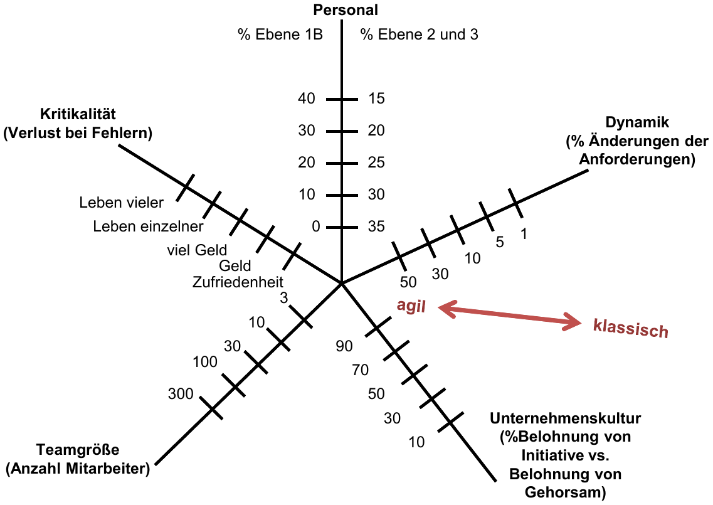

# Klassifizierung der Fähigkeiten eines Entwicklungsteams

| Ebene | Charakteristik |
| --- | --- |
| 3 | Fähig, eine Methode anzupassen, d.h. auch deren Regeln zu brechen, um mit unvorhergesehenen Situationen fertig zu werden |
| 2 | Fähig, eine Methode bei vorhersehbaren Situationen anzupassen |
| 1A | Nach Ausbildung fähig, größerer Entwicklungsaktivitäten richtig abzuwickeln. Kann mit viel Erfahrung auf Ebene 2 gelangen. |
| 1B | Nach Ausbildung in der Lage, kleinere Teilschritte in Entwicklungsprozessen korrekt auszuführen Kann mit Erfahrung auf Ebene 1A gelangen |
| -1 | Hat vielleicht technische Fähigkeiten, ist aber unfähig oder unwillig, im Team mit gemeinsam vereinbarten Methoden zu arbeiten |

## Dimensionen der Methodenauswahl

## Fazit 3: Hype, Mode, Zukunft? ✓

> Hype sicherlich bei Methoden wie XP.
>
> Mode sicherlich, weil vielfach alter Wein in neuen Schläuchen (Crystal, ASD).
>
> Zukunft sicherlich, weil Rückbesinnung auf wichtige Tugenden (Crystal, ASD).

Quelle: systems-engineering/origin/WDS125 - Systems Engineering (BäM)/07 LE 4_ Agiles Software Engineering - _Elefanten isst man scheibchenweise_/Folien der Lerneinheit/04.RE-AgileSE.pdf, Folien 18–20
