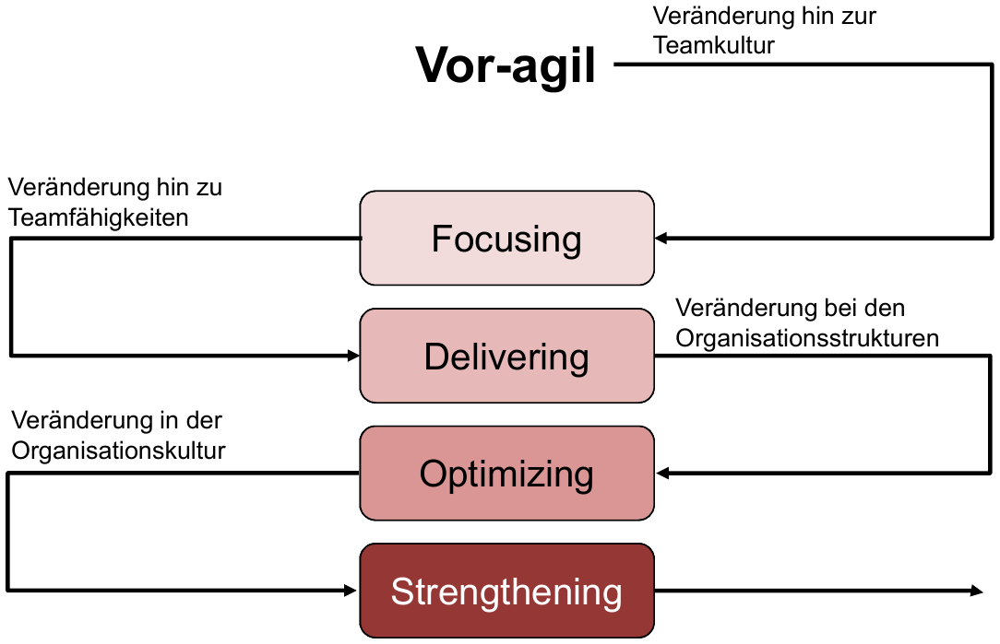
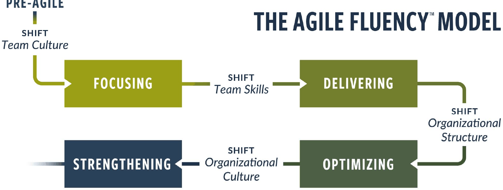

# Zonen des Agile-Fluency-Modells

Quelle: Shore, J.: Die Kunst der agilen Entwicklung, S. 24

Beachte auch Disclaimer nächste Folie!

## THE AGILE FLUENCY™ MODEL

© 2012-2018 James Shore und Diana Larsen. „Agile Fluency“ ist eine eingetragene Marke des Agile Fluency Projekt LLC. Sie dürfen diese Grafik in jeder Form verwenden, solange dies Bemerkung unverändert vorhanden ist.

Das ist das Problem mit dem Methodengurus:

➔ Sie wollen letztlich (viel) Geld mit ihren Modellen und Methoden verdienen.

Modelle und Methoden sollten prinzipiell Aufgabe der Wissenschaft sein und allen zur Verfügung stehen.

## Fluency (≠ Reife)

Fluency ist eine Eigenschaft, die in einem Team entsteht, nicht bei einem Individuum. Es bedeutet nicht, dass jedes Teammitglied jede Fähigkeit besitzt, die mit der Zone in Verbindung gebracht wird. Stattdessen braucht das Team als Ganzes die Fähigkeit, immer die richtigen Personen zur richtigen Zeit einzusetzen.

Quelle: Shore, J.: Die Kunst der agilen Entwicklung, S. 25

## Jede Zone der Fluency hat verschiedene Stufen der Reife

1. **Lernen:** Das Team erlernt die Fähigkeiten der entsprechenden Fluency-Zone
   - Beispiel: Das Team erlernt die Fähigkeit zur Retrospektive
2. **Bewandert:** Das Team kann eine Fähigkeit zeigen, wenn es sich darauf konzentriert
   - Beispiel: Das Team macht immer genau am Ende eines Sprints eine Retrospektive
3. **Fluent (= routiniert):** Solange das Team von einem Coach als Teil des Teams unterstützt wird, zeigt es die Fähigkeit automatisch, ohne darüber nachzudenken
   - Beispiel: Angeleitet vom Coach macht das Team auch Retrospektiven, sobald sich dafür ein Bedarf zeigt
4. **Unabhängig fluent (= unabhängig routiniert):** Das Team zeigt die Fähigkeit automatisch, ohne von einem Coach unterstützt zu werden
   - Beispiel: Das Team macht selbstständig Retrospektiven flexibel nach Bedarf, ohne von einem Coach unterstützt zu werden

Quelle: systems-engineering/origin/WDS125 - Systems Engineering (BäM)/07 LE 4_ Agiles Software Engineering - _Elefanten isst man scheibchenweise_/Agile-Fluency-Modell/04.2AgileFluencyModell.pdf, Folien 1–7
