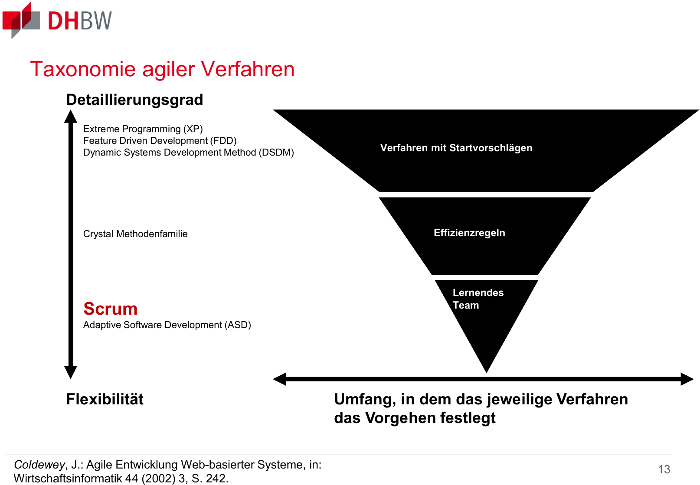
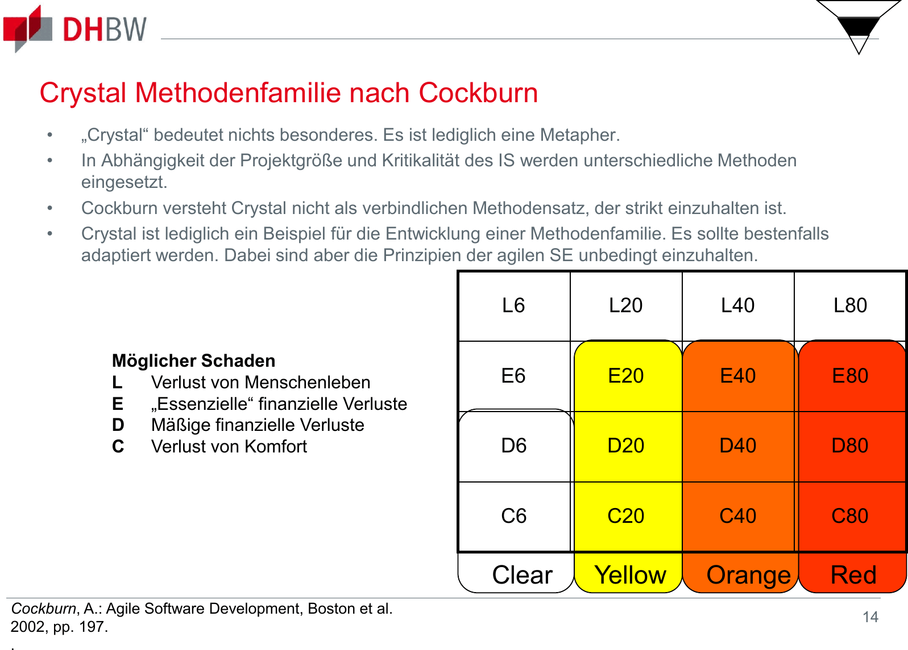
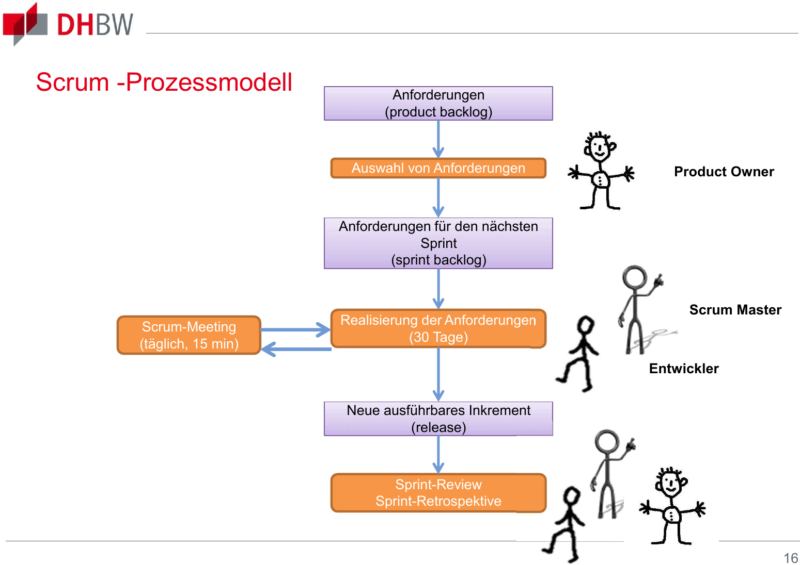
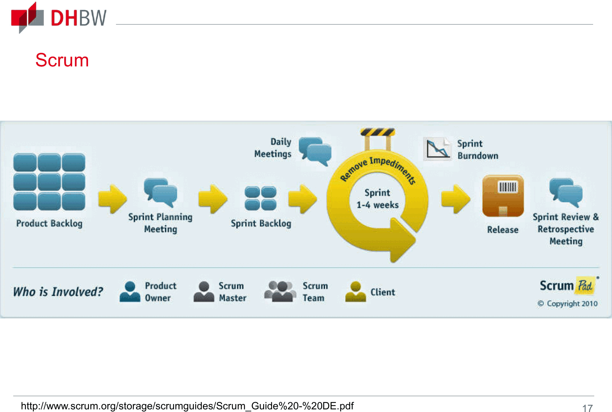
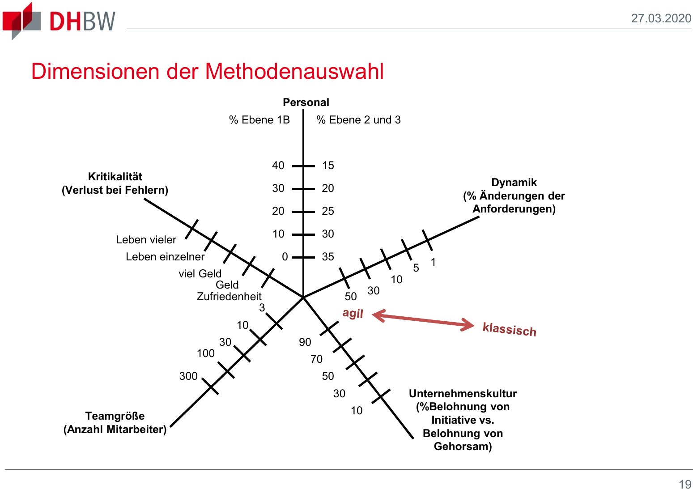
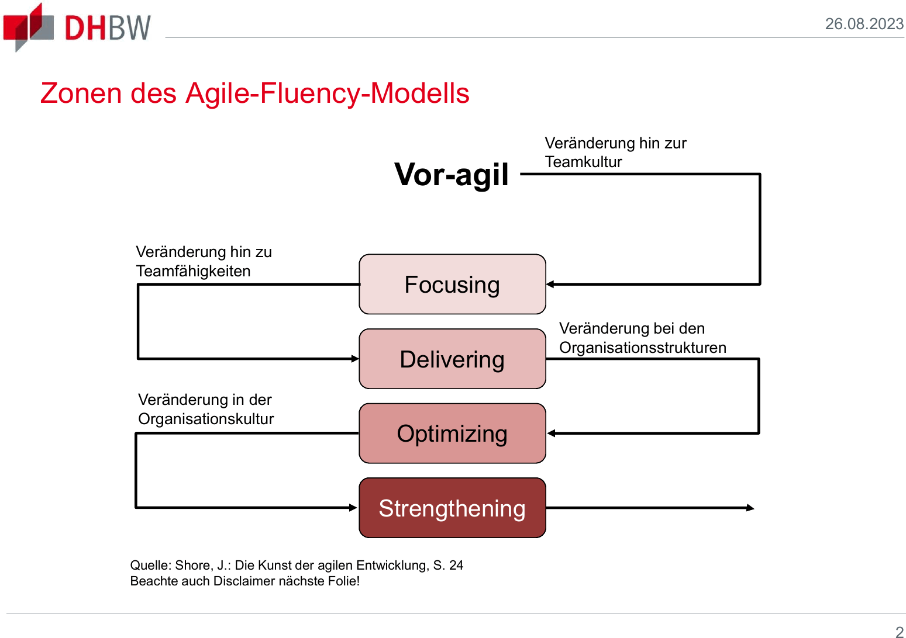
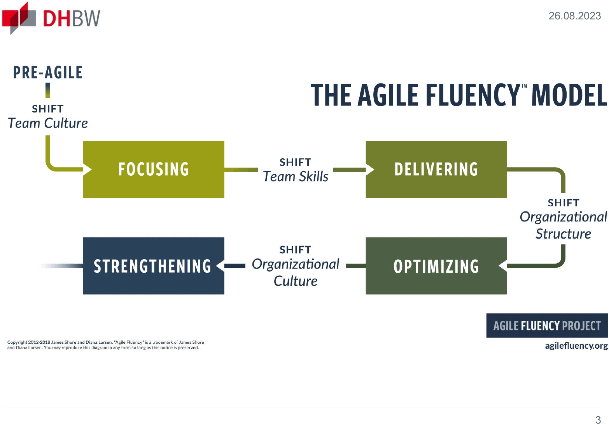
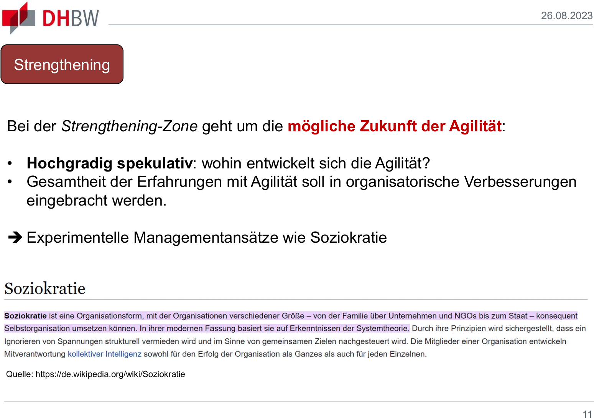

# Agile Softwareentwicklung

## Agile Softwareentwicklung – Wichtige Fragen

- Hype, Mode, Zukunft?
- Grenzerfahrungen des Software Engineering?
- Zu dumm für ingenieurmäßiges Arbeiten?

## Schwergewichtige SE-Prozesse

- Das „klassische“ Softwareengineering mit seinem Prozessen und Methoden wird als schwergewichtig bezeichnet.
- Vorwurf (Schwergewichtig =)
    - Rigider Formalismus: sinnlose Einhaltung von Standards.
    - Dokumentenfixierung: Schrankware statt Software.
    - Zuwenig Kommunikation im Team und mit dem Kunden.
    - Management nimmt sich zu wichtig: Konzentration auf Planung, Steuerung und Kontrolle. Prozessbeherrschung wird mit Kompetenz verwechselt.
    - Moving Targets nicht beherrschbar: laufende Änderungen der Kundenwünsche nicht erfassbar.
    - Time to Market wird behindert: schnelle Verfügbarkeit des IS oftmals wichtiger als 100% Realisierung aller Anforderungen.

## Beispiel

- Die Erfahrung zeigt, dass die vollständige Spezifikation eines Systems nicht immer sinnvoll, möglicherweise sogar gar nicht möglich ist.
    - Innovative Systeme sind meistens nicht vollständig spezifizierbar.
        - Covisint als Plattform: muss evolutionär weiterentwickelt werden.
        - Mitte der 90er Jahre waren die meisten E-Business-Systeme zu neuartig, um abschließend spezifiziert werden zu können.
    - Eine vollständige, formale Spezifikation ist nicht immer wirtschaftlich sinnvoll
        - Space Shuttle: in jeder LOC steckt 1 PM Gesamtaufwand
        - Umgerechnet auf typische betriebliche IS:
            - 100 – 200 KLOC typische Größe
            - Kosten: 1 bis 2 Milliarden Euro
            - Dauer: bei 1000 MA immer noch 16 Jahre (dabei Brooks Law noch gar nicht berücksichtigt!)

## Fazit 1: Grenzerfahrungen? ✓

> Formalismus bedeutet nicht Disziplin
>
> Prozess bedeutet nicht Fähigkeit
>
> Dokumentation bedeutet nicht Verständnis

## Leichtgewichtige SE-Prozesse

- Leichtgewichtige SE-Prozesse fordern den Einsatz eines minimalen Satzes an SE-Methoden und –Prozessen unter Konzentration auf das, was der Kunde will: lauffähige Software.
- Plakativ formuliert:
    - Schwergewichtige Prozesse = Effektivität (doing the right things)
    - Leichtgewichtige Prozesse = Effektivität (doing the right things) und Effizienz (doing the things right)

> Merke:
>
> Leichtgewichtige SE-Prozesse beanspruchen für sich:
>
> Doing the right things right!

## Agile Softwareentwicklung

- Agil = beweglich, wendig, geschäftig
- Bei der Agilen SE wird hoher Wert auf die Änderbarkeit der Software gelegt. Dabei sind nicht die eingesetzten Verfahren von Bedeutung, sondern die erzielten Ergebnisse.
- Einziges Ziel und Erfolgskriterium ist das lauffähige IS!

> Merke:
>
> Agile SE = Leichtgewichtiges Software Engineering

## Doing the right things right: Das Agile Manifest

> We are undercovering better ways of developing software by doing it and helping others do it. Through this work we have come to value:
>
> Individuals and interactions over processes and tools
>
> Working software over comprehensive documentation
>
> Customer collaboration over contract negotiation
>
> Responding to change over following a plan
>
> That is, while there is value in the items in the right, we value the items on the left more.

Cockburn, A.: Agile Software Development, Boston et al. 2002, pp. 213

Agiles Manifest: www.agilealliance.org

## Agiles Manifest

| Schwergewichtiges SWE | Leichtgewichtiges SWE |
| --- | --- |
| Detaillierte Prozesse und Werkzeuge. | Konzentration auf Kommunikation und Kollaboration. |
| Umfangreiche Dokumente sind notwendig. | Laufendes IS wichtiger als Dokumente. |
| Detaillierte Verträge. | Zusammenarbeit mit Kunden wichtiger als detaillierte Verträge. |
| Konzentration auf Planung, Steuerung und Kontrolle. | Fähigkeit, auf Änderungen zu reagieren wichtiger als Planerfüllung. |

Coldewey, J.: Multi-Kulti: Ein Überblick über die agile Entwicklung (www.coldewey.com)

## Murmelfrage

Halten Sie das Agile Manifest für sinnvoll? Gibt es Projekte, wo das nicht geht?

## 12 Prinzipien der Agilen SE

1. Kundenzufriedenheit durch schnelle und kontinuierliche Auslieferung lauffähiger Software.
2. Änderungen begrüßen und Änderungen ermöglichen.
3. Kontinuierliche Auslieferung von Software innerhalb kurzen Intervallen.
4. Kunden und Entwickler arbeiten eng und täglich zusammen.
5. Professionalität der Menschen, nicht der Techniken. Vertrauen in die Menschen, nicht in die Techniken.
6. Kommunikation findet primär Face-to-Face statt.
7. Lauffähige Software ist das Maß zur Messung des Fortschritts, nicht die Dokumentation.
8. Nachhaltige SE durch entsprechende organisatorische Maßnahmen (Burn Out verhindern; keine Überstunden langfristig zulassen).
9. Konzentration auf technische Qualität und gutes Design.
10. So einfach wie möglich entwickeln. Minimierung der Arbeit, die nicht notwendig gewesen wäre.
11. Selbstorganisation des Teams zulassen.
12. Regelmäßige Reviewrunden des Teams mit Rückkopplung in SE-Prozess durchführen.

## Fazit 2: Zu dumm für Software Engineering? ✗

> Agile Softwareentwicklung ist Software Engineering und eines Softwareingenieurs durchaus würdig.
>
> Ein dummer Softwareingenieur würde gar nicht auf die Idee kommen, von Standards, Richtlinien, Normen, Vorgaben etc. abweichen zu wollen, um situativ selbständig zu entscheiden.

## Taxonomie agiler Verfahren

Coldewey, J.: Agile Entwicklung Web-basierter Systeme, in: Wirtschaftsinformatik 44 (2002) 3, S. 242.

## Crystal Methodenfamilie nach Cockburn

- „Crystal“ bedeutet nichts besonderes. Es ist lediglich eine Metapher.
- In Abhängigkeit der Projektgröße und Kritikalität des IS werden unterschiedliche Methoden eingesetzt.
- Cockburn versteht Crystal nicht als verbindlichen Methodensatz, der strikt einzuhalten ist.
- Crystal ist lediglich ein Beispiel für die Entwicklung einer Methodenfamilie. Es sollte bestenfalls adaptiert werden. Dabei sind aber die Prinzipien der agilen SE unbedingt einzuhalten.

Möglicher Schaden

- L Verlust von Menschenleben
- E „Essenzielle“ finanzielle Verluste
- D Mäßige finanzielle Verluste
- C Verlust von Komfort

Cockburn, A.: Agile Software Development, Boston et al. 2002, pp. 197.

## Beispiel: Crystal Clear

- Kategorie: D6, also Teamgröße ca. 6 MA und lediglich finanzieller Verlust (schmerzlich, aber unkritisch)
- 1 Team, 1 Ort (räumliche Einheit ist wichtig).
- Rollen: Sponsor, Senior Designer, Designer-Programmierer, Kunde. Einer davon ist Projektkoordinator.
- Software wird regelmäßig inkrementell alle 2-3 Monate ausgeliefert.
- Fortschritt wird v.a. anhand ausgelieferter SW als Meilenstein gemessen.
- Automatisierte Regressionstests implementiert.
- Direkter Kundeneinbezug.
- Zwei Kundenreviews pro Release
- Typische Produkte/Dokumente die entstehen sind: Releases, Zeitplan für Reviews, Use Cases, Designskizzen, GUI-Entwürfe, grobes Objektmodell, Quellcode, Migrationstools, Testfälle, Benutzerhandbuch.
- Vorlagen für Arbeitsergebnisse, Codingstandards, QS-Standards sind Sache des Teams.
- Wichtigste Tools sind: Compiler, KM-Tool, Whiteboard.

## Scrum -Prozessmodell

## Scrum

http://www.scrum.org/storage/scrumguides/Scrum_Guide%20-%20DE.pdf

## Klassifizierung der Fähigkeiten eines Entwicklungsteams

| Ebene | Charakteristik |
| --- | --- |
| 3 | Fähig, eine Methode anzupassen, d.h. auch deren Regeln zu brechen, um mit unvorhergesehenen Situationen fertig zu werden |
| 2 | Fähig, eine Methode bei vorhersehbaren Situationen anzupassen |
| 1A | Nach Ausbildung fähig, größerer Entwicklungsaktivitäten richtig abzuwickeln. Kann mit viel Erfahrung auf Ebene 2 gelangen. |
| 1B | Nach Ausbildung in der Lage, kleinere Teilschritte in Entwicklungsprozessen korrekt auszuführen Kann mit Erfahrung auf Ebene 1A gelangen |
| -1 | Hat vielleicht technische Fähigkeiten, ist aber unfähig oder unwillig, im Team mit gemeinsam vereinbarten Methoden zu arbeiten |

## Dimensionen der Methodenauswahl

## Fazit 3: Hype, Mode, Zukunft? ✓

> Hype sicherlich bei Methoden wie XP.
>
> Mode sicherlich, weil vielfach alter Wein in neuen Schläuchen (Crystal, ASD).
>
> Zukunft sicherlich, weil Rückbesinnung auf wichtige Tugenden (Crystal, ASD).

Quelle: systems-engineering/origin/WDS125 - Systems Engineering (BäM)/07 LE 4_ Agiles Software Engineering - _Elefanten isst man scheibchenweise_/Folien der Lerneinheit/04.RE-AgileSE.pdf, Seiten 1–20

---

# Agile Begriffe

## Epic: Definition

|  |  |
| --- | --- |
| Definition | Eine große, übergeordnete Anforderung, von der User Stories abgeleitet werden |
| Anwendung | Es werden nur inhaltliche Aspekte beschrieben. Aus Epics werden in nachfolgenden Verfeinerungen untergeordnete Epics, User Stories und/oder Use Cases |
| Mitwirkende | Programm-/Portfoliomanager Produktmanager Product Owner Systemarchitekt |
| Eigenschaften | Umsetzung innerhalb eines Sprints nicht möglich (zu groß dafür) Ausschließlich inhaltliche Anforderungssicht Nur grobe Kostenschätzung möglich |

## Epic: Beispiel

> EP #1:
>
> Der Geldautomat erlaubt es einem Kunden 24x7 seine Wertpapiergeschäfte mit unserer Bank abzuwickeln.

> EP #2:
>
> Der Geldautomat erlaubt es einem Kunden 24x7 seine Geldtransaktionen mit unserer Bank abzuwickeln.

## User Story: Definition

|  |  |
| --- | --- |
| Definition | Eine Funktionalität, die entweder für einen User oder einen Käufer eines Systems oder einer Software von Wert ist |
| Anwendung | Repräsentiert eine funktionale Anforderung mit einem Detaillierungsgrad, der ausreicht, um als Basis für die Planung der nächsten Iteration zu dienen. |
| Mitwirkende | Produktmanager Product Owner Mitarbeiter des Fachbereichs Key User Entwicklerteam Evt. Systemarchitekt |
| Eigenschaften | Kurze funktionale Anforderungsbeschreibung aus Benutzersicht. In Alltagssprache formuliert. Typische Satzschablone dafür:  Als `<Benutzerrolle/Systemrolle>` will ich `<Aktion/Story>` sodass/weil `<Grund für das Ziel/Nutzen>`  Entwicklungsaufwand: 1-5 Personentage (= umsetzbar in einer Iteration/Sprint) |

## User Story: Beispiel

> US #1:
>
> Als Bankkunde will ich jederzeit den Geldautomaten nutzen können, sodass ich von den Schalterzeiten unabhängig Aktien kaufen kann.

> US #2:
>
> Als Bankkunde will ich jederzeit den Geldautomaten nutzen können, sodass ich von den Schalterzeiten unabhängig Aktien verkaufen kann.

## INVEST-Qualitätsregeln für User Stories

**Independent**

Die US sind unabhängig voneinander. Jede US kann als eigenständiges Paket geschätzt, geplant und umgesetzt werden.

**Negotiable**

Die US sind verhandelbar (und verhandelt). Sie stellen aber keinen fixen Vertrag dar. Stellt sich im Verlauf der Umsetzung heraus, dass ein Detail anders einfacher oder benutzerfreundlicher umgesetzt werden kann, dann wird diese mit dem PO abgestimmt.

**Valuable**

Jede US muss einen erkennbaren Wert für den Kunden liefern.

**Estimatable**

Der Aufwand für die US ist zu mindestens relativ abschätzbar (und geschätzt).

**Small**

Jede US muss innerhalb einer einzigen Iteration umsetzbar sein. Sie sollte daher, je nach Sprint-Dauer, eine Größe von maximal fünf Umsetzungstagen haben.

**Testable**

Jede US muss testbar sein.

## User Story: Übungsaufgabe (20 min)

1. Identifizieren Sie für EP #2 die User Stories
   (Tipp: Klären Sie erst einmal, was für Ihren Auftraggeber eine „Geldtransaktion“ ist)
2. Formulieren Sie die identifizierten User Stories für EP #2

## Definition of Done (DoD)

Die DoD ist eine Checkliste mit zwei Sichten

- Die Produktsicht umfasst alle Eigenschaften, die ein umgesetztes Backlog Item (= US) erfüllen muss.
- Die Prozesssicht definiert alle Tätigkeiten, die dabei erledigt sein müssen.

Die Kriterien für ein DoD sollten der SMART-Regel entsprechen.

- Spezifisch: eindeutig und präzise
- Messbar: messbar und testbar
- Akzeptiert: angemessen und von allen Beteiligten akzeptiert
- Realistisch: Einhaltung und Erreichung muss möglich sein
- Terminiert: bis wann, wie getestet und wie abgenommen

## Qualitätskriterien für Anforderungen nach IEEE 830-1998 und IREB Teil #1/3

**Verständlich und eindeutig**

Keine Mehrdeutigkeiten durch Universalquantoren („jeder“, „nichts“, „immer“ etc.), passive Formulierungen, konjunktive und relativierende Formulierungen („meistens“, „manchmal“, „sollte“, „dürfte“ etc.)

**Vollständig und angemessen**

Alle relevanten Stakeholder soweit wie möglich beteiligen; Ausgleich zwischen den unterschiedlichen Vorstellungen finden

**Abgestimmt**

Abstimmung mit allen relevanten Stakeholdern (Review-Meetings, Sprint-Planning-Meeting etc.)

**Gültig und aktuell**

Anforderungen können sich laufend verändern. Deshalb auf diese Kriterien prüfen

## Qualitätskriterien für Anforderungen nach IEEE 830-1998 und IREB Teil #2/3

**Realisierbar**

Anforderungen, die nicht realisierbar sind, werden begründet abgelehnt. Ggf. muss die Umsetzbarkeit durch eine Machbarkeitsanalyse (z.B. experimenteller Prototyp) überprüft werden.

**Bewertet**

Eine Anforderung ist dann korrekt, wenn sie die tatsächlichen Bedürfnisse der Stakeholder widerspiegelt => Essenz!

**Konsistent**

Die Anforderungen sollen widerspruchsfrei in sich sowie über alle Anforderungen hinweg sein.

## Qualitätskriterien für Anforderungen nach IEEE 830-1998 und IREB Teil #3/3

**Prüfbar**

Jede Anforderungen, die umgesetzt werden soll, muss am fertigen Release prüfbar sein, ob sie richtig umgesetzt wurde. Die Kriterien dafür werden vorab festgelegt durch Akzeptanz-/Abnahmekriterien zu jeder Anforderungen, DoD und Testfälle

Solange man für eine Anforderung nicht genau weiß, wie man sie später abnehmen und testen wird, ist sie nicht reif für die Umsetzung!

**Verfolgbar**

Rückverfolgbarkeit der Beziehungen zwischen Anforderungen, User Stories, Use Cases, Epics etc.

## Definition of Ready (DoR)

Die DoR ist eine Liste mit Kriterien für die Aufnahme eines Product-Backlog-Elements (zumeist eine US) in das Sprint Backlog.

Beispiele

- Ist die Anforderung vollständig beschrieben?
- Ist die User Story (US) verständlich und eindeutig formuliert?
- Ist die US bewertet (Priorität, Business Value, Risiko)?
- Sind die relevanten Akzeptanzkriterien definiert?
- Sind die Risiken für die US identifiziert und bewertet?
- Wird die US vom Tester als testbar eingestuft?
- Sind die Testfälle erstellt?
- Ist geklärt, wer die US abnimmt?
- Ist das Entwicklerteam bereit für die Umsetzung der US?
- Erfüllt die US die INVEST-Kriterien?
- Sind alle Abhängigkeiten der US zu anderen Anforderungen klar?

Quelle: systems-engineering/origin/WDS125 - Systems Engineering (BäM)/07 LE 4_ Agiles Software Engineering - _Elefanten isst man scheibchenweise_/Agile Begriffe/04.1AgileBegriffe.pdf, Seiten 1–12

---

# Agile-Fluency-Modell

## Zonen des Agile-Fluency-Modells

Quelle: Shore, J.: Die Kunst der agilen Entwicklung, S. 24

Beachte auch Disclaimer nächste Folie!

## THE AGILE FLUENCY™ MODEL

© 2012-2018 James Shore und Diana Larsen. „Agile Fluency“ ist eine eingetragene Marke des Agile Fluency Projekt LLC. Sie dürfen diese Grafik in jeder Form verwenden, solange dies Bemerkung unverändert vorhanden ist.

Das ist das Problem mit dem Methodengurus:

➔ Sie wollen letztlich (viel) Geld mit ihren Modellen und Methoden verdienen.

Modelle und Methoden sollten prinzipiell Aufgabe der Wissenschaft sein und allen zur Verfügung stehen.

## Fluency (≠ Reife)

Fluency ist eine Eigenschaft, die in einem Team entsteht, nicht bei einem Individuum. Es bedeutet nicht, dass jedes Teammitglied jede Fähigkeit besitzt, die mit der Zone in Verbindung gebracht wird. Stattdessen braucht das Team als Ganzes die Fähigkeit, immer die richtigen Personen zur richtigen Zeit einzusetzen.

Quelle: Shore, J.: Die Kunst der agilen Entwicklung, S. 25

## Jede Zone der Fluency hat verschiedene Stufen der Reife

1. Lernen: Das Team erlernt die Fähigkeiten der entsprechenden Fluency-Zone
2. Bewandert: Das Team kann eine Fähigkeit zeigen, wenn es sich darauf konzentriert
3. Fluent (= routiniert): Solange das Team von einem Coach als Teil des Teams unterstützt wird, zeigt es die Fähigkeit automatisch, ohne darüber nachzudenken
4. Unabhängig fluent (= unabhängig routiniert): Das Team zeigt die Fähigkeit automatisch, ohne von einem Coach unterstützt zu werden

## Beispiel

1. Lernen: Das Team erlernt die Fähigkeit zur Retrospektive
2. Bewandert: Das Team macht immer genau am Ende eines Sprints eine Retrospektive
3. Fluent (= routiniert): Angeleitet vom Coach macht das Team auch Retrospektiven, sobald sich dafür ein Bedarf zeigt
4. Unabhängig fluent (= unabhängig routiniert): Das Team macht selbstständig Retrospektiven flexibel nach Bedarf, ohne von einem Coach unterstützt zu werden

## Focusing

Bei der Focusing-Zone geht es um die agilen Grundlagen:

- Konzentration auf Ergebnisse für das Geschäftsfeld
- als Team zusammenarbeiten und
- den Auftrag in Besitz nehmen (Selbstorganisation).

Teams, die die Handlungen in dieser Zone routinemäßig erledigen, konzentrieren sich bei der Entwicklung auf ihren Hauptzweck: Sie bringen immer zuerst das wertvollste Feature heraus und sind in der Lage, die Richtung zu ändern, wenn es geänderte Anforderungen gibt.

➔ Sie fokussieren sich auf die wertvollsten Anforderungen

## Delivering

Bei der Delivering-Zone geht es um technische Exzellenz:

- Quellcode so gestalten, dass er jederzeit leicht geändert werden kann.
- Hohe Codequalität sichern, sodass keine Zeit mit Fehlersuche unnötig verschwendet wird.
- Verbesserung des Produktionszyklus (= hohe Prozessqualität).
- Zuverlässig geringe Fehlerzahl.

Um technische Exzellenz zu erreichen, muss einerseits in die technischen Fähigkeiten der Teammitglieder investiert werden. Andererseits müssen strukturelle Veränderungen vorgenommen werden, um Personen mit Test- und Betriebsfähigkeit in das Team zu integrieren.

➔ DevOps als Idee

## Optimizing

Bei der Optimizing-Zone geht um die Optimierung der agilen Prozesse:

- Anpassung der Organisationsstruktur.
- Produkt- und Marktexperten werden dauerhaft in die Teams eingebunden.
- Volle Verantwortung der Teams für Produktbudget und Produktplan.

➔ Diese Zone ist ein niemals endender Prozess von Experimenten, Lernen und Entdecken.

➔ Skalierbare Modelle der Agilität werden hier relevant, z.B. SAFe.

## Strengthening

Bei der Strengthening-Zone geht um die mögliche Zukunft der Agilität:

- Hochgradig spekulativ: wohin entwickelt sich die Agilität?
- Gesamtheit der Erfahrungen mit Agilität soll in organisatorische Verbesserungen eingebracht werden.

➔ Experimentelle Managementansätze wie Soziokratie

Soziokratie

Soziokratie ist eine Organisationsform, mit der Organisationen verschiedener Größe – von der Familie über Unternehmen und NGOs bis zum Staat – konsequent Selbstorganisation umsetzen können. In ihrer modernen Fassung basiert sie auf Erkenntnissen der Systemtheorie. Durch ihre Prinzipien wird sichergestellt, dass ein Ignorieren von Spannungen strukturell vermieden wird und im Sinne von gemeinsamen Zielen nachgesteuert wird. Die Mitglieder einer Organisation entwickeln Mitverantwortung kollektiver Intelligenz sowohl für den Erfolg der Organisation als Ganzes als auch für jeden Einzelnen.

Quelle: https://de.wikipedia.org/wiki/Soziokratie

---

Lohnt die Zeit zum Lesen:

https://martinfowler.com/articles/agileFluency.html

Quelle: systems-engineering/origin/WDS125 - Systems Engineering (BäM)/07 LE 4_ Agiles Software Engineering - _Elefanten isst man scheibchenweise_/Agile-Fluency-Modell/04.2AgileFluencyModell.pdf, Seiten 1–12
