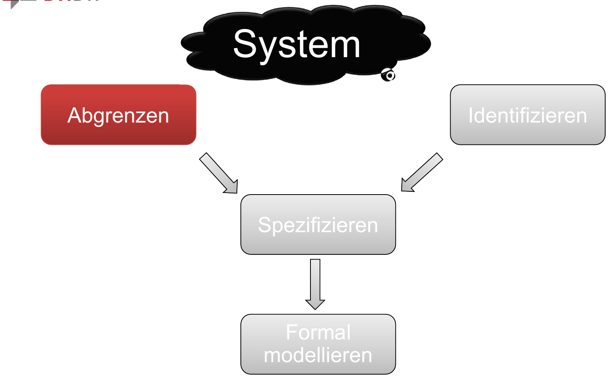
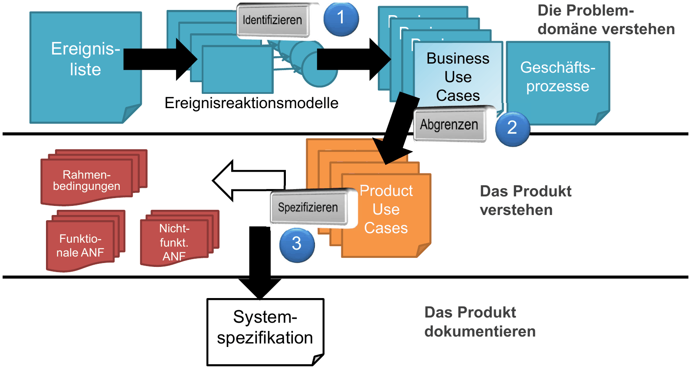

# So werden wir vorgehen - Das RE-Vorgehensmodell

Quelle: systems-engineering/origin/WDS125 - Systems Engineering (BäM)/11 LE 8_ Aktivitätsdiagramme, BPMN - Modellierung der alternativen Ablaufszenarien/Folien der Lerneinheit/10.RE-AD-BPMN.pdf, Folien 2–3
