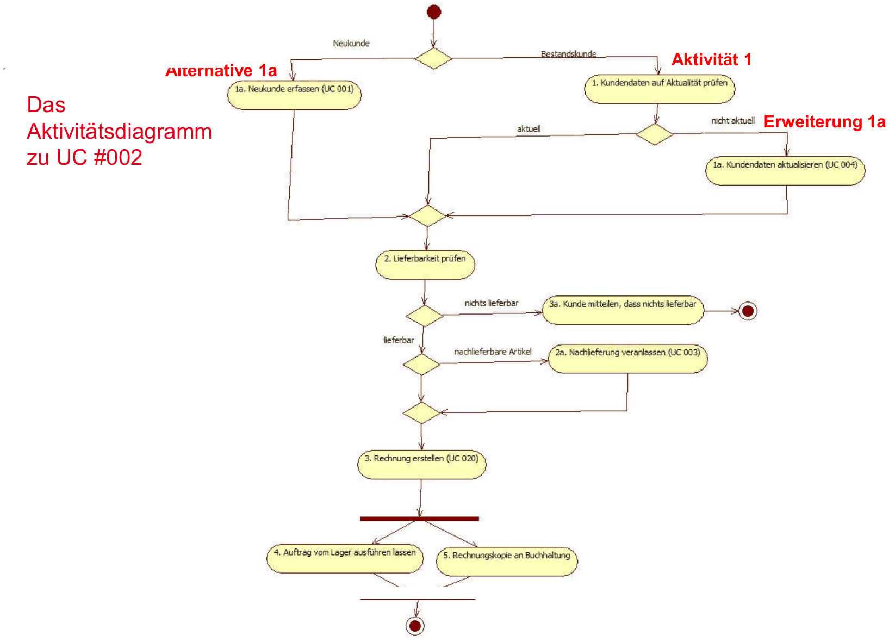
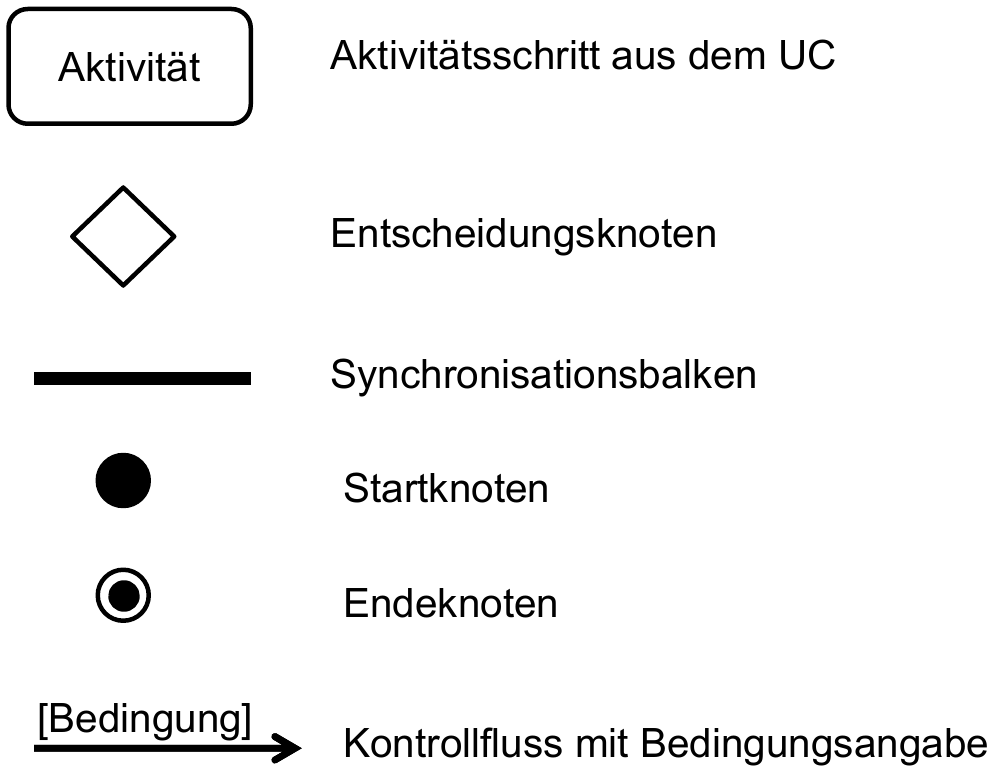
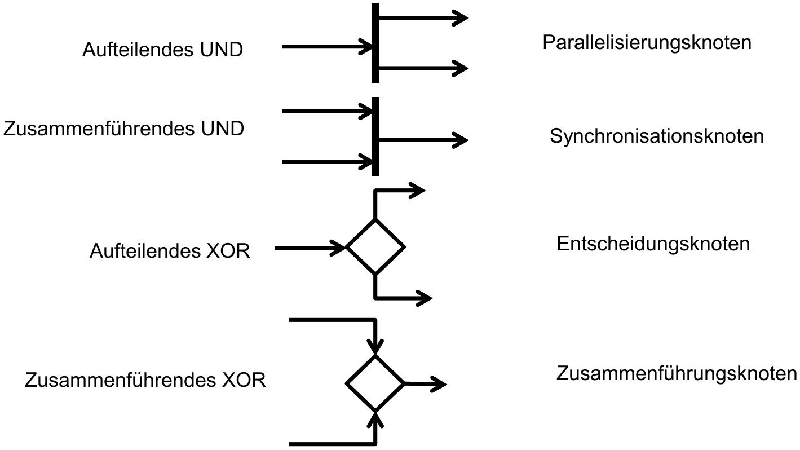
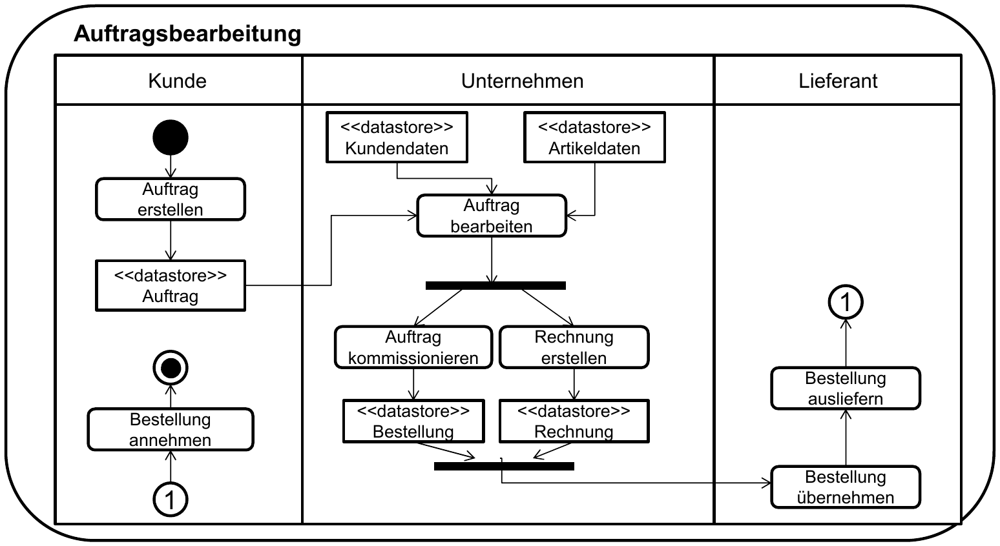

# Nachteil der Use Case-Schablone

Die Use Case-Schablone suggeriert eine Sequenz der Abarbeitung, die u.U. gar nicht gegeben ist:

Beispiel (UC #002 Kundenauftrag ausführen)

**Beschreibung**:

1. Die Kundendaten werden auf Aktualität geprüft
2. Lieferbarkeit prüfen
3. Rechnung erstellen: UC #020 Rechnung erstellen
4. Auftrag vom Lager ausführen lassen
5. Rechnungskopie an Buchhaltung geben

Aktivität 4 und 5 müssen nicht sequentiell ablaufen

Dieser Nachteil kann durch Aktivitätsdiagramme beseitigt werden.

## Alternative 1a: Das Aktivitätsdiagramm zu UC #002

## Grundlegende Notationssymbole eines AD

- Aktivität — Aktivitätsschritt aus dem UC
- Entscheidungsknoten
- Synchronisationsbalken
- Startknoten
- Endeknoten
- [Bedingung] — Kontrollfluss mit Bedingungsangabe

## Modellierung wichtiger logischer Operatoren

- Aufteilendes UND — Parallelisierungsknoten
- Zusammenführendes UND — Synchronisationsknoten
- Aufteilendes XOR — Entscheidungsknoten
- Zusammenführendes XOR — Zusammenführungsknoten

## Weiterführende Elemente

Quelle: systems-engineering/origin/WDS125 - Systems Engineering (BäM)/11 LE 8_ Aktivitätsdiagramme, BPMN - Modellierung der alternativen Ablaufszenarien/Folien der Lerneinheit/10.RE-AD-BPMN.pdf, Folien 4–8
