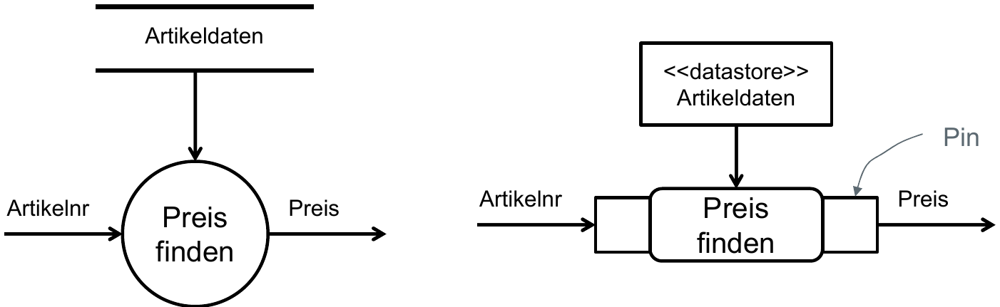

# Exkurs: Gedanklicher Zusammenhang von SA und AD

NB:
`<<datastore>>` kann man auch weglassen.
Es kennzeichnet lediglich die persistente Speicherung.

Quelle: systems-engineering/origin/WDS125 - Systems Engineering (BäM)/11 LE 8_ Aktivitätsdiagramme, BPMN - Modellierung der alternativen Ablaufszenarien/Folien der Lerneinheit/10.RE-AD-BPMN.pdf, Folie 9
