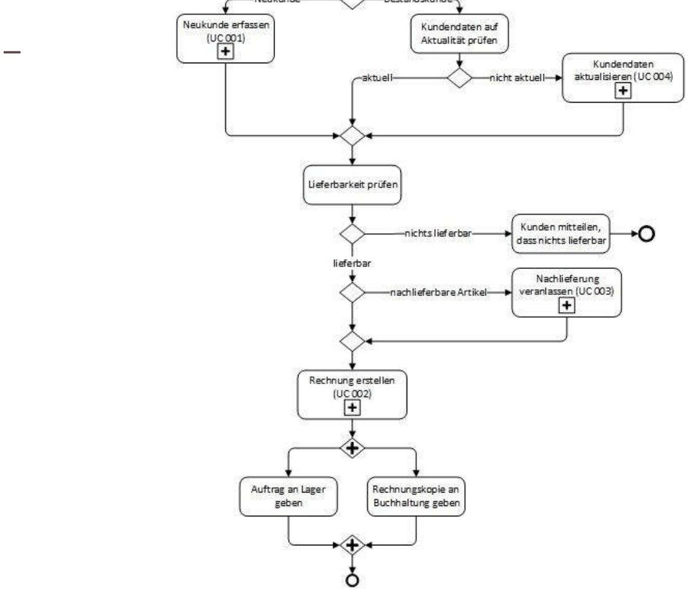
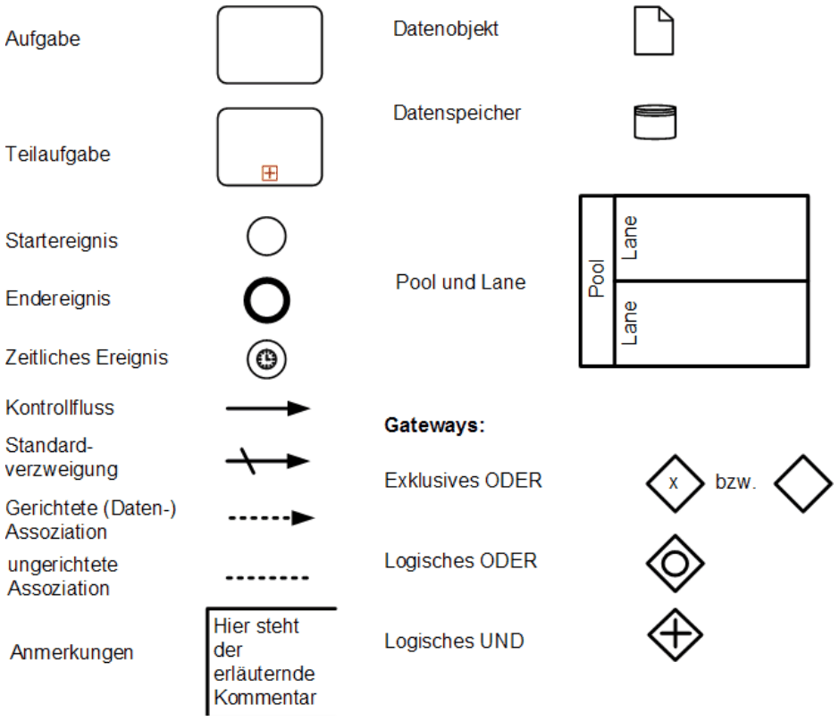

# Exkurs: BPMN 2.0 – die elegantere Lösung, aber halt nicht UML…

## BPMN 2.0 – Die wichtigsten Notationssymbole

- Aufgabe
- Teilaufgabe
- Startereignis
- Endereignis
- Zeitliches Ereignis
- Kontrollfluss
- Standardverzweigung
- Gerichtete (Daten-)Assoziation
- ungerichtete Assoziation
- Anmerkungen
- Datenobjekt
- Datenspeicher
- Pool und Lane
- Gateways:
  - Exklusives ODER
  - Logisches ODER
  - Logisches UND

Quelle: systems-engineering/origin/WDS125 - Systems Engineering (BäM)/11 LE 8_ Aktivitätsdiagramme, BPMN - Modellierung der alternativen Ablaufszenarien/Folien der Lerneinheit/10.RE-AD-BPMN.pdf, Folien 10–11
