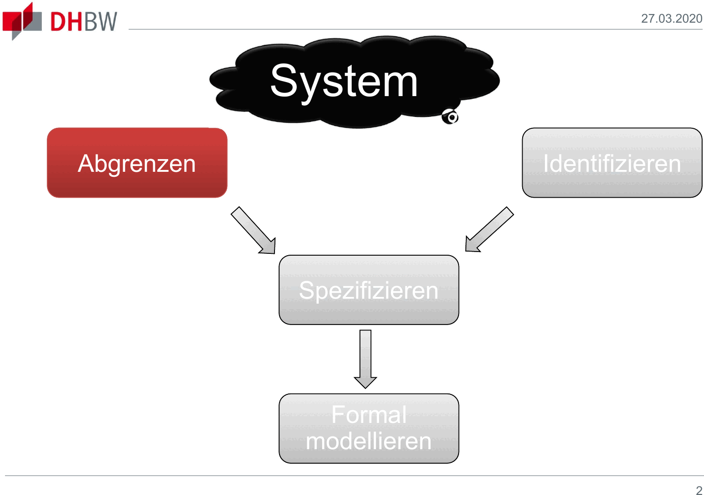
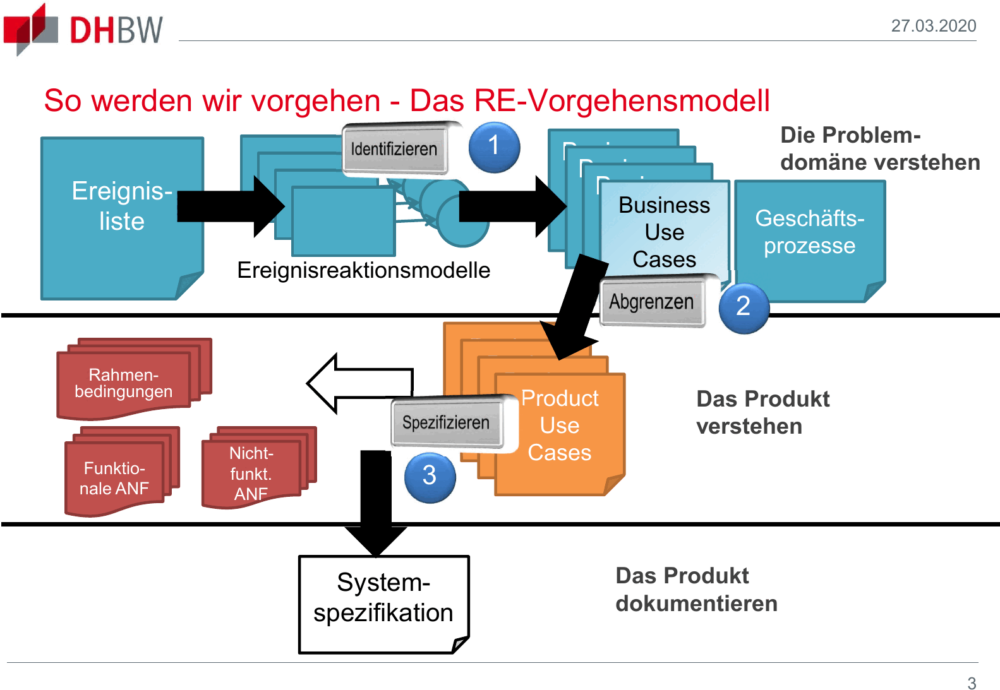
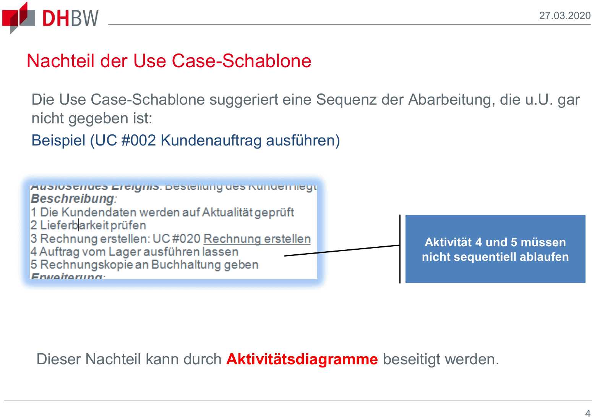
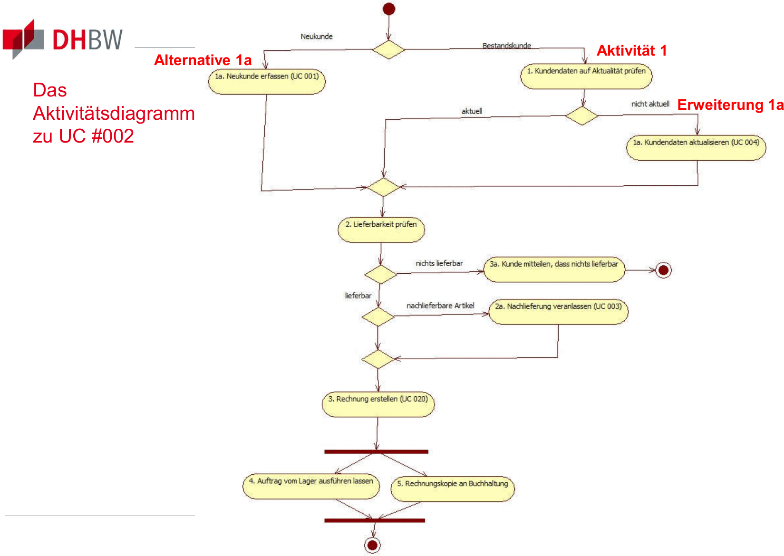
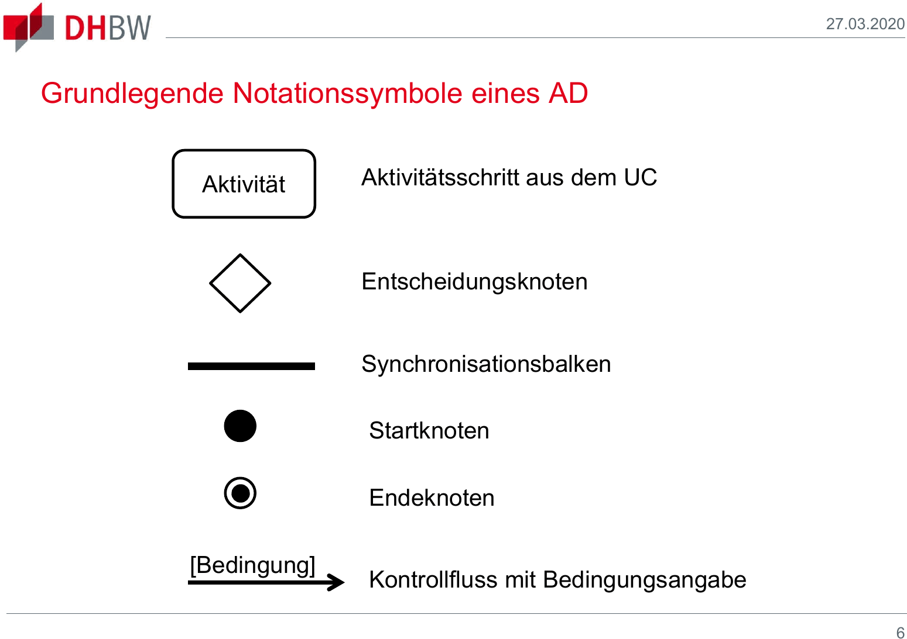
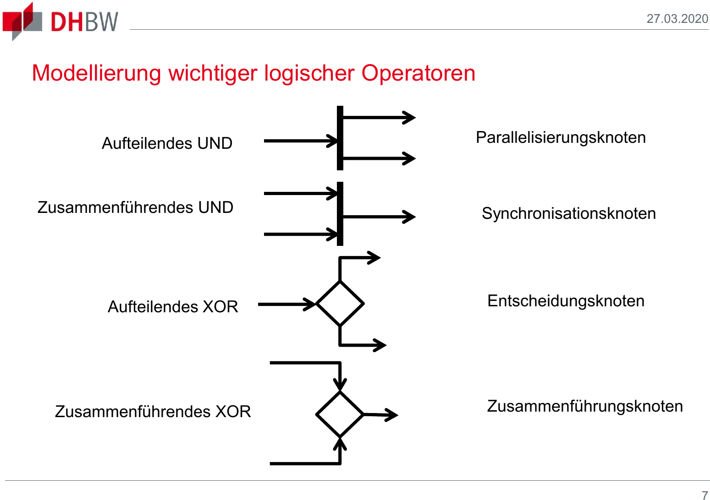
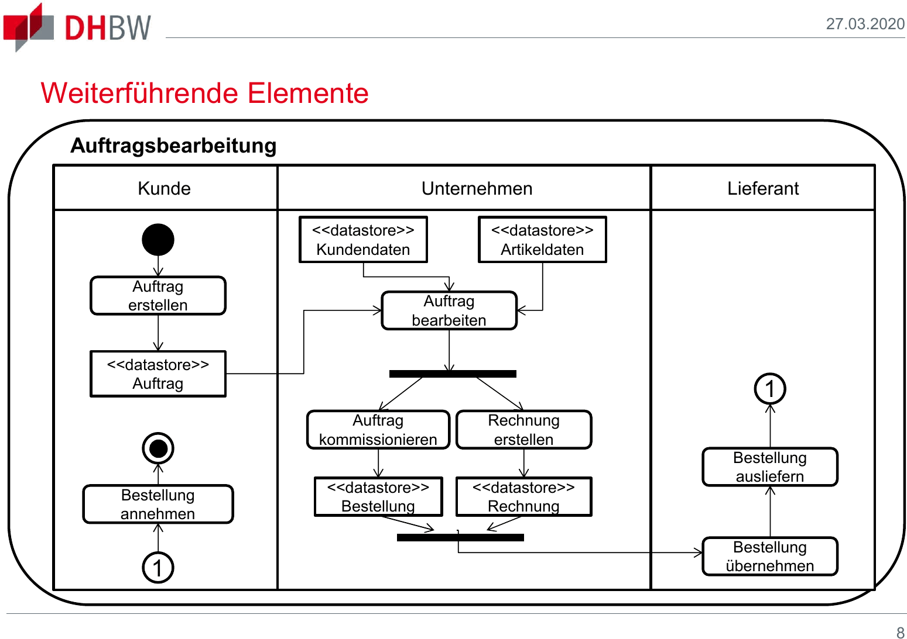
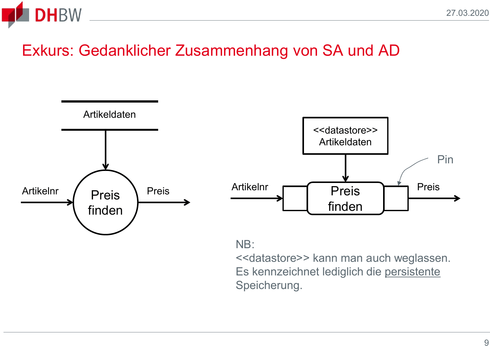
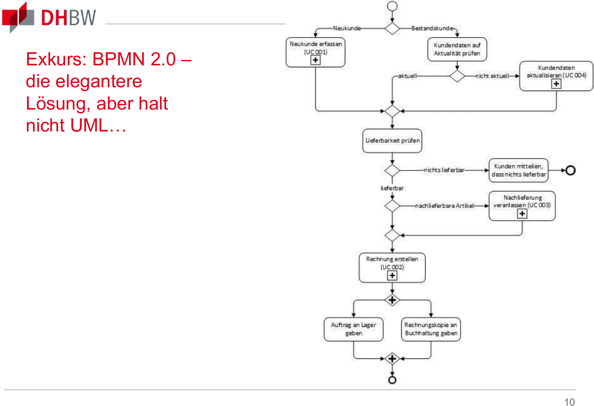
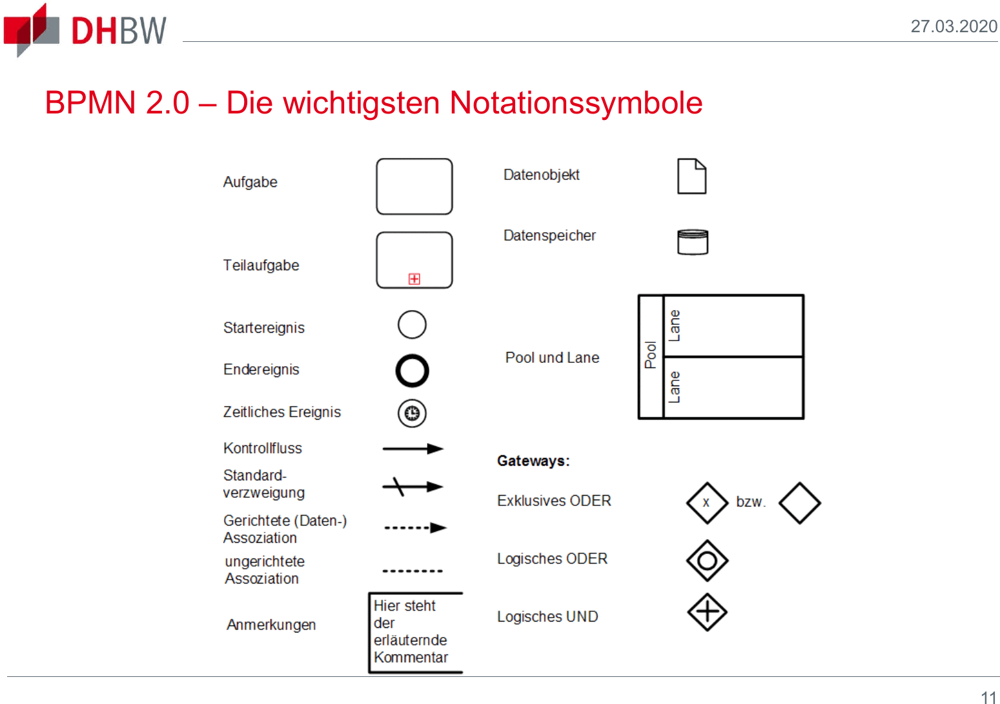

# Aktivitätsdiagramme und BPMN

## So werden wir vorgehen - Das RE-Vorgehensmodell

## Nachteil der Use Case-Schablone

Die Use Case-Schablone suggeriert eine Sequenz der Abarbeitung, die u.U. gar nicht gegeben ist:

Beispiel (UC #002 Kundenauftrag ausführen)

Aktivität 4 und 5 müssen nicht sequentiell ablaufen

Dieser Nachteil kann durch Aktivitätsdiagramme beseitigt werden.

## Das Aktivitätsdiagramm zu UC #002

## Grundlegende Notationssymbole eines AD

- Aktivität — Aktivitätsschritt aus dem UC
- Entscheidungsknoten
- Synchronisationsbalken
- Startknoten
- Endeknoten
- [Bedingung] — Kontrollfluss mit Bedingungsangabe

## Modellierung wichtiger logischer Operatoren

- Aufteilendes UND — Parallelisierungsknoten
- Zusammenführendes UND — Synchronisationsknoten
- Aufteilendes XOR — Entscheidungsknoten
- Zusammenführendes XOR — Zusammenführungsknoten

## Weiterführende Elemente

## Exkurs: Gedanklicher Zusammenhang von SA und AD

NB:
`<<datastore>>` kann man auch weglassen.
Es kennzeichnet lediglich die persistente Speicherung.

## Exkurs: BPMN 2.0 – die elegantere Lösung, aber halt nicht UML…

## BPMN 2.0 – Die wichtigsten Notationssymbole

- Aufgabe
- Teilaufgabe
- Startereignis
- Endereignis
- Zeitliches Ereignis
- Kontrollfluss
- Standardverzweigung
- Gerichtete (Daten-)Assoziation
- ungerichtete Assoziation
- Anmerkungen
- Datenobjekt
- Datenspeicher
- Pool und Lane
- Gateways:
  - Exklusives ODER
  - Logisches ODER
  - Logisches UND

Quelle: systems-engineering/origin/WDS125 - Systems Engineering (BäM)/11 LE 8_ Aktivitätsdiagramme, BPMN - Modellierung der alternativen Ablaufszenarien/Folien der Lerneinheit/10.RE-AD-BPMN.pdf, Seiten 1–11
