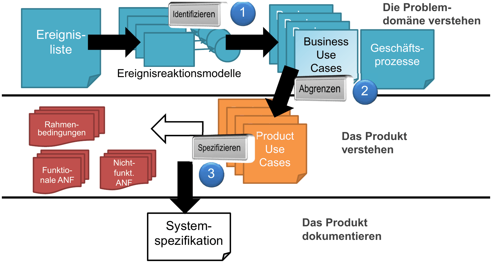
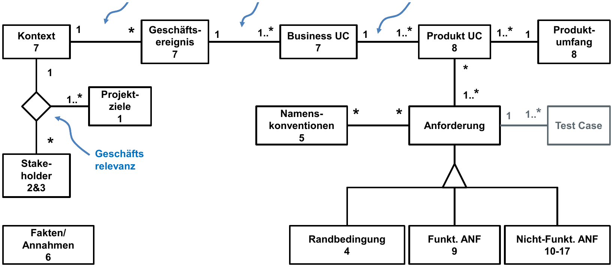

# So werden wir vorgehen - Das RE-Vorgehensmodell

## Anforderung

Jede Nummer entspricht dem zugehörigen Kapitel in der Spezifikationsvorlage Volere (Volere Template: http://www.volere.co.uk/template.htm)

## Atomare Anforderungsarten

1. Funktionale Anforderungen FANF
   - Beschreiben, welche Dienste das Produkt zur Verfügung stellt, damit das Geschäftsziel/die Aufgabe erfüllt werden kann.
   - Das System muss die Kundenstammdaten auf Plausibilität prüfen.
   - Das System muss dem Sachbearbeiter die Möglichkeit bieten, einen Auftrag für einen Kunden anzulegen.
2. Nicht-funktionale Anforderungen NFANF
   - Beschreiben, wie sich das System verhalten soll, z.B. Antwortzeitverhalten, Ergonomieanforderungen, Sicherheitsanforderungen, etc. => Qualitätsanforderungen
   - Die Plausibilitätsprüfung muss nach maximal 5 Sekunden erfolgreich abgeschlossen sein.
   - Die Bildschirmmasken für die Sachbearbeiter müssen ergonomisch EN ISO 9241 entsprechen.
3. Randbedingungen RANF
   - Beschreiben, welche wirtschaftlichen, zeitlichen, rechtlichen, technischen Restriktionen etc. zu beachten sind. Gehören zu den nicht-funktionalen Anforderungen.
   - Das System muss auf der bestehenden IT-Infrastruktur lauffähig sein.
   - Die SW-Lösung darf nicht mehr als EUR 50.0000 kosten.

Quelle: systems-engineering/origin/WDS125 - Systems Engineering (BäM)/13 LE 10_ Anforderungen formulieren - Anforderungen an gute Anforderungssätze/Folien der Lerneinheit/12.RE-Anforderungen.pdf, Folien 2–5 (die Folie mit der aufgedruckten Nummer 3 fehlt: die Seite ist in der PDF ein Null-Objekt und lässt sich nicht öffnen)
