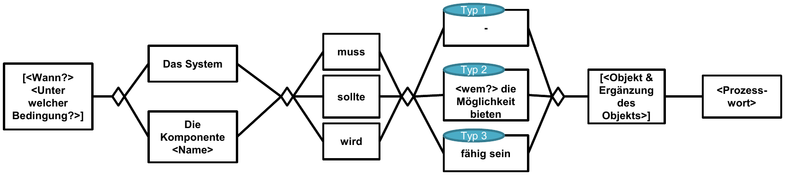

# Schablonen zur Anforderungsformulierung mittels der SOPHIST-Normsprache

- Typ 1: Selbständige Systemaktivität (ohne Benutzerinteraktion)
- Typ 2: Benutzerinteraktion: Das System stellt dem Nutzer eine Funktionalität zur Verfügung
- Typ 3: Schnittstellenanforderung: Ein eingehendes Ereignis aus einem externen System löst eine Aktion aus

Rupp, Ch. & die SOPHISTen: Requirements-Engineering und –Management, 5. A., S. 159ff

## Schlüsselwörter und ihre Rechtsverbindlichkeit

| Rechtliche Verbindlichkeit | Schlüsselwort |
| --- | --- |
| Der Ausdruck *muss* wird benutzt, um verpflichtende Anforderungen zu definieren. • Die Erfüllung der Anforderung im Produkt ist verpflichtend • Die Abnahme des Produkts kann verweigert werden, wenn einer muss-Anforderung nicht entsprochen wurde. | muss/shall |
| Der Ausdruck *sollte* wird benutzt, um wünschenswerte Anforderungen zu definieren. Wünsche • sind nicht verpflichtend • müssen nicht erfüllt werden • dienen der besseren Zusammenarbeit von Stakeholdern und Entwicklern • erhöhen die Zufriedenheit der Stakeholder. | soll/should |
| Der Ausdruck *wird* wird benutzt, um Anforderungen zu definieren, die in der Zukunft integriert werden. • Zukünftige Anforderungen sind verpflichtend • Sie helfen in der aktuellen Lösung Vorbereitungen zu treffen, um Zukünftiges später optimal zu integrieren. | wird/will |

Quelle: systems-engineering/origin/WDS125 - Systems Engineering (BäM)/13 LE 10_ Anforderungen formulieren - Anforderungen an gute Anforderungssätze/Folien der Lerneinheit/12.RE-Anforderungen.pdf, Folien 6–7
