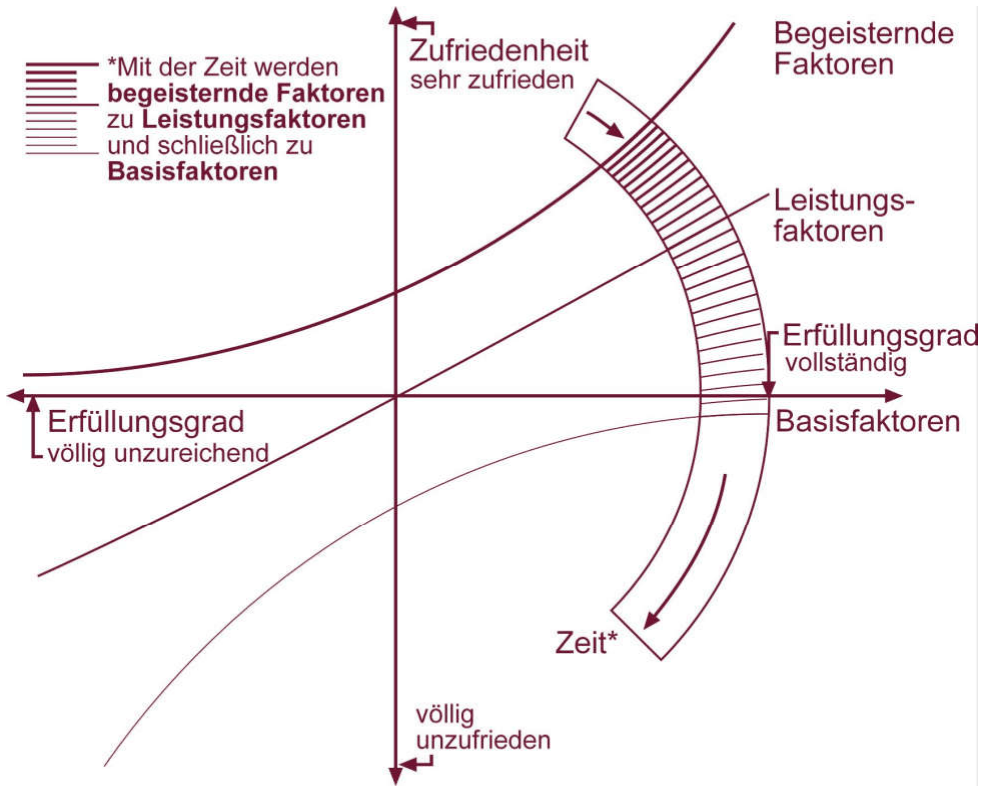
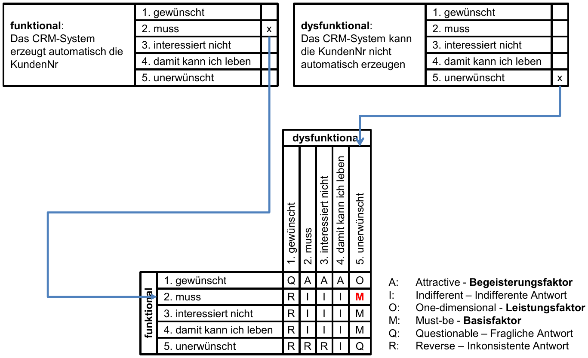

# Priorisierung von Anforderungen mit dem Kano-Modell

entnommen: Rupp, Chris& die SOPHISTen: Requirements-Engineering und – Management, 5. Aufl., S. 82.

## Basisfaktor

Eine Anforderung ist ein Basisfaktor, wenn das System diese Anforderung als Selbstverständlichkeit aufweisen muss, um den Markteintritt/Akzeptanz zu ermöglichen.

## Leistungsfaktor

Eine Anforderung ist ein Leistungsfaktor, wenn die Kunden diese Anforderung im System bewusst fordern. Eine Steigerung der Leistungsmerkmale führt i.d.R. zu einer Steigerung der Kundenzufriedenheit.

## Begeisterungsfaktor

Eine Anforderung ist ein Begeisterungsfaktor, wenn den Kunden diese Anforderung nicht bewusst war bzw. sie die Umsetzung dieser Anforderung im System nicht erwartet haben und die Kundenzufriedenheit überproportional wächst, falls das System eine solche Anforderung umsetzt.

## Kano-Modell: Ablauf

- Schritt 1: Identifikation von Systemmerkmalen, die klassifiziert werden sollen
- Schritt 2: Entwurf eines Fragebogens, in dem für jedes Systemmerkmal erfragt wird, wie der Stakeholder empfindet, wenn (1) das Merkmal im System enthalten ist (funktionale Frage) und (2) das Merkmal nicht im System enthalten ist (dysfunktionale Frage).
- Schritt 3: Auswertung der Befragungsergebnisse und Ermittlung der Durchschnittswerte
- Schritt 4: Identifizierung der zugehörigen Merkmalsklasse

## Beispiel für FANF #005

- A: Attractive - Begeisterungsfaktor
- I: Indifferent – Indifferente Antwort
- O: One-dimensional - Leistungsfaktor
- M: Must-be - Basisfaktor
- Q: Questionable – Fragliche Antwort
- R: Reverse – Inkonsistente Antwort

## Erweiterung der Snowcard-Schablone um Kano-Index

- **ANF #:** 005
- **ANF-Typ**: FANF
- **UC #**: 001

| | |
| --- | --- |
| **Definition**: | Wenn ein Neukunde nach FANF#004 erfolgreich angelegt wurde, muss das System eine Kundennummer für den Neukunden generieren (Regel: Letzte Kundennummer + 1). |
| **Grund**: | Dient der eindeutigen Identifizierung eines Kunden. |
| **Quelle**: | Auftragsabteilung |
| **Abnahme-Kriterium**: | Kundennummer wird fortlaufend vergeben: letzteKundenNr + 1 |
| **Kano-Merkmalsklasse**: | M (Basismerkmal) |
| **Priorität:** | 5 |
| **Zusatzmaterial:** | Auftragserfassungsformular |
| **Änderungshistorie**: | 2012-05-15, BäM |

Quelle: systems-engineering/origin/WDS125 - Systems Engineering (BäM)/13 LE 10_ Anforderungen formulieren - Anforderungen an gute Anforderungssätze/Folien der Lerneinheit/12.RE-Anforderungen.pdf, Folien 16–20
