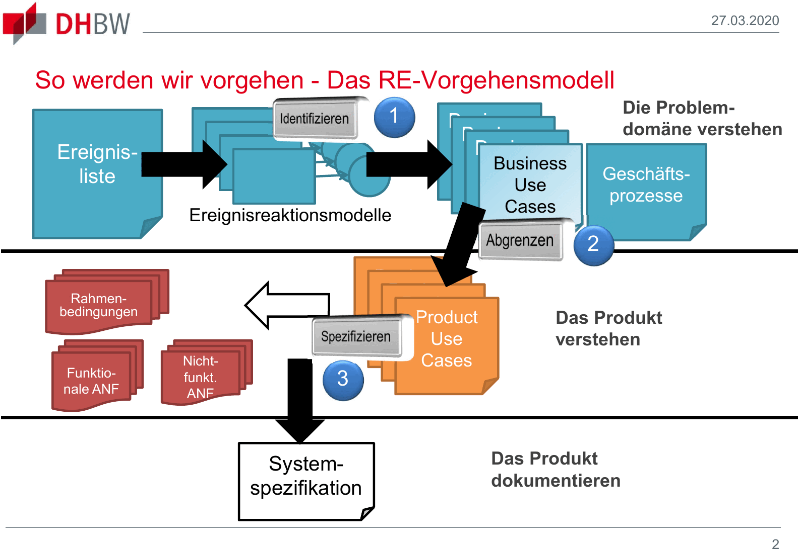
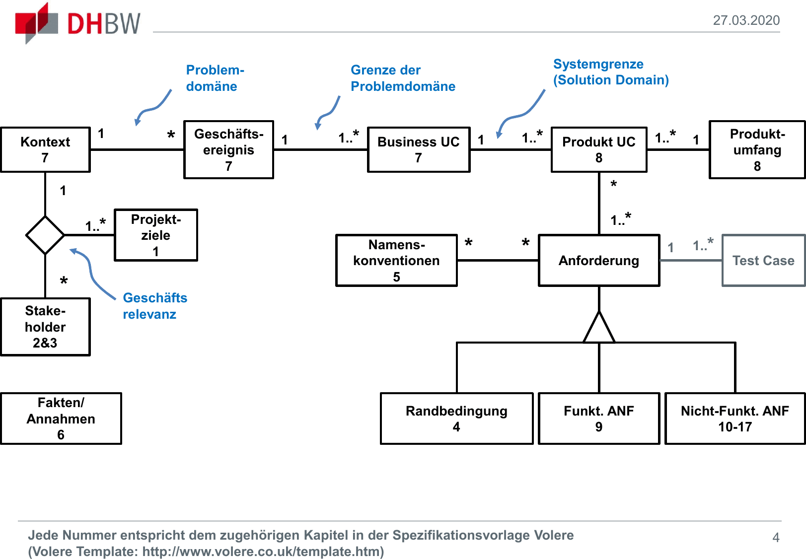
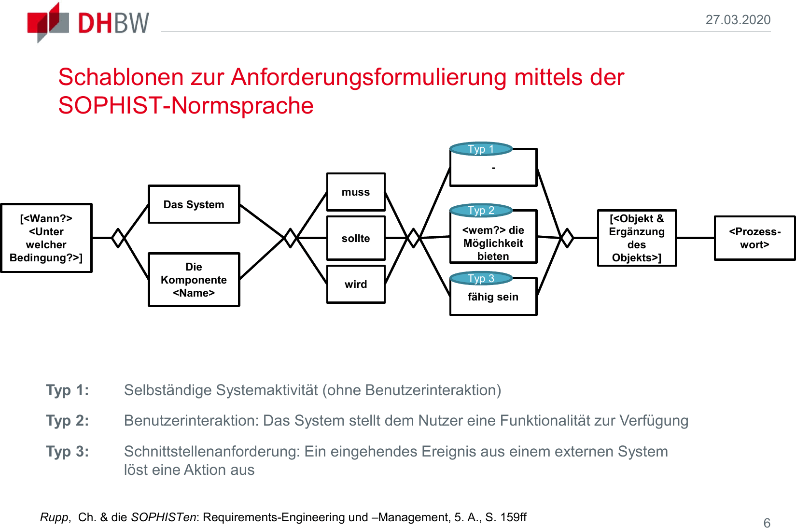
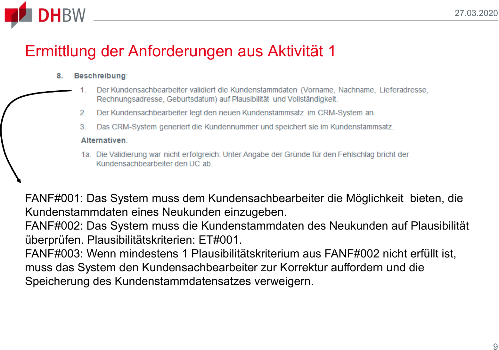
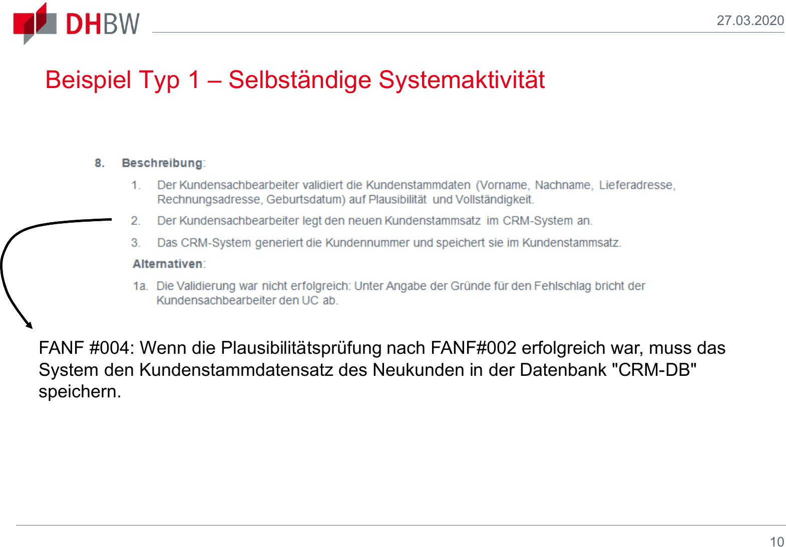
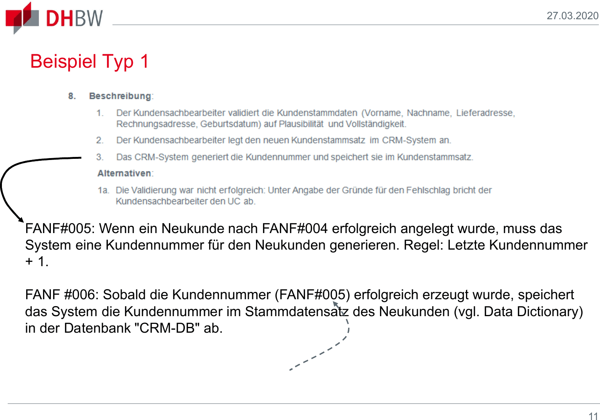
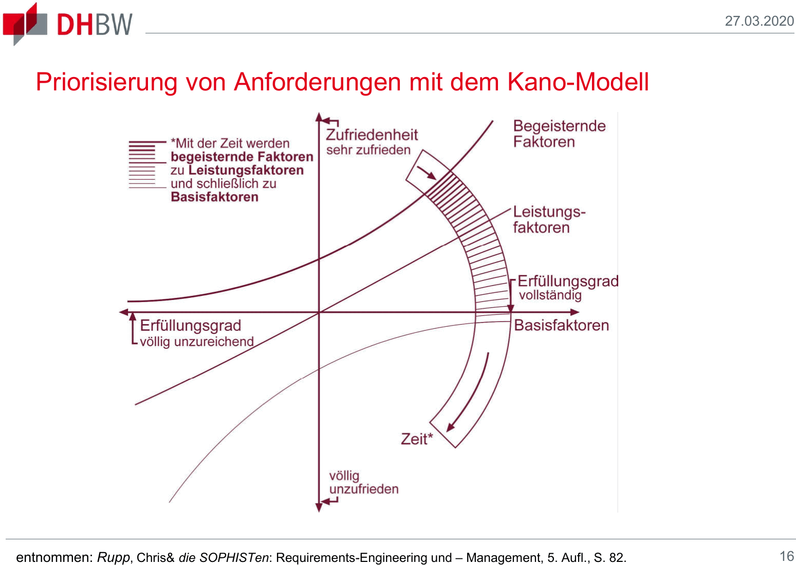
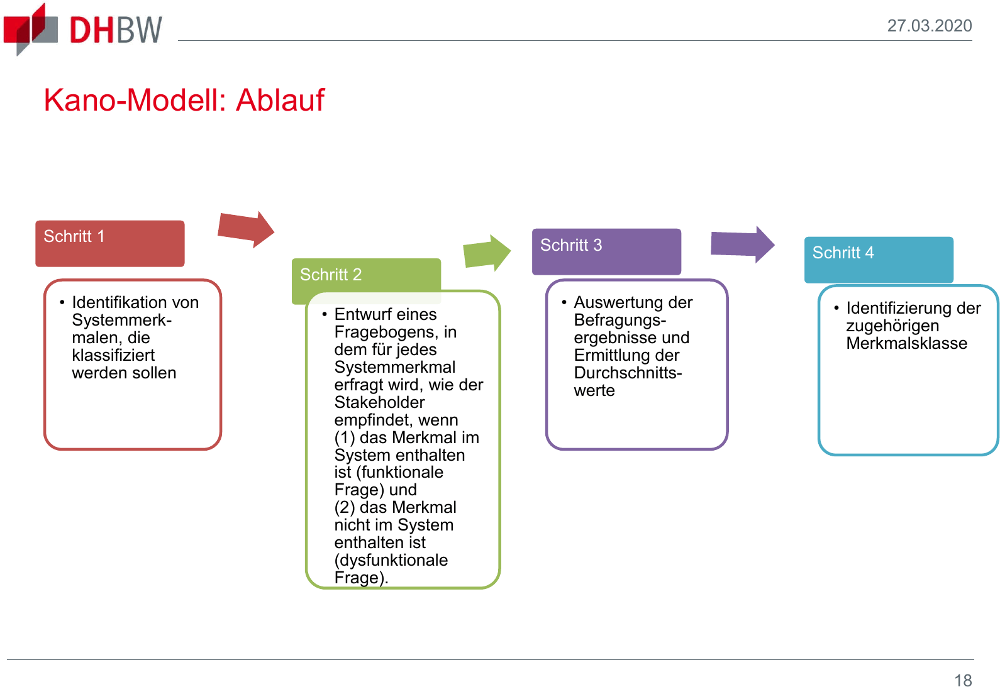
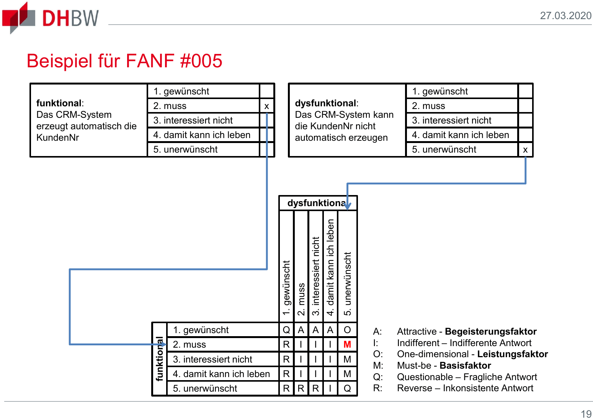

# Atomare Anforderungen

## So werden wir vorgehen - Das RE-Vorgehensmodell

Jede Nummer entspricht dem zugehörigen Kapitel in der Spezifikationsvorlage Volere (Volere Template: http://www.volere.co.uk/template.htm)

## Atomare Anforderungsarten

1. Funktionale Anforderungen FANF
   - Beschreiben, welche Dienste das Produkt zur Verfügung stellt, damit das Geschäftsziel/die Aufgabe erfüllt werden kann.
   - Das System muss die Kundenstammdaten auf Plausibilität prüfen.
   - Das System muss dem Sachbearbeiter die Möglichkeit bieten, einen Auftrag für einen Kunden anzulegen.
2. Nicht-funktionale Anforderungen NFANF
   - Beschreiben, wie sich das System verhalten soll, z.B. Antwortzeitverhalten, Ergonomieanforderungen, Sicherheitsanforderungen, etc. => Qualitätsanforderungen
   - Die Plausibilitätsprüfung muss nach maximal 5 Sekunden erfolgreich abgeschlossen sein.
   - Die Bildschirmmasken für die Sachbearbeiter müssen ergonomisch EN ISO 9241 entsprechen.
3. Randbedingungen RANF
   - Beschreiben, welche wirtschaftlichen, zeitlichen, rechtlichen, technischen Restriktionen etc. zu beachten sind. Gehören zu den nicht-funktionalen Anforderungen.
   - Das System muss auf der bestehenden IT-Infrastruktur lauffähig sein.
   - Die SW-Lösung darf nicht mehr als EUR 50.0000 kosten.

## Schablonen zur Anforderungsformulierung mittels der SOPHIST-Normsprache

- Typ 1: Selbständige Systemaktivität (ohne Benutzerinteraktion)
- Typ 2: Benutzerinteraktion: Das System stellt dem Nutzer eine Funktionalität zur Verfügung
- Typ 3: Schnittstellenanforderung: Ein eingehendes Ereignis aus einem externen System löst eine Aktion aus

Rupp, Ch. & die SOPHISTen: Requirements-Engineering und –Management, 5. A., S. 159ff

## Schlüsselwörter und ihre Rechtsverbindlichkeit

| Rechtliche Verbindlichkeit | Schlüsselwort |
| --- | --- |
| Der Ausdruck *muss* wird benutzt, um verpflichtende Anforderungen zu definieren. • Die Erfüllung der Anforderung im Produkt ist verpflichtend • Die Abnahme des Produkts kann verweigert werden, wenn einer muss-Anforderung nicht entsprochen wurde. | muss/shall |
| Der Ausdruck *sollte* wird benutzt, um wünschenswerte Anforderungen zu definieren. Wünsche • sind nicht verpflichtend • müssen nicht erfüllt werden • dienen der besseren Zusammenarbeit von Stakeholdern und Entwicklern • erhöhen die Zufriedenheit der Stakeholder. | soll/should |
| Der Ausdruck *wird* wird benutzt, um Anforderungen zu definieren, die in der Zukunft integriert werden. • Zukünftige Anforderungen sind verpflichtend • Sie helfen in der aktuellen Lösung Vorbereitungen zu treffen, um Zukünftiges später optimal zu integrieren. | wird/will |

## Beispiel: Product Use Case #001

1. **Use Case**: #001 Neukunde erfassen.
2. **Ziel**: Ein neuer Kunde wurde erfasst.
3. **Vorbedingung**: es handelt sich um eine natürliche Person (Endkunde) und die Kundenstammdaten liegen vor.
4. **Nachbedingung Erfolg**: Die für Auftragsdurchführung und Kundenkommunikation notwendigen Stammdaten des neuen Kunden wurden erfasst und gespeichert.
5. **Nachbedingung Fehlschlag**: Der Kundenstammdatensatz wurde nicht im CRM-System angelegt. Die Gründe für den Fehlschlag wurden mitgeteilt.
6. **Akteur**: Kundensachbearbeiter.
7. **Auslösendes Ereignis**: Ein Kaufauftrag wurde durch einen Neukunden erteilt.
8. **Beschreibung**:
   1. Der Kundensachbearbeiter validiert die Kundenstammdaten (Vorname, Nachname, Lieferadresse, Rechnungsadresse, Geburtsdatum) auf Plausibilität und Vollständigkeit.
   2. Der Kundensachbearbeiter legt den neuen Kundenstammsatz im CRM-System an.
   3. Das CRM-System generiert die Kundennummer und speichert sie im Kundenstammsatz.

   **Alternativen**:

   1a. Die Validierung war nicht erfolgreich: Unter Angabe der Gründe für den Fehlschlag bricht der Kundensachbearbeiter den UC ab.

## Ermittlung der Anforderungen aus Aktivität 1

FANF#001: Das System muss dem Kundensachbearbeiter die Möglichkeit bieten, die Kundenstammdaten eines Neukunden einzugeben.

FANF#002: Das System muss die Kundenstammdaten des Neukunden auf Plausibilität überprüfen. Plausibilitätskriterien: ET#001.

FANF#003: Wenn mindestens 1 Plausibilitätskriterium aus FANF#002 nicht erfüllt ist, muss das System den Kundensachbearbeiter zur Korrektur auffordern und die Speicherung des Kundenstammdatensatzes verweigern.

## Beispiel Typ 1 – Selbständige Systemaktivität

FANF #004: Wenn die Plausibilitätsprüfung nach FANF#002 erfolgreich war, muss das System den Kundenstammdatensatz des Neukunden in der Datenbank "CRM-DB" speichern.

## Beispiel Typ 1

FANF#005: Wenn ein Neukunde nach FANF#004 erfolgreich angelegt wurde, muss das System eine Kundennummer für den Neukunden generieren. Regel: Letzte Kundennummer + 1.

FANF #006: Sobald die Kundennummer (FANF#005) erfolgreich erzeugt wurde, speichert das System die Kundennummer im Stammdatensatz des Neukunden (vgl. Data Dictionary) in der Datenbank "CRM-DB" ab.

## Beispiel Typ 3 - Schnittstellenanforderung

NFANF#099: Solange das System online ist, muss es in der Lage sein, Softwareupdates von einem zentralen Administrationsrechner über das LAN zu empfangen und einzuspielen.

## Übung

Welcher Typ liegt hier jeweils vor?

1. Der Kunde will, dass das System Deutsch, Englisch und Chinesisch als Benutzersprache unterstützt.
2. Der Kunde möchte, dass das System auch beliebige Sprachen in der Zukunft unterstützen kann.
3. Das System muss nicht mandantenfähig sein, soll diese Fähigkeit aber zukünftig nicht unmöglich machen.

## Snowcard-Schablone

- **ANF #:** Eindeutige Nummer
- **ANF-Typ**: Nr. (aus Volere-Template)
- **UC #:**

| | |
| --- | --- |
| **Definition**: | Hier kommt der die ANF beschreibende Satz (Regelfall: 1 Satz!) |
| **Grund**: | Begründung für die ANF |
| **Quelle**: | Von wem stammt die ANF? |
| **Abnahme-Kriterium**: | Messgröße, mit der beim Test ermittelt werden kann, ob die ANF erfüllt ist. |
| **Kundenzufriedenheit**: | Wert auf Zufriedenheitsskala 1 (gleichgültig) bis 5 (extrem glücklich) aus Sicht der Kunden, wenn ANF erfolgreich implementiert wurde. |
| **Kundenunzufriedenheit**: | Wert auf Unzufriedenheitsskala 1 (gleichgültig) bis 5 ( extrem unzufrieden) aus Sicht des Kunden, wenn ANF nicht Teil des Endprodukt ist. |
| **Priorität:** | Ratingwert des Kundennutzens |
| **Zusatzmaterial:** | Dokumente, Formulare etc., die für das Verständnis der ANF wichtig sind/sein könnten |
| **Änderungshistorie**: | Erstellungsdatum, Ersteller Änderungsdatum, Ändernder |

## Beispiel - Snowcard-Schablone für FANF#005

- **ANF #:** 005
- **ANF-Typ**: FANF
- **UC #**: 001

| | |
| --- | --- |
| **Definition**: | Wenn ein Neukunde nach FANF#004 erfolgreich angelegt wurde, muss das System eine Kundennummer für den Neukunden generieren (Regel: Letzte Kundennummer + 1). |
| **Grund**: | Dient der eindeutigen Identifizierung eines Kunden. |
| **Quelle**: | Auftragsabteilung |
| **Abnahme-Kriterium**: | Kundennummer wird fortlaufend vergeben: letzteKundenNr + 1 |
| **Kundenzufriedenheit**: | 3 |
| **Kundenunzufriedenheit**: | 5 |
| **Priorität:** | 5 |
| **Zusatzmaterial:** | Auftragserfassungsformular |
| **Änderungshistorie**: | 2012-05-15, BäM |

Für jede atomare ANF wird die Schablone ausgefüllt!

## Priorisierung von Anforderungen mit dem Kano-Modell

entnommen: Rupp, Chris& die SOPHISTen: Requirements-Engineering und – Management, 5. Aufl., S. 82.

## Basisfaktor

Eine Anforderung ist ein Basisfaktor, wenn das System diese Anforderung als Selbstverständlichkeit aufweisen muss, um den Markteintritt/Akzeptanz zu ermöglichen.

## Leistungsfaktor

Eine Anforderung ist ein Leistungsfaktor, wenn die Kunden diese Anforderung im System bewusst fordern. Eine Steigerung der Leistungsmerkmale führt i.d.R. zu einer Steigerung der Kundenzufriedenheit.

## Begeisterungsfaktor

Eine Anforderung ist ein Begeisterungsfaktor, wenn den Kunden diese Anforderung nicht bewusst war bzw. sie die Umsetzung dieser Anforderung im System nicht erwartet haben und die Kundenzufriedenheit überproportional wächst, falls das System eine solche Anforderung umsetzt.

## Kano-Modell: Ablauf

- Schritt 1
  - Identifikation von Systemmerkmalen, die klassifiziert werden sollen
- Schritt 2
  - Entwurf eines Fragebogens, in dem für jedes Systemmerkmal erfragt wird, wie der Stakeholder empfindet, wenn (1) das Merkmal im System enthalten ist (funktionale Frage) und (2) das Merkmal nicht im System enthalten ist (dysfunktionale Frage).
- Schritt 3
  - Auswertung der Befragungsergebnisse und Ermittlung der Durchschnittswerte
- Schritt 4
  - Identifizierung der zugehörigen Merkmalsklasse

## Beispiel für FANF #005

- A: Attractive - Begeisterungsfaktor
- I: Indifferent – Indifferente Antwort
- O: One-dimensional - Leistungsfaktor
- M: Must-be - Basisfaktor
- Q: Questionable – Fragliche Antwort
- R: Reverse – Inkonsistente Antwort

## Erweiterung der Snowcard-Schablone um Kano-Index

- **ANF #:** 005
- **ANF-Typ**: FANF
- **UC #**: 001

| | |
| --- | --- |
| **Definition**: | Wenn ein Neukunde nach FANF#004 erfolgreich angelegt wurde, muss das System eine Kundennummer für den Neukunden generieren (Regel: Letzte Kundennummer + 1). |
| **Grund**: | Dient der eindeutigen Identifizierung eines Kunden. |
| **Quelle**: | Auftragsabteilung |
| **Abnahme-Kriterium**: | Kundennummer wird fortlaufend vergeben: letzteKundenNr + 1 |
| **Kano-Merkmalsklasse**: | M (Basismerkmal) |
| **Priorität:** | 5 |
| **Zusatzmaterial:** | Auftragserfassungsformular |
| **Änderungshistorie**: | 2012-05-15, BäM |

Quelle: systems-engineering/origin/WDS125 - Systems Engineering (BäM)/13 LE 10_ Anforderungen formulieren - Anforderungen an gute Anforderungssätze/Folien der Lerneinheit/12.RE-Anforderungen.pdf, Seiten 1–20 (die Datei enthält nur 19 lesbare Seiten; die Seite mit der Foliennummer 3 ist in der PDF ein Null-Objekt und lässt sich nicht öffnen)
