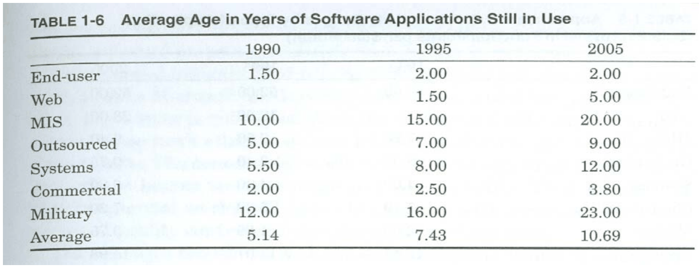
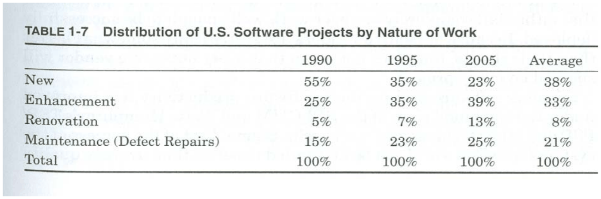
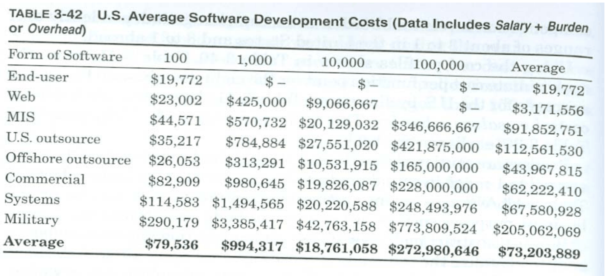
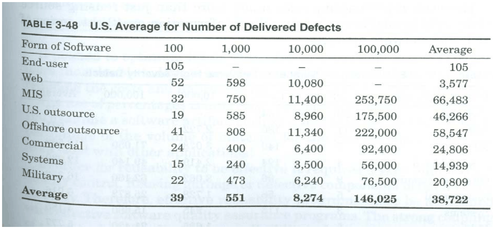
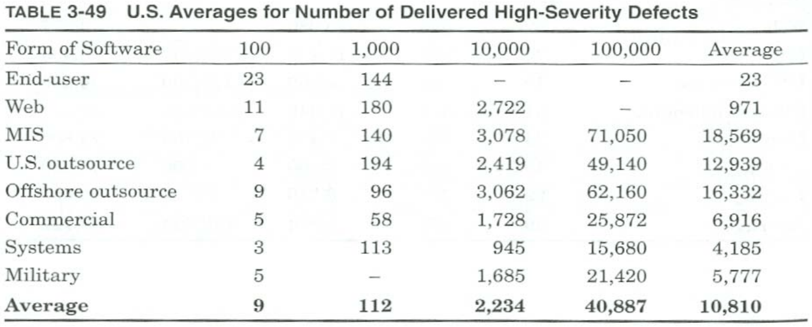
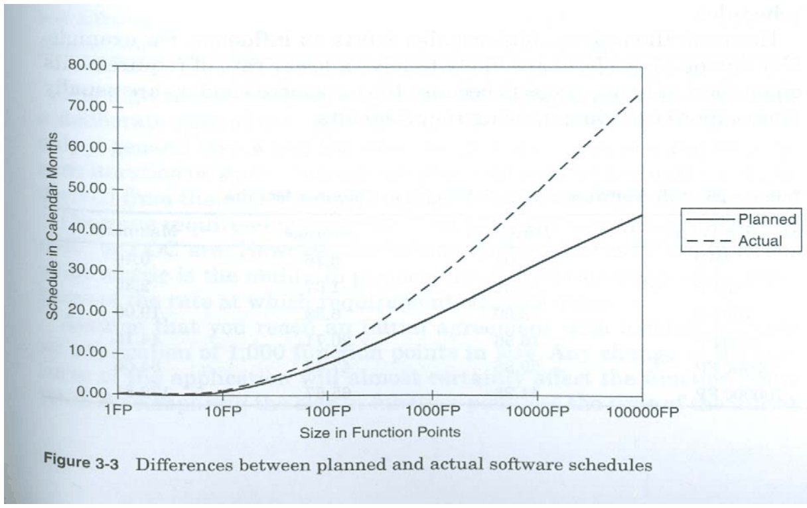
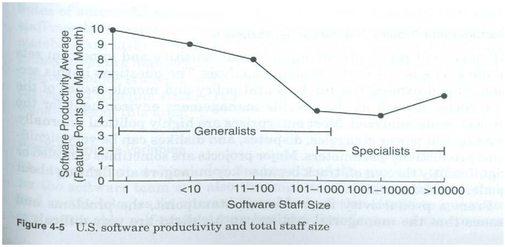
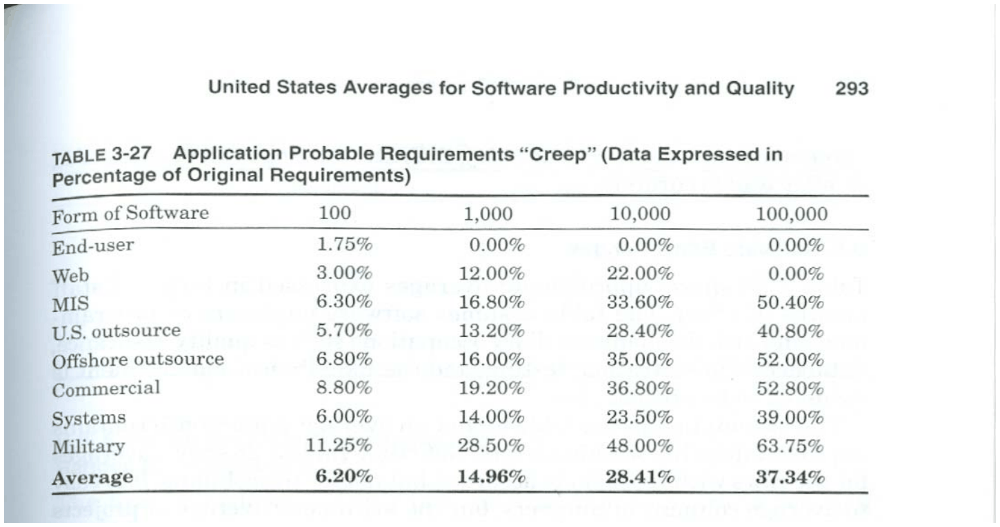

# Empirische Studie

Jones, Capers: Applied Software Measurement. Global Analysis of Productivity and Quality. 3rd ed., New York et al.:McGraw-Hill 2008.

- Studie über 8.300 Projekte (1991-2008)
- Ziel: Quantitative Messung von Softwaremerkmalen („software metrics“)

## Durchschnittsalter der Software

Durchschnittliche Lebensdauer einer Programmiersprache: 15 J.

## Verteilung der Projektarten (Neuentwicklung, etc.)

## Entwicklungskosten

Java/C++: 1 FP ≈ 53 LOC
C: 1 FP ≈ 128 LOC
VB: 1 FP ≈ 32 LOC

## Anzahl ausgelieferter Fehler

## Anzahl ausgelieferter schwerer Fehler

## Planungstreue

## Produktivität von Generalisten und Spezialisten

## Anteil nachgebesserter Anforderungen

Quelle: systems-engineering/origin/WDS125 - Systems Engineering (BäM)/04 LE 1_ Black Swans - Warum Softwareprojekte scheitern/Folien der Lerneinheit/01.RE-BlackSwansOhneLoesung.pdf, Folien 5–13
