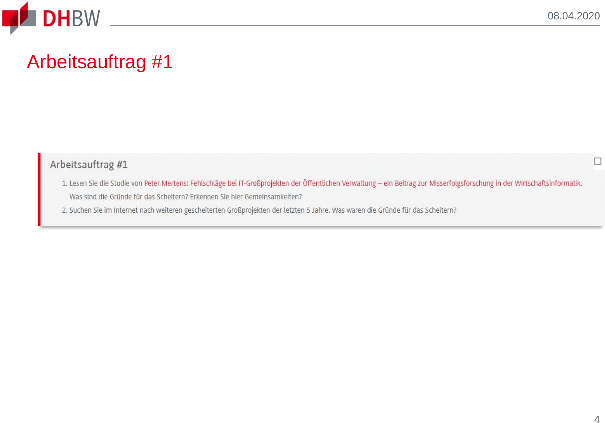
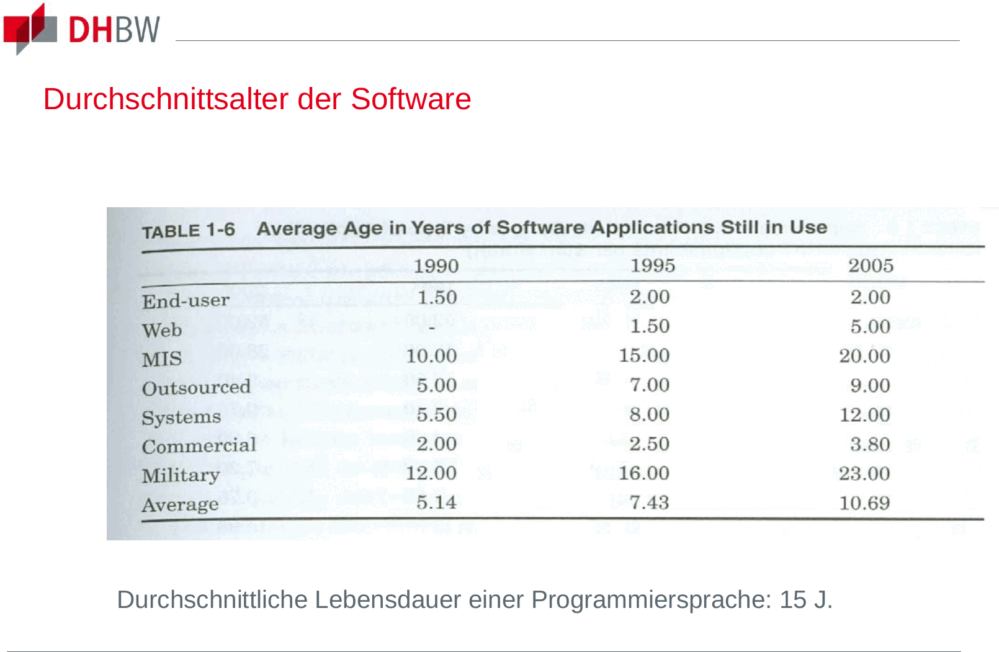
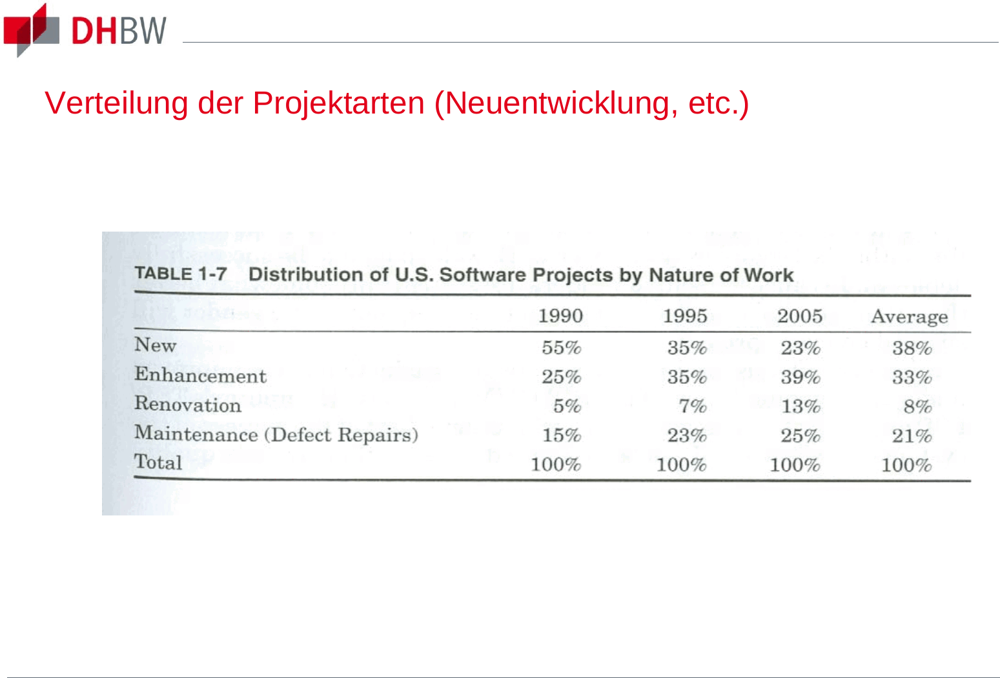
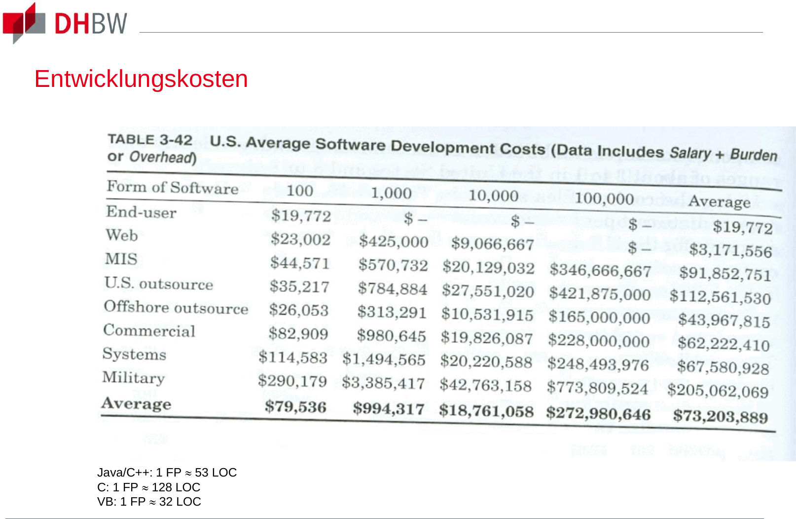
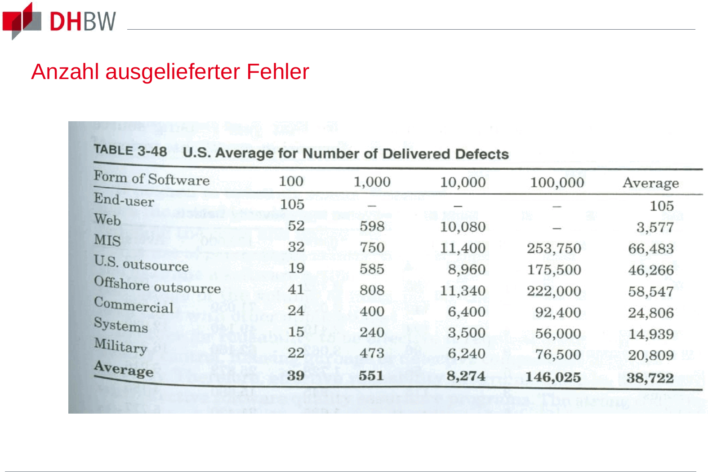
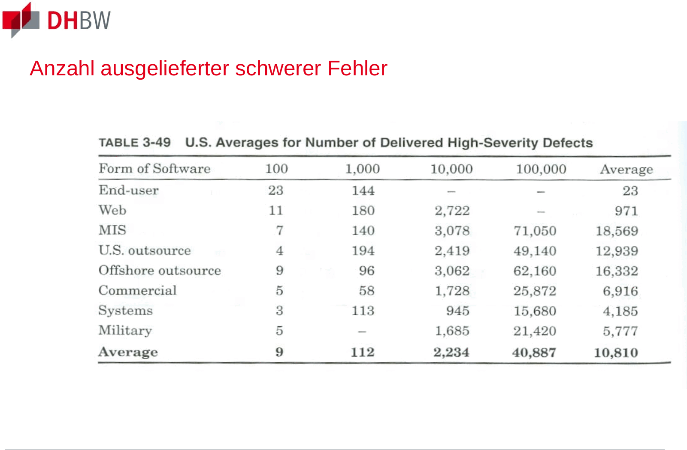
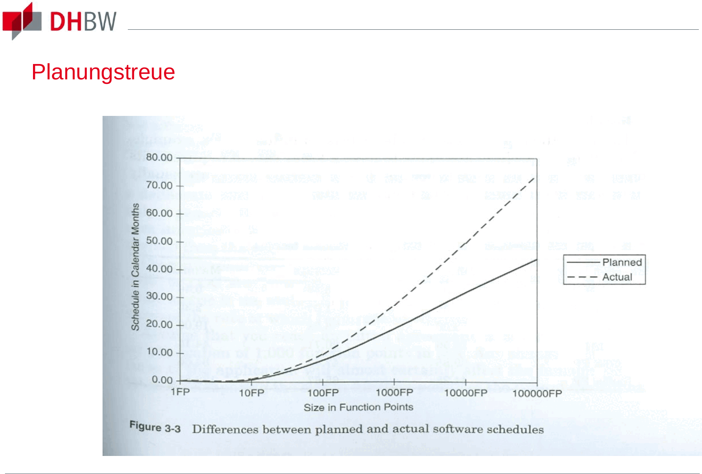
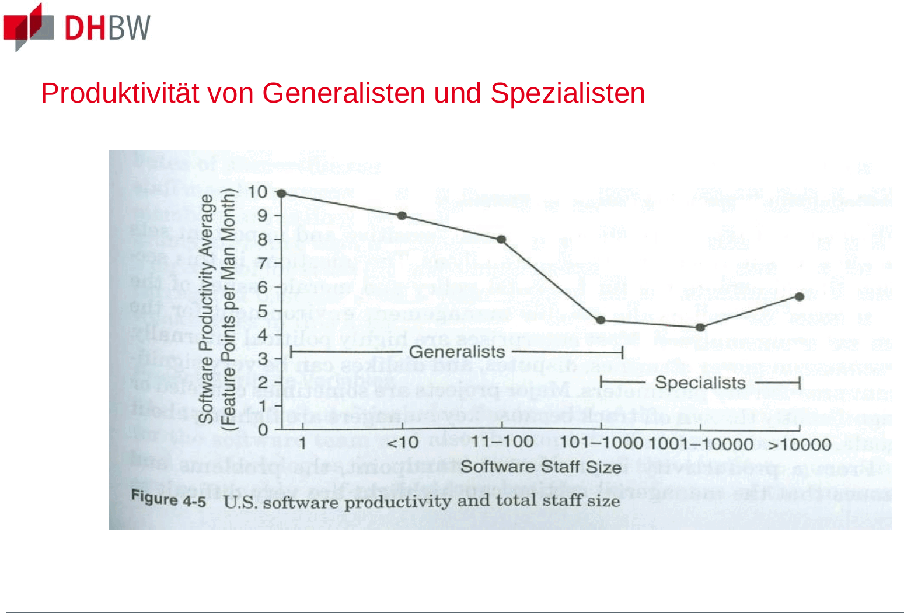
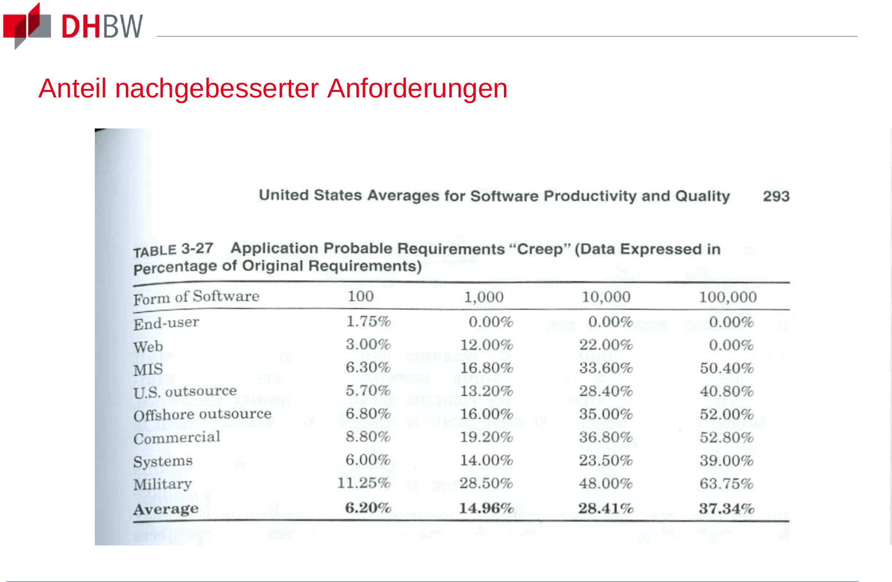

# Black Swans und IT-Projekte

## Der Begriff der "Black Swan-Projekte"

Höchst unwahrscheinliches Ereignis, welches im Wesentlichen drei Charakteristika aufweist:

- Unvorhersehbarkeit
- Massive Auswirkungen
- Seltenes Auftreten

Taleb NN (2008) Der Schwarze Schwan: Die Macht höchst unwahrscheinlicher Ereignisse, 2. Aufl., Carl Hanser:München

## 2003: Ein Beispiel – Levi Strauss Co.

In 2003 the Levi Strauss Company celebrated its 150 birthday. Apart from the company’s birthday the management was facing two highly critical issues.

First, international expansion to over 110 countries had lead to a highly fragmented and overlapping IT architecture. The company operated a Baan system in Europe and ran a mix of bespoke mainframe solutions for Asia, Canada, and the US. Secondly, the 2002 Sarbanes-Oxley Act put pressure on auditors and financial processes. A new auditor revealed flaws in accounting procedures, which almost forced Levi Strauss to restate their accounts.

Presented with a burning platform the top-management decided to revamp the complete architecture. The project aimed to implement SAP with the help of Deloitte consulting. Analysts estimated the project cost to be USD 5 million without consulting fees. Project complexity increased quickly: while the project was being first implemented in Asia, Levi-Strauss’ key client Walmart required that the existing – and soon to be replaced - systems interface with their supply chain management system. In 2008 the system was finally rolled out to the U.S. market. Project management anticipated risks during switch-over. The company pre-shipped as many Q2 orders in Q1 as possible. However, when the actual go-live happened the three US distribution centres went offline for a full week. As a result Levi Strauss reported a USD 192.5 million hit to the bottom line for Q2. David Bergen, who had been Levi’s CIO for 8 years, resigned from his post. SAP still remains the key vendor to Levi Strauss.

Flyvbjerg B, Budzier A (2011) Double whammy – how ICT projects are fooled by randomness and screwed by political intent. http://users.ox.ac.uk/~mast2876/WP_2011_08_15.pdf, S. 4ff, Abruf am 2012-05-08

## Arbeitsauftrag #1

1. Lesen Sie die Studie von Peter Mertens: Fehlschläge bei IT-Großprojekten der Öffentlichen Verwaltung – ein Beitrag zur Misserfolgsforschung in der Wirtschaftsinformatik.
   Was sind die Gründe für das Scheitern? Erkennen Sie hier Gemeinsamkeiten?
2. Suchen Sie im Internet nach weiteren gescheiterten Großprojekten der letzten 5 Jahre. Was waren die Gründe für das Scheitern?

Begleitender Text: `01_Mertens.Fehlschlaege.pdf`

## Empirische Studie

Jones, Capers: Applied Software Measurement. Global Analysis of Productivity and Quality. 3rd ed., New York et al.:McGraw-Hill 2008.

- Studie über 8.300 Projekte (1991-2008)
- Ziel: Quantitative Messung von Softwaremerkmalen („software metrics“)

## Durchschnittsalter der Software

Durchschnittliche Lebensdauer einer Programmiersprache: 15 J.

## Verteilung der Projektarten (Neuentwicklung, etc.)

## Entwicklungskosten

Java/C++: 1 FP ≈ 53 LOC
C: 1 FP ≈ 128 LOC
VB: 1 FP ≈ 32 LOC

## Anzahl ausgelieferter Fehler

## Anzahl ausgelieferter schwerer Fehler

## Planungstreue

## Produktivität von Generalisten und Spezialisten

## Anteil nachgebesserter Anforderungen

## Webrecherche: CHAOS-Studie

Die CHAOS-Studie (eigentlich CHAOS report) der Standish Group (in der ersten Version von 1994, später immer wieder aktualisiert) beschäftigt sich mit den Erfolgs- und Misserfolgsfaktoren in IT-Projekten. Sie gehört zu den bekanntesten und wichtigsten Langzeitstudien im Bereich Projektmanagement, seit 1994 wurden über 40.000 Einzelprojekte wissenschaftlich untersucht.

Lesen Sie den Wikipediaeintrag zur Chaos-Studie.

1. Wie hoch ist der Anteil der Projekte, die zu mindestens teilweise nicht erfolgreich waren?
2. Was sind die Hauptgründe dafür?
3. Was ist die Kritik an der CHAOS-Studie?

Quelle: systems-engineering/origin/WDS125 - Systems Engineering (BäM)/04 LE 1_ Black Swans - Warum Softwareprojekte scheitern/Folien der Lerneinheit/01.RE-BlackSwansOhneLoesung.pdf, Seiten 1–14
