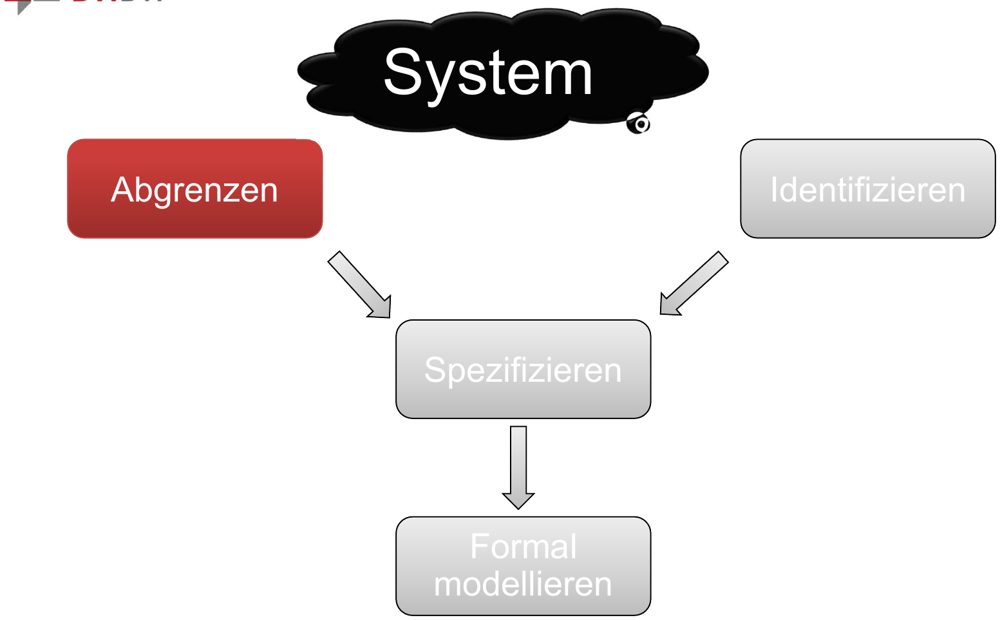
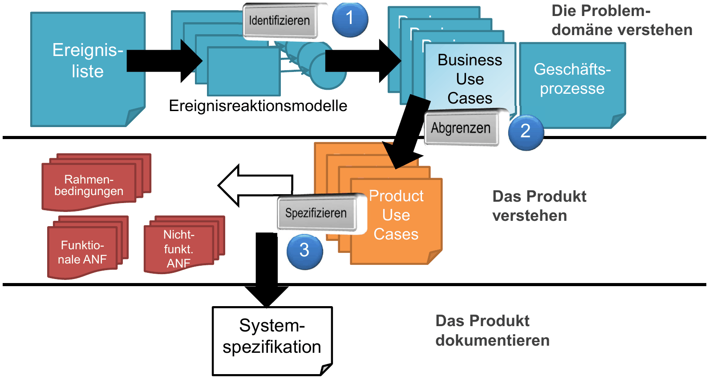

# So werden wir vorgehen - Das RE-Vorgehensmodell

Quelle: systems-engineering/origin/WDS125 - Systems Engineering (BäM)/12 LE 9_ Entscheidungstabellen - Modellierung von stark regelbehafteten Anforderungen/Folien der Lerneinheit/11.RE-ET.pdf, Folien 2–3
