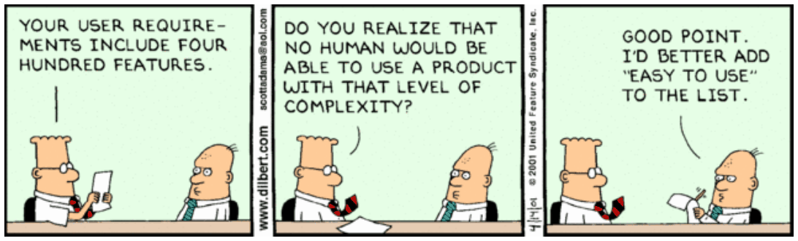
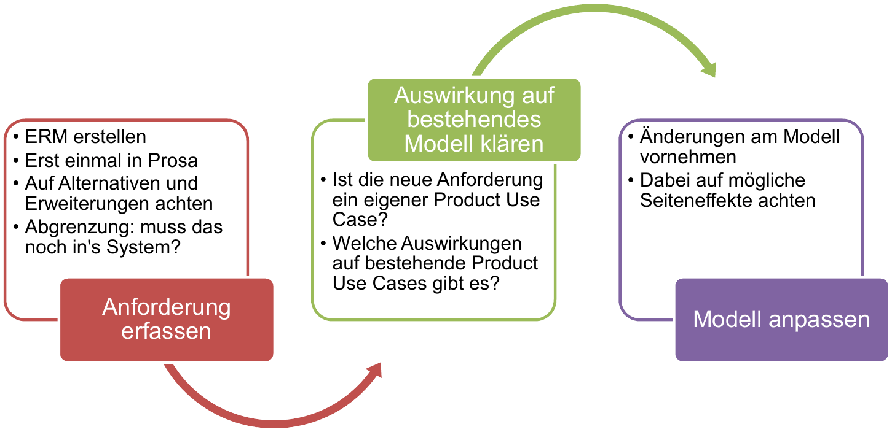

# Featurewünsche des Kunden sind nicht immer einfach zu identifizieren…

## Eine keinesfalls untypische Situation…

Freitag-Nachmittag. Sie freuen sich auf das Wochenende…
Im letzten Meeting der Woche mit dem Kunden Ihres CRM-Systems führen Sie ein Review zu UC #020 (Rechnung erstellen) durch, dabei erfahren Sie, dass vor der Rechnungsstellung die Bonität des Kunden positiv geprüft sein muss.

Was tun?

## Ablauf

Anforderung erfassen

- ERM erstellen
- Erst einmal in Prosa
- Auf Alternativen und Erweiterungen achten
- Abgrenzung: muss das noch in's System?

Auswirkung auf bestehendes Modell klären

- Ist die neue Anforderung ein eigener Product Use Case?
- Welche Auswirkungen auf bestehende Product Use Cases gibt es?

Modell anpassen

- Änderungen am Modell vornehmen
- Dabei auf mögliche Seiteneffekte achten

## Bonitätsprüfung: Der CRM-Kunde im O-Ton

"Wenn ein neuer Kundenauftrag ausgeführt wird, dann schreiben wir eine Rechnung – schon richtig in Ihrem UC #020.

Aber wenn so ein Auftrag reinkommt, dann müssen wir erst einmal klären, ob das einer von unseren schrägen Vögeln ist, die immer bestellen, aber dann eine schlechte Zahlungsmoral haben.

DHBW-Studenten – zum Beispiel – sind echt ein Problem für uns. Deshalb prüfen wir das gleich zu Beginn des Auftragsprozesses. Wenn das nämlich ein schräger Vogel ist, verweigern wir die Ausführung des Auftrags."

Welche Fragen stellen Sie jetzt als RE-Ingenieur/in? Schreiben Sie hier Ihre Fragen an unseren CRM-Kunden auf

## Die Bonitätsprüfung im O-Ton

"Wir prüfen da mehrere Sachen. Also zunächst einmal, ob der Kunde überhaupt noch bei uns kaufen darf. Denn ansonsten hat sich das gleich erledigt. Ansonsten prüfen wir, ob er noch offene Rechnungen hat und wenn ja, wie hoch die sind, denn das ist bei uns ganz entscheidend. Da hängt dann letztlich der ganze weitere Ablauf davon ab. Wenn die über 750, nein, falsch, das wurde ja mittlerweile auf 1000 EUR geändert, also, wenn die über den Betrag sind, dann geht nur Bankeinzug. Nachnahme lassen wir übrigens nur bei Kunden mit einwandfreiem Zahlungsverhalten zu, also wenn in der Kundenhistorie nicht mehr als zwei 2. Mahnungen stehen, denn wissen Sie, wir haben da schon erlebt, dass…"

Alles kapiert?

Quelle: systems-engineering/origin/WDS125 - Systems Engineering (BäM)/12 LE 9_ Entscheidungstabellen - Modellierung von stark regelbehafteten Anforderungen/Folien der Lerneinheit/11.RE-ET.pdf, Folien 4–9
