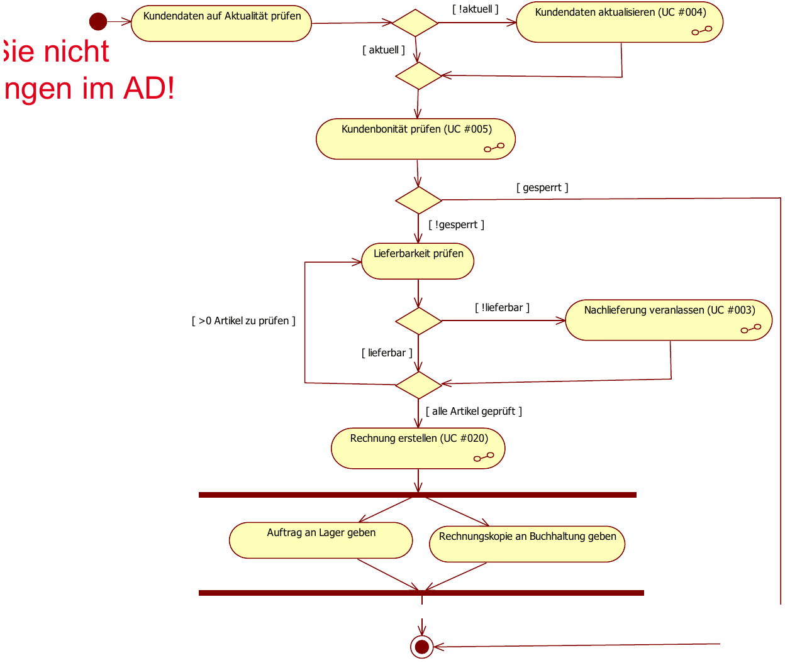

# Use Case: #002 Kundenauftrag ausführen

**Ziel:** Ware an Kunden geliefert

**Vorbedingung:** -

**Nachbedingung Erfolg:** Ware ausgeliefert (auch Teillieferungen), Rechnungskopie bei Buchhaltung

**Nachbedingung Fehlschlag:** Mitteilung an Kunden, dass nichts lieferbar ist

**Akteure:** Kundensachbearbeiter, Lagersachbearbeiter, Buchhaltung

**Auslösendes Ereignis:** Bestellung des Kunden liegt vor

**Beschreibung:**

1. Die Kundendaten werden auf Aktualität geprüft
2. Den Kunden anhand ET #001 auf Bonität prüfen
3. Lieferbarkeit prüfen
4. Rechnung erstellen: UC #020 Rechnung erstellen
5. Auftrag vom Lager ausführen lassen
6. Rechnungskopie an Buchhaltung geben

**Erweiterung:**

- 1a Wenn die gespeicherten Kundendaten nicht aktuell sind: UC #004 Kundendaten aktualisieren
- 5a Für nicht-lieferbare Artikel: UC #003 Nachlieferung veranlassen

**Alternativen:**

- 1a Wenn der Besteller noch nicht Kunde ist: UC #001 Neukunde erfassen
- 2a Wenn der Kunde gesperrt ist: Auftragsannahme verweigern (UC beenden)
- 4a Rechnung mit Nachnahme erstellen (UC #020 Rechnung erstellen)
- 4b Rechnung mit Bankeinzug erstellen (UC #020 Rechnung erstellen)

## Vergessen Sie nicht die Anpassungen im AD!

Quelle: systems-engineering/origin/WDS125 - Systems Engineering (BäM)/12 LE 9_ Entscheidungstabellen - Modellierung von stark regelbehafteten Anforderungen/Folien der Lerneinheit/11.RE-ET.pdf, Folien 13–14
