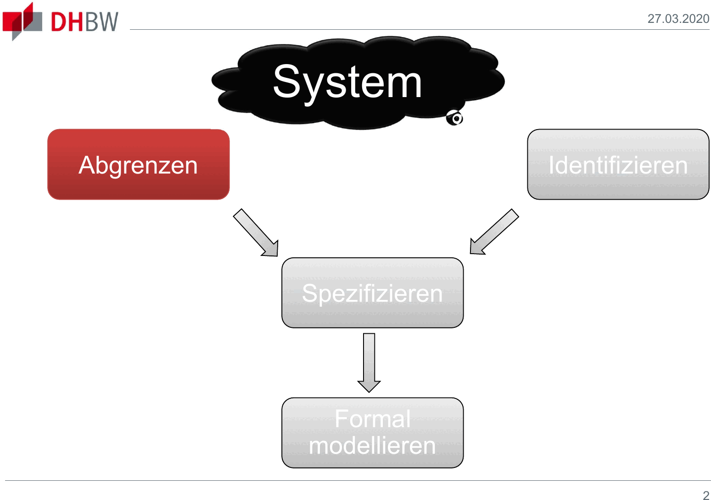
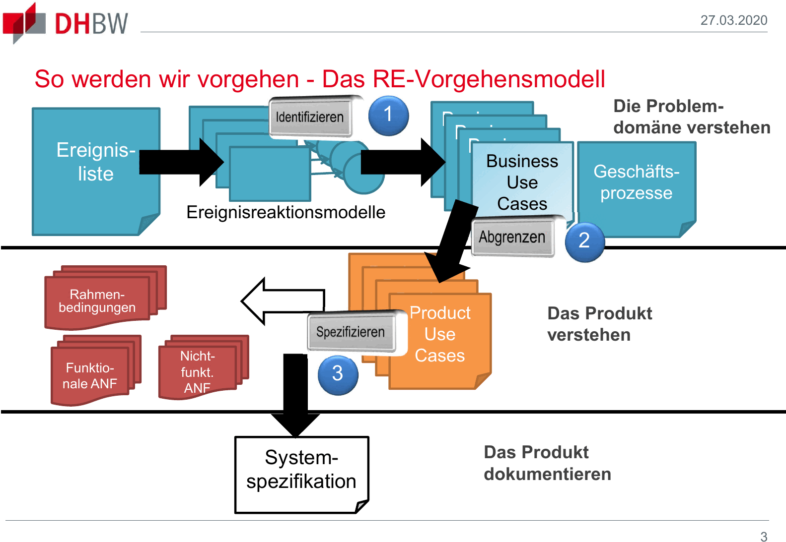
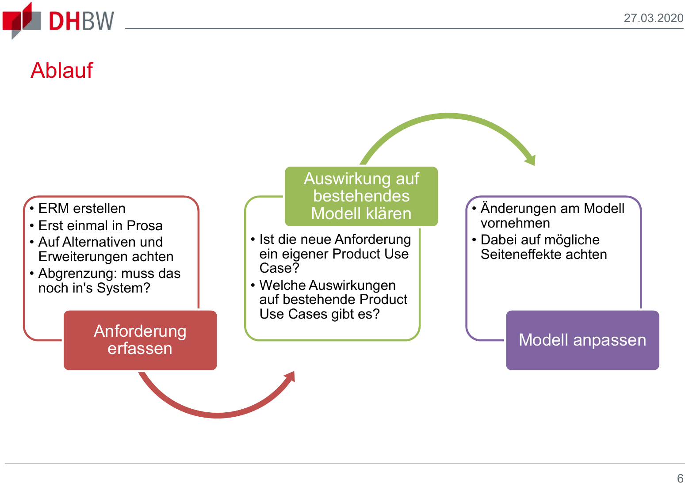
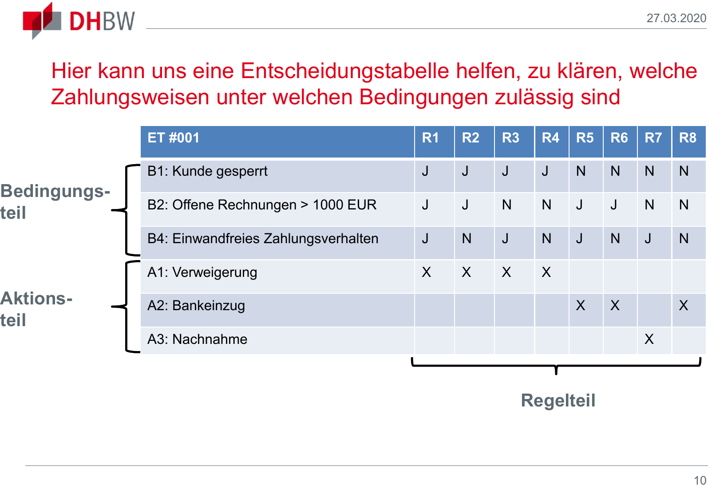
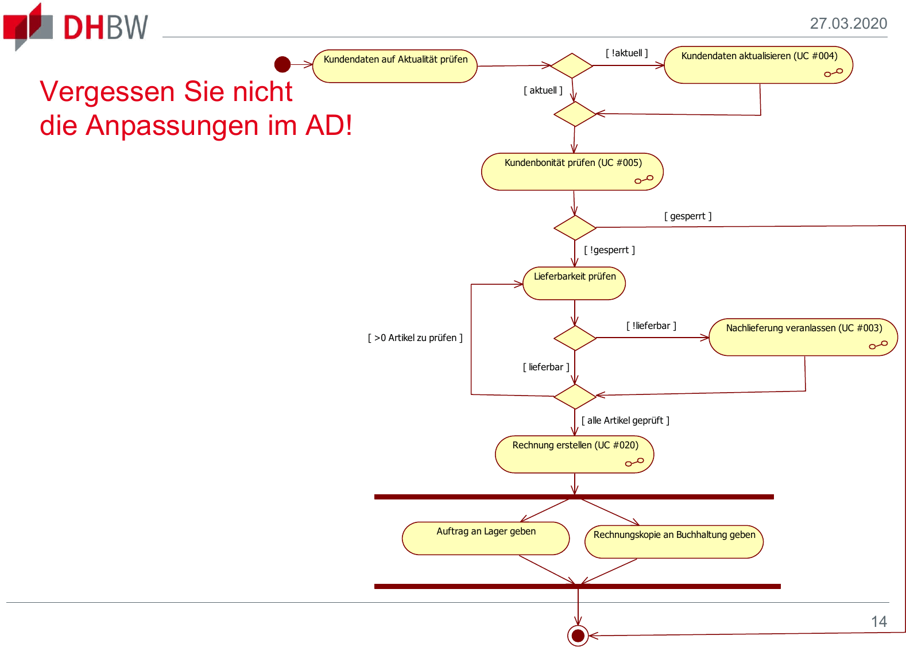

# Entscheidungstabellen bei stark regelbehafteten Anforderungen

## So werden wir vorgehen - Das RE-Vorgehensmodell

## Featurewünsche des Kunden sind nicht immer einfach zu identifizieren…

## Eine keinesfalls untypische Situation…

Freitag-Nachmittag. Sie freuen sich auf das Wochenende…
Im letzten Meeting der Woche mit dem Kunden Ihres CRM-Systems führen Sie ein Review zu UC #020 (Rechnung erstellen) durch, dabei erfahren Sie, dass vor der Rechnungsstellung die Bonität des Kunden positiv geprüft sein muss.

Was tun?

## Ablauf

Anforderung erfassen

- ERM erstellen
- Erst einmal in Prosa
- Auf Alternativen und Erweiterungen achten
- Abgrenzung: muss das noch in's System?

Auswirkung auf bestehendes Modell klären

- Ist die neue Anforderung ein eigener Product Use Case?
- Welche Auswirkungen auf bestehende Product Use Cases gibt es?

Modell anpassen

- Änderungen am Modell vornehmen
- Dabei auf mögliche Seiteneffekte achten

## Bonitätsprüfung: Der CRM-Kunde im O-Ton

"Wenn ein neuer Kundenauftrag ausgeführt wird, dann schreiben wir eine Rechnung – schon richtig in Ihrem UC #020.

Aber wenn so ein Auftrag reinkommt, dann müssen wir erst einmal klären, ob das einer von unseren schrägen Vögeln ist, die immer bestellen, aber dann eine schlechte Zahlungsmoral haben.

DHBW-Studenten – zum Beispiel – sind echt ein Problem für uns. Deshalb prüfen wir das gleich zu Beginn des Auftragsprozesses. Wenn das nämlich ein schräger Vogel ist, verweigern wir die Ausführung des Auftrags."

Welche Fragen stellen Sie jetzt als RE-Ingenieur/in?

## Schreiben Sie hier Ihre Fragen an unseren CRM-Kunden auf

## Die Bonitätsprüfung im O-Ton

"Wir prüfen da mehrere Sachen. Also zunächst einmal, ob der Kunde überhaupt noch bei uns kaufen darf. Denn ansonsten hat sich das gleich erledigt. Ansonsten prüfen wir, ob er noch offene Rechnungen hat und wenn ja, wie hoch die sind, denn das ist bei uns ganz entscheidend. Da hängt dann letztlich der ganze weitere Ablauf davon ab. Wenn die über 750, nein, falsch, das wurde ja mittlerweile auf 1000 EUR geändert, also, wenn die über den Betrag sind, dann geht nur Bankeinzug. Nachnahme lassen wir übrigens nur bei Kunden mit einwandfreiem Zahlungsverhalten zu, also wenn in der Kundenhistorie nicht mehr als zwei 2. Mahnungen stehen, denn wissen Sie, wir haben da schon erlebt, dass…"

Alles kapiert?

## Hier kann uns eine Entscheidungstabelle helfen, zu klären, welche Zahlungsweisen unter welchen Bedingungen zulässig sind

| ET #001 | R1 | R2 | R3 | R4 | R5 | R6 | R7 | R8 |
| --- | --- | --- | --- | --- | --- | --- | --- | --- |
| B1: Kunde gesperrt | J | J | J | J | N | N | N | N |
| B2: Offene Rechnungen > 1000 EUR | J | J | N | N | J | J | N | N |
| B4: Einwandfreies Zahlungsverhalten | J | N | J | N | J | N | J | N |
| A1: Verweigerung | X | X | X | X | | | | |
| A2: Bankeinzug | | | | | X | X | | X |
| A3: Nachnahme | | | | | | | X | |

## Konsolidierung

| ET #001 | R1 | R5 | R6 | R7 | R8 |
| --- | --- | --- | --- | --- | --- |
| B1: Kunde gesperrt | J | N | N | N | N |
| B2: Offene Rechnungen > 1000 EUR | - | J | J | N | N |
| B4: Einwandfreies Zahlungsverhalten | - | J | N | J | N |
| A1: Verweigerung | X | | | | |
| A2: Bankeinzug | | X | X | | X |
| A3: Nachnahme | | | | X | |

Eine Entscheidungstabelle ist konsolidierbar, wenn mehrere Regeln zu einer zusammengefasst werden können. Hier: R1-R4

Frage: Kann man noch weitere Regeln zusammenfasen

## Weitere Regeln

| | R1 | R2 |
| --- | --- | --- |
| B1 | J | J |
| B2 | N | - |
| B3 | N | N |
| A1 | X | X |
| A2 | X | X |

Redundanzfreiheit

R1 braucht es nicht, da R2 diese Regel schon beinhaltet für B2 = "N"

| | R1 | R2 |
| --- | --- | --- |
| B1 | J | J |
| B2 | N | N |
| B3 | - | N |
| A1 | X | X |
| A2 | X | |

Widerspruchsfreiheit/Konsistenz

R1 steht bei B3 = "N" mit R2 im Widerspruch, denn R1 hat A1 und A2 als Aktion, R2 aber nur A1.

## Use Case: #002 Kundenauftrag ausführen

**Ziel:** Ware an Kunden geliefert

**Vorbedingung:** -

**Nachbedingung Erfolg:** Ware ausgeliefert (auch Teillieferungen), Rechnungskopie bei Buchhaltung

**Nachbedingung Fehlschlag:** Mitteilung an Kunden, dass nichts lieferbar ist

**Akteure:** Kundensachbearbeiter, Lagersachbearbeiter, Buchhaltung

**Auslösendes Ereignis:** Bestellung des Kunden liegt vor

**Beschreibung:**

1. Die Kundendaten werden auf Aktualität geprüft
2. Den Kunden anhand ET #001 auf Bonität prüfen
3. Lieferbarkeit prüfen
4. Rechnung erstellen: UC #020 Rechnung erstellen
5. Auftrag vom Lager ausführen lassen
6. Rechnungskopie an Buchhaltung geben

**Erweiterung:**

- 1a Wenn die gespeicherten Kundendaten nicht aktuell sind: UC #004 Kundendaten aktualisieren
- 5a Für nicht-lieferbare Artikel: UC #003 Nachlieferung veranlassen

**Alternativen:**

- 1a Wenn der Besteller noch nicht Kunde ist: UC #001 Neukunde erfassen
- 2a Wenn der Kunde gesperrt ist: Auftragsannahme verweigern (UC beenden)
- 4a Rechnung mit Nachnahme erstellen (UC #020 Rechnung erstellen)
- 4b Rechnung mit Bankeinzug erstellen (UC #020 Rechnung erstellen)

## Vergessen Sie nicht die Anpassungen im AD!

## Frage zum Schluss

Was kennzeichnet eine gute Modellierung Ihrer Meinung nach?

## Grundsätze ordnungsgemäßer Modellierung – die GoM

**Grundsatz der Richtigkeit**

Voraussetzung für ein qualitativ hochwertiges Modell ist, dass es den zu repräsentierenden Sachverhalt korrekt wiedergibt. Dieser Aspekt kennzeichnet die semantische Richtigkeit. Hierbei ist die Richtigkeit von Modellen grundsätzlich nicht beweisbar, sondern ergibt sich aus dem Konsens der Fach- und Methodenexperten, die ein Modell als zutreffend erachten. Von der semantischen Richtigkeit ist die syntaktische Richtigkeit abzugrenzen, welche die Einhaltung der ggf. individuell definierten Notationsregeln beschreibt.

**Grundsatz der Relevanz**

Es sollen nur die Sachverhalte modelliert werden, die für den zu Grunde liegenden Modellierungszweck relevant sind. Um das beurteilen zu können, müssen die Ziele der Modellierung expliziert werden. Anhand der explizierten Modellierungsziele können Entscheidungen über das Abstraktionsniveau der darzustellenden Sachverhalte sowie der zu verwendenden Modellierungstechniken getroffen werden. Der Grundsatz der Relevanz ist außerdem für die Entwicklung zweckadäquater Modellierungstechniken hilfreich.

**Grundsatz der Wirtschaftlichkeit**

Intention des Grundsatzes der Wirtschaftlichkeit ist es, sicherzustellen, dass die Modellierungsaktivitäten in einem angemessenen Kosten-Nutzen-Verhältnis zueinander stehen. Es ist zu beachten, dass die Modellierungskosten den eigentlich verfolgten Nutzen der entstehenden Modelle nicht überkompensieren.

http://www.enzyklopaedie-der-wirtschaftsinformatik.de/wi-enzyklopaedie/lexikon/is-management/Systementwicklung/Hauptaktivitaten-der-Systementwicklung/Problemanalyse-/Grundsatze-ordnungsgemaser-Modellierung

## Grundsätze ordnungsgemäßer Modellierung – die GoM

**Grundsatz der Klarheit**

Der Grundsatz der Klarheit trägt dem Tatbestand Rechnung, dass ein Modell nur von Nutzen ist, wenn es vom Adressaten auch verstanden wird. Abhängig vom Modellnutzer hat ein Modell einen adäquaten Grad an intuitiver Lesbarkeit aufzuweisen. So sind einerseits die Modellierungstechniken an sich nutzeradäquat auszuwählen und andererseits die Modelle mit Hilfe der Techniken möglichst klar und lesbar darzustellen.

**Grundsatz der Vergleichbarkeit**

Der Grundsatz der Vergleichbarkeit wird als Ziel formuliert, weil in realen Anwendungssituationen ggf. mehrere Modelle nebeneinander existieren, die vergleichbar sein müssen. Besondere Bedeutung kommt aus betriebswirtschaftlicher Sicht dabei dem Vergleich von Ist- und Sollmodellen zu, damit aus den Modellen Gestaltungsempfehlungen abgeleitet werden können. Daneben sind Modelle vergleichbar zu gestalten, die mit unterschiedlichen Modellierungstechniken erstellt worden sind.

**Grundsatz des systematischen Aufbaus**

Dieser Grundsatz hat seine Notwendigkeit in der Darstellung eines Sachverhalts aus unterschiedlichen Sichten, die zur Reduktion dessen Komplexität gebildet werden. Bei der Modellierung von Informationssystemen werden Daten-, Funktions-, Organisations- und Steuerungssicht oder die Struktur- und die Verhaltenssicht unterschieden. Mit dem Grundsatz des systematischen Aufbaus wird eine sichtenübergreifende Modellerstellung gefordert. Dieses Ziel wird zum einen mit einem sichtenübergreifenden Metamodell gefördert, das den Zusammenhang zwischen den unterschiedlichen Sprachkonstrukten herstellt. Zum anderen ist auch für den Modellinhalt eine konsistente sichtenübergreifende Modellierung zu fordern.

http://www.enzyklopaedie-der-wirtschaftsinformatik.de/wi-enzyklopaedie/lexikon/is-management/Systementwicklung/Hauptaktivitaten-der-Systementwicklung/Problemanalyse-/Grundsatze-ordnungsgemaser-Modellierung

Quelle: systems-engineering/origin/WDS125 - Systems Engineering (BäM)/12 LE 9_ Entscheidungstabellen - Modellierung von stark regelbehafteten Anforderungen/Folien der Lerneinheit/11.RE-ET.pdf, Seiten 1–17
