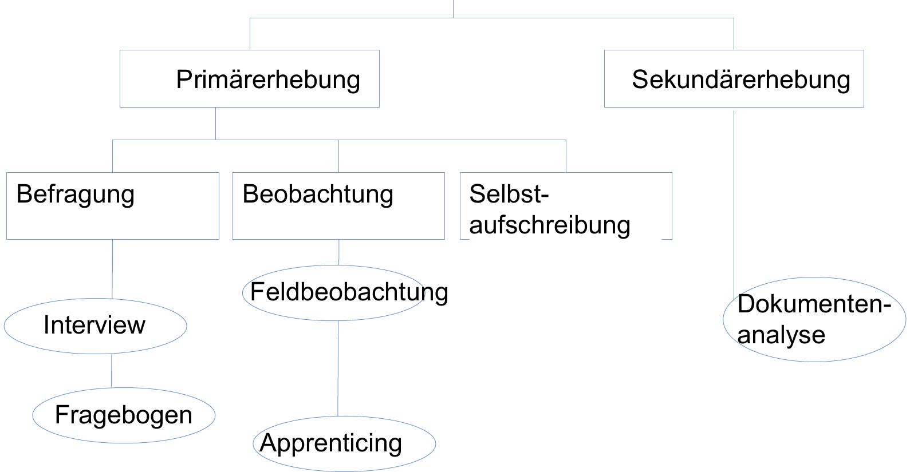

# Erhebungstechniken

## Befragungstypen nach Modus

- Schriftlich/Postalisch
- Telefonisch
- Face to Face
- Online

Quelle: systems-engineering/origin/WDS125 - Systems Engineering (BäM)/09 LE 6_ Erhebungstechniken - Ermittlung der Anforderungen/Folien der Lerneinheit/07.RE-Erhebungstechniken.pdf, Folien 4–5
