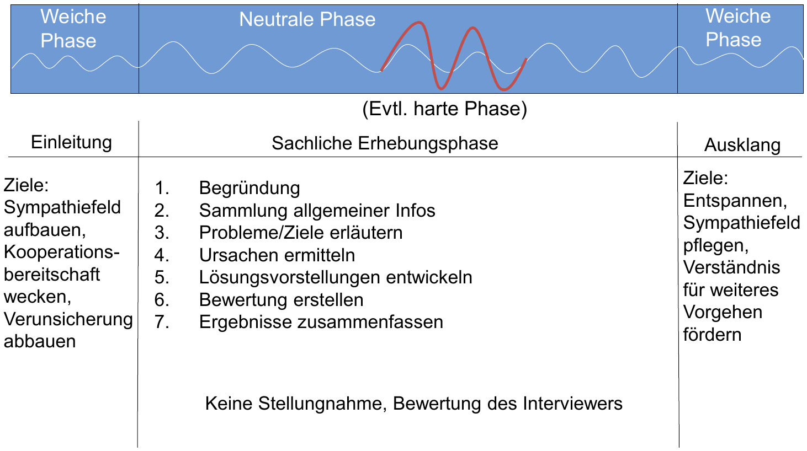
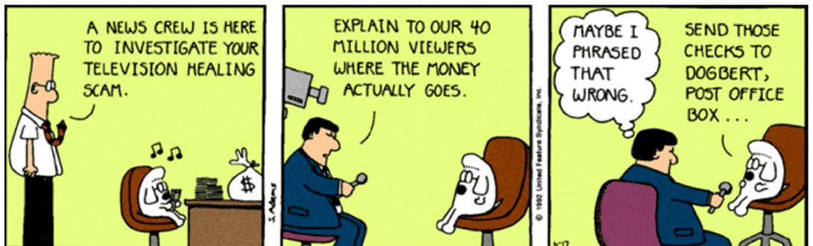

# Kurzbeschreibung

|  | Gespräch | Interview im engeren Sinne | Standardisiertes Interview mit offenen Fragen | Standardisiertes Inteview mit geschlossenen Fragen |
| --- | --- | --- | --- | --- |
| Kurzbeschreibung | lockere Form, weitgehend ungeplant, generelle Fragen vorbereitet | Fragenkatalog ist vorhanden, aber noch nicht vollständig | Fragen sind festgelegt, hinsichtlich der Antworten ist der Interviewte frei | Fragen sind festgelegt, Interviewte entscheidet zwischen begrenzter Anzahl von Antworten |
| Zweck | Ergründung von Absichten, Ziel- und Wertvorstellungen | Detaillierte Erfassung von Aussagen, Überprüfung & Absichern von Aussagen | Absicherung und Meinungen einer größeren Personengruppe | Absichten und Meinungen einer großen Gruppe ist erwünscht - Vergleichbarkeit der Antworten ist wichtig |
| Betroffener Personenkreis | sehr klein | relativ klein | groß | sehr groß |
| Art der erwarteten Aussage | allgemein, überwiegend qualitativ | konkreter, noch überwiegend qualitativ | konkret, qualitativ und quantitativ | konkret, qualitativ und quantitativ |
| Spielraum hinsichtlich Ablauf | sehr groß, Rahmen noch offen | groß, Rahmen nur grob vorgegeben | eingeengt | klein |
| Anforderungen an den Interviewer | sehr hoch | hoch | mittel, Fragen interpretieren, situationsbedingt ergänzen | gering |
| Vorbereitungsaufwand | gering | mittel, Vorbereitung des Fragenkatalogs | hoch, Testläufe sind zweckmäßig | sehr hoch, Testläufe sind notwendig |
| Auswertung | sehr schwierig, Problemfeld muss strukturiert werden | schwierig, Problemfeld muss um- oder detaillierter strukturiert werden | mittelschwer, Vergleichbarkeit der Antworten muss generiert werden | einfache, maschinelle Auswertung |

## Phasen eines Interviews

## Grundregeln für Interviewer

- Keine Suggestivfragen
- Interviewer soll zuhören können
- Kein Verhör-Stil
- Keine Positionierung des Interviewers
    - Weder positive noch negative Kritik
    - Ausnahme: Provokative Wertung, um Aussagen herauszufordern, die sonst nicht erhältlich wären
- Kurze, offene Fragen stellen
    - Eine bestimmte Frage soll i.d.R. nur einen Sachverhalt und nicht mehrere Sachverhalte betreffen (keine Unterfragen und Kettenfragen
- Wahl einfacher, leicht verständlicher Formulierungen
- Ausschweifungen „dezent eindämmen“
    - (Vielredner auch bei offenen Fragen bremsen!)
- Vermeidung von Hast und Eile
    - Sonst besteht die Gefahr unüberlegte Antworten zu erhalten
- Lange Interviews ermüden
    - Maximal eine Stunde
    - Wenn nötig Fortsetzungstermin

## Interviewmethode - Bewertung

- ☺ Erfassung auch qualitativer Einflussgrößen
- ☺ Abbau negativer Einstellungen während des Gesprächs möglich
- ☺ Angaben für die Entwicklung können erfragt werden
- ☺ Erfassung der Unternehmensstruktur und Arbeitsablauf
- ☹ Erfordernis qualifizierter Interviewer
- ☹ Zeitaufwendiges Verfahren
- ☹ Starke Beeinflussung des Betriebsablaufs
- ☹ Angaben zu Mengen und Bearbeitungszeiten sind subjektiv

Quelle: systems-engineering/origin/WDS125 - Systems Engineering (BäM)/09 LE 6_ Erhebungstechniken - Ermittlung der Anforderungen/Folien der Lerneinheit/07.RE-Erhebungstechniken.pdf, Folien 14–17
