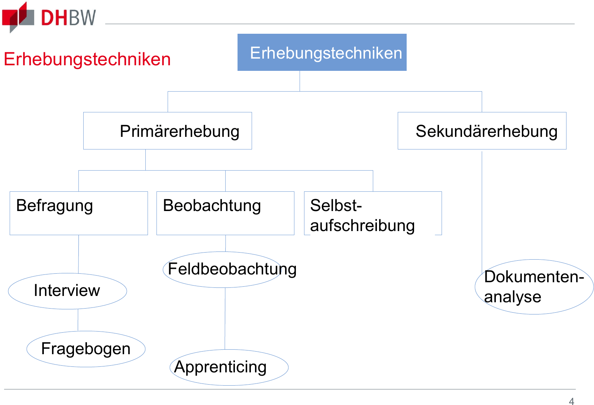
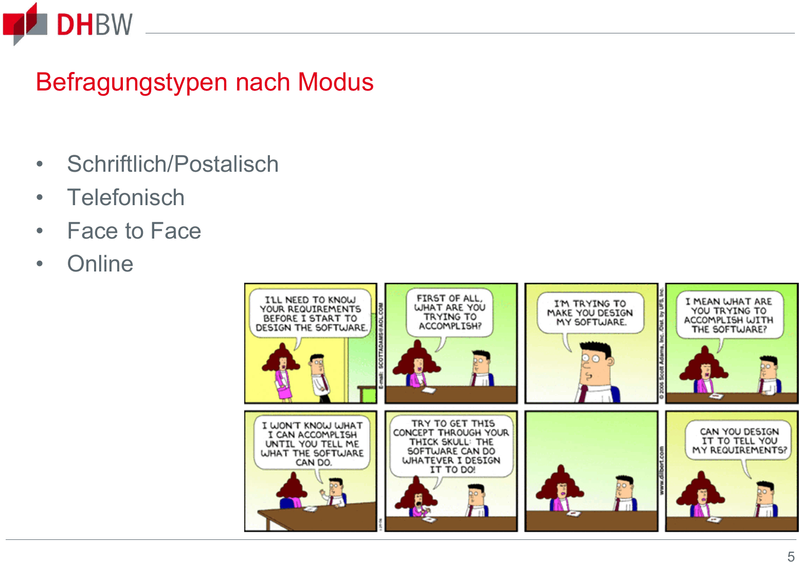
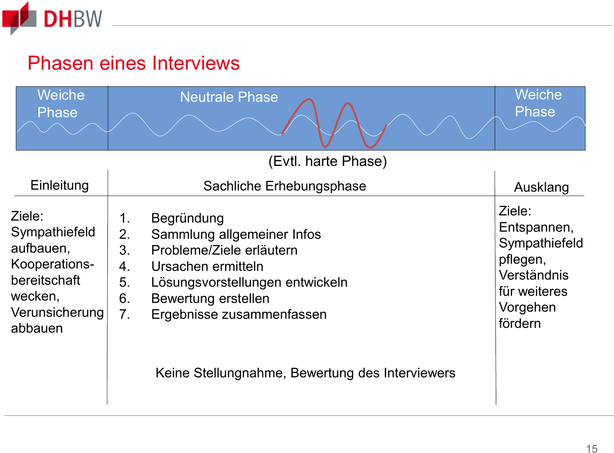
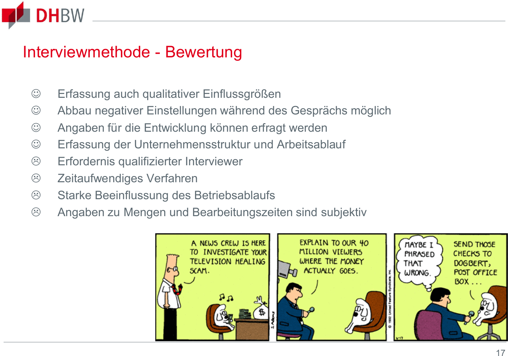

# Erhebungstechniken

## Warum Systemanalyse/Anforderungsanalyse?

- Gemeinsames Verständnis aller betroffenen Personengruppen über den automatisierenden Anteil im betroffenen Arbeitssystem herzustellen
- Wissenserwerb
    - Wer wird das System wofür nutzen?
    - Welchen Vorteil soll das System bringen?
    - Was sind die Randbedingungen der Entwicklung
- Konsensbildung
    - Zwischen Auftraggeber und Auftragnehmer („Vertrag“, „Angebot“, „Ausschreibung“)
    - Zwischen Auftraggeber und Benutzer
    - Zwischen den verschiedenen Nutzergruppen

## Informationssammlung

Identifikation

- Problemabgrenzung (Welches Problem soll gelöst werden)
- Kontext des Problems (Wo ist das Problem)
- Ziele der Beteiligten (Warum muss es gelöst werden)
- Szenariensammlung (Wie könnte das neue System helfen)

Machbarkeit und Risiko (Was könnte uns daran hindern das Problem zu lösen)

Expertenwissen im Anwendungsgebiet

- Erfassung des Problembereichs
- Nutzung der anfänglichen Unwissenheit um Fragen zu stellen
- Sachverstand der Gesprächspartner anerkennen

## Erhebungstechniken

## Befragungstypen nach Modus

- Schriftlich/Postalisch
- Telefonisch
- Face to Face
- Online

## Schriftliche Befragung

- Hoher Grad an Anonymität
- Geringe Interviewfehler/Reaktivität
- Möglichkeit zu komplexen Fragen mit Diagrammen u.ä
- Überlegte und bewusste Antworten
- Aber Verlust an Spontaneität
- Unkontrollierte Ausfüllsituation (wer füllt aus mit wem?)
- Erhöhte Ausfallquote

## Schriftliche Befragung: Eigenschaften

- Rücklaufquote zwischen 10 % und 90 %
- Wichtig für die Rücklaufquote
    - Thema der Untersuchung
    - Knapp formulierte, leicht verständliche Fragen
    - Ansprechendes grafisches Layout
    - Ankündigungsschreiben – besser telefonische Vorankündigung
    - Briefaufmachung von einer Werbesendung unterscheiden
    - Persönlich abgefasstes Anschreiben
    - Nutzen des Ausfüllers herausstellen
    - Vertraulichkeit versichern
    - Angaben eines Rücksendedatums
    - Frankierter Rückumschlag
    - Finanzielle Anreize, u.a.

## Fragebogenkonstruktion

- Prüfen, ob es bereits Fragebögen zum Thema gibt
- Sprachliche Gestaltung immer auf die Zielgruppe ausrichten
- Verständliche, die Handhabung des Fragebogens eindeutig anleitende Instruktion
- Letzter Teil des Fragebogens einfach halten
- Platzierungseffekt, Ausstrahlungseffekt beachten
    - Nachfolgende Fragen werden von vorhergehenden Fragen beeinflusst
- Lieber mehr Seiten und weniger Fragen pro Seite; Dauer hängt ab von der Zielgruppe (10 Minuten) – in einem Unternehmen kann es längere geben (bis 1 Stunde)
- Graphisch anschauliche Darstellung beachten

## Formulierung von Fragen

- Entscheidung, ob offene oder geschlossene Fragen gestellt werden
- Art der Formulierung
    - Eine Frage ist üblicherweise allgemein formuliert und hält das angesprochene Problem prinzipiell offen
    - Eine Behauptung eignet sich zur Erkundung von Positionen, Meinungen und Einstellungen
- Einfach formulieren
    - Keine Fachausdrücke, Fremdwörter, Abkürzungen, Slang, kurz halten, konkret formulieren, nicht suggestiv, neutral, wertend
- Alle Antwortmöglichkeiten in der Frage ausformulieren
    - „Männer sind für die Politik besser geeignet als Frauen.“ Stimme zu /lehne ab
    - Besser: „Würden Sie sagen, dass die meisten Männer für die Politik besser geeignet sind als Frauen, dass Frauen und Männer in dieser Beziehung gleich sind, oder dass Frauen besser für die Politik geeignet sind?“

## Telefonische Befragung

- Von einem meist zentralen Institut werden zufällig Teilnehmer angerufen. Der Interviewer führt aktiv das Gespräch
- Fragen mit hoher Ausfallquote können während der Befragung gestrichen werden
- Mittels kurzen Vorgesprächen können auch längere Interviews gemacht werden
- Befragte können durch die Interviewer motiviert werden
- Komplexe Fragen mit vielen Antwortmöglichkeiten können nur mehrstufig gestellt werden
- Keine visuelle Hilfestellung möglich

## Face to Face

Gespräch zwischen Interviewer und Befragtem (siehe Interview)
Variierender Zeitrahmen

## Online Befragung

Hauptsächlich zwei Arten

- Email-Umfragen
    - Wenig gebräuchlich
    - Ähnlich der postalischen Befragung
- Umfragen im WWW
    - Interaktion mit dem Befragten möglich
    - Sammeln von Metainformationen möglich
    - Verschieden Multimedia-Elemente können eingefügt werden (Animation, Musik,..)

## Online Befragungen

- ☺ Sehr kostengünstig – geringe Abhängigkeit zur Größe der Stichprobe
- ☺ Daten liegen elektronisch vor
- ☺ Extrem kurze Rücklaufzeiten
- ☹ Grundgesamtheit der Internetnutzer ist nicht bekannt
- ☹ Kleinere Stichproben sind nicht repräsentativ
- ☹ Nutzung von Multimediainhalten kann Nutzer ausschließen

---

|  | Gespräch | Interview im engeren Sinne | Standardisiertes Interview mit offenen Fragen | Standardisiertes Inteview mit geschlossenen Fragen |
| --- | --- | --- | --- | --- |
| Kurzbeschreibung | lockere Form, weitgehend ungeplant, generelle Fragen vorbereitet | Fragenkatalog ist vorhanden, aber noch nicht vollständig | Fragen sind festgelegt, hinsichtlich der Antworten ist der Interviewte frei | Fragen sind festgelegt, Interviewte entscheidet zwischen begrenzter Anzahl von Antworten |
| Zweck | Ergründung von Absichten, Ziel- und Wertvorstellungen | Detaillierte Erfassung von Aussagen, Überprüfung & Absichern von Aussagen | Absicherung und Meinungen einer größeren Personengruppe | Absichten und Meinungen einer großen Gruppe ist erwünscht - Vergleichbarkeit der Antworten ist wichtig |
| Betroffener Personenkreis | sehr klein | relativ klein | groß | sehr groß |
| Art der erwarteten Aussage | allgemein, überwiegend qualitativ | konkreter, noch überwiegend qualitativ | konkret, qualitativ und quantitativ | konkret, qualitativ und quantitativ |
| Spielraum hinsichtlich Ablauf | sehr groß, Rahmen noch offen | groß, Rahmen nur grob vorgegeben | eingeengt | klein |
| Anforderungen an den Interviewer | sehr hoch | hoch | mittel, Fragen interpretieren, situationsbedingt ergänzen | gering |
| Vorbereitungsaufwand | gering | mittel, Vorbereitung des Fragenkatalogs | hoch, Testläufe sind zweckmäßig | sehr hoch, Testläufe sind notwendig |
| Auswertung | sehr schwierig, Problemfeld muss strukturiert werden | schwierig, Problemfeld muss um- oder detaillierter strukturiert werden | mittelschwer, Vergleichbarkeit der Antworten muss generiert werden | einfache, maschinelle Auswertung |

## Phasen eines Interviews

## Grundregeln für Interviewer

- Keine Suggestivfragen
- Interviewer soll zuhören können
- Kein Verhör-Stil
- Keine Positionierung des Interviewers
    - Weder positive noch negative Kritik
    - Ausnahme: Provokative Wertung, um Aussagen herauszufordern, die sonst nicht erhältlich wären
- Kurze, offene Fragen stellen
    - Eine bestimmte Frage soll i.d.R. nur einen Sachverhalt und nicht mehrere Sachverhalte betreffen (keine Unterfragen und Kettenfragen
- Wahl einfacher, leicht verständlicher Formulierungen
- Ausschweifungen „dezent eindämmen“
    - (Vielredner auch bei offenen Fragen bremsen!)
- Vermeidung von Hast und Eile
    - Sonst besteht die Gefahr unüberlegte Antworten zu erhalten
- Lange Interviews ermüden
    - Maximal eine Stunde
    - Wenn nötig Fortsetzungstermin

## Interviewmethode - Bewertung

- ☺ Erfassung auch qualitativer Einflussgrößen
- ☺ Abbau negativer Einstellungen während des Gesprächs möglich
- ☺ Angaben für die Entwicklung können erfragt werden
- ☺ Erfassung der Unternehmensstruktur und Arbeitsablauf
- ☹ Erfordernis qualifizierter Interviewer
- ☹ Zeitaufwendiges Verfahren
- ☹ Starke Beeinflussung des Betriebsablaufs
- ☹ Angaben zu Mengen und Bearbeitungszeiten sind subjektiv

## Fragetyp Testfrage - Sachfragen

Fragen nach Sachverhalten, nicht nach Meinungen oder psychischem Befinden
„Besitzen Sie ein Smartphone?“

Gefahren:

- Vermeide Überforderung
- Recherchefrage: „Wie viel Geld geben Sie jeden Monat für Ihre Hobbys aus?“
- Gedächtnisfragen, die zu weit in der Vergangenheit ragen
- Doppelte Sachfragen, die zwei Sachverhalte auf einmal abfragen: „Essen Sie morgens und/oder zum Frühstück Schinken?“

## Fragetyp Wissensfragen

Fragen zum individuellen Informationsstand
„Wer ist deutscher Bundeskanzler?“

Gefahren:

- Frustration durch zu viele und zu schwierige Fragen
    - Lösung: Leichte und schwere Fragen mischen

## Fragetyp Einstellungs- und Meinungsfragen

„Wie beurteilen Sie das Asylgesetz?“ (sozial/unsozial, gerecht/ungerecht, gut/schlecht)

Gefahren:

- Non-Opinions: Viele Befragte machen sich erst im Moment der Fragestellung Gedanken über das Problem (Pseudo-Meinung)

## Fragetyp Einstellungs- und Meinungsfragen

Fragen nach persönlichen Meinungen

Gefahren:

- Frageformulierung/Wortwahl haben großen Einfluss auf die Antworten
- „Weiß-nicht“ als gültige Antwort nicht vergessen! Auch das Nicht-Vorliegen einer Einstellung ist ein gültiger/messbarer Wert

## Fragetyp Verhaltensfragen

Sollen Auskunft konkrete Verhaltensweisen geben
„Wie lange haben Sie gestern ferngesehen?“

Gefahren:

- Frage sollte nicht zu weit in der Vergangenheit reichen
    - Es entsteht oft Erinnerungsverzerrung, weil dem Befragten eher die Einstellung zum eigenen Verhalten als das tatsächliche Verhalten bewusst ist (ich sehe sehr wenig fern!! Als Einstellung)

## Fragetyp Eisbrecherfragen

Zu Beginn des Interviews, Hemmschwellen abbauen, auflockern, Interesse wecken
Muss mit dem eigentlichen Thema nichts zu tun haben, wird oft gar nicht ausgewertet

Gefahren:

- Thema der Frage sollte jeder kennen, sollte zum Reden ermuntern
- keine Ja/Nein-Frage stellen, die der Befragte vielleicht auch noch verneint

## Fragetyp Überleiterfragen

Überleitung zwischen verschiedenen Themenbereichen der Befragung
„und jetzt zu etwas anderem – haben Sie sich schon einmal Gedanken über anti-autoritäre Erziehung gemacht?“

Gedanklich Abgrenzung – Öffnen für das neue Thema, Gedankenpause, Unterhaltung, Aktiv werden, gedankliche Rüstzeit beachten

Meist keine Relevanz für das eigentliche Erkenntnisinteresse

## Fragetyp Kontrollfragen

Doppelte Fragen mit veränderter Formulierung zur Feststellung von Inkonsistenzen

Gründe für Inkonsistenzen

- Zwiespalt beim Befragten
- Nicht ehrliche Beantwortung
- Ermüdung, Befragter antwortet zufällig
- Antwort nach sozialer Erwünschtheit bei kritischen Themen

## Beispielfragen – System-Produkt

- Welches Problem soll das neue System lösen?
- Könnte es sein, dass dieses System neue Probleme schafft?
- In welchem Umfeld soll das System zum Einsatz kommen?
- Gibt es Vorgaben für die geforderte Leistungsfähigkeit?
- Sind bestimmte Vorgaben des Gesetzgebers zu beachten?

## Beispielfragen – Fragen, falls schriftlicher Kontakt bestand

- Ich habe das Material studiert, das Sie mir geschickt haben. Es war nützlich, aber manche Punkte kann man besser im persönlichen Gespräch klären. Können wir einen Termin ausmachen, um die noch offenen Punkte zu klären?
- Gibt es weitere Mitarbeiter, die mir in dieser Sache helfen könnten?
- Können wir uns die Umgebung ansehen, in der die Software später eingesetzt werden soll?

## Beispielfragen – das Ende des Interviews

- Gibt es wichtige Punkte, die ich vergessen habe?
- Gibt es Sonderfälle, die zwar selten auftreten, aber angesprochen werden müssen?
- Darf ich zurückkommen, wenn mir weitere Fragen einfallen?

## Beobachtung

Erfassung von Fakten durch den Analytiker ohne direkten Kontakt mit dem beobachteten Aufgabenträger/Arbeitsprozess

- ☺ Arbeitsablauf wird nicht behindert
- ☺ Ermittlung von Arbeitsauslastungen, Fehlerquellen im Arbeitsablauf und Auswirkungen von Umwelteinflüssen
- ☹ Hoher Zeitaufwand
- ☹ Mengengerüst der Daten wird nicht erfasst

## Selbstaufschreibung

Es wird eine ausführliche Beschreibung, der in Frage kommenden Arbeitsgebiete verlangt
Ausfüllen von Erhebungsbögen (Statistik)

- ☺ Genaue Beschreibung der Arbeitsgebiete
- ☺ Betroffene sind aktiv beteiligt und können Lösungsvorschläge und Anregungen unterbreiten
- ☹ Individuelle Erfassung
- ☹ Mengen-/Zeitangaben sind kritisch zu betrachten

## Dokumentenanalyse

Auswertung vorhandener Unterlagen

- Organisations- und Aufgabenpläne
- Stellen- und Arbeitsplatzbeschreibungen
- Arbeitsablaufdiagramme
- Ausgefüllte Vordrucke
- Geschäftsberichte / Statistiken
- …

- ☺ Keine Störung des Betriebsablaufs
- ☺ Gute Erfassung von Mengengerüsten
- ☺ Objektive Aussagen
- ☺ Kostengünstig
- ☹ Beschreibung gleich Realität? Bsp.: Abläufe/Prozesse
- ☹ Gültigkeit für die Zukunft unsicher
- ☹ Kein Abbau negativer Einstellungen der Belegschaft möglich
- ☹ Qualifiziertes Untersuchungsteam erforderlich

Quelle: systems-engineering/origin/WDS125 - Systems Engineering (BäM)/09 LE 6_ Erhebungstechniken - Ermittlung der Anforderungen/Folien der Lerneinheit/07.RE-Erhebungstechniken.pdf, Seiten 1–31
