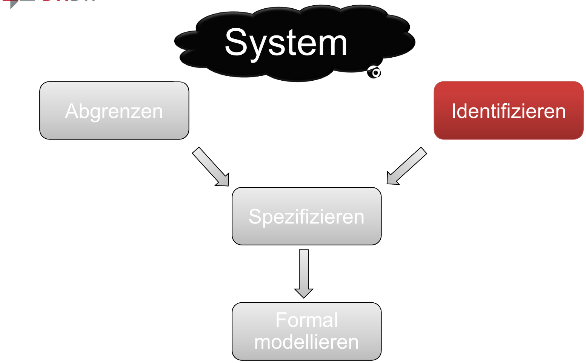
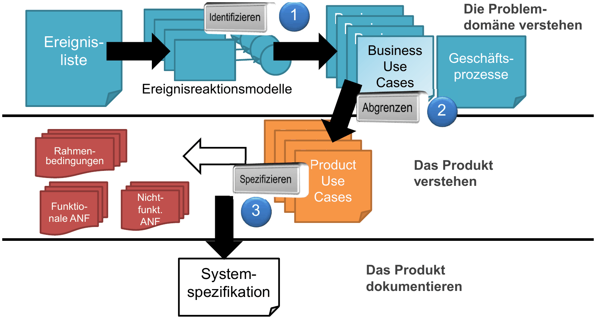

# So werden wir vorgehen - Das RE-Vorgehensmodell

Quelle: systems-engineering/origin/WDS125 - Systems Engineering (BäM)/08 LE 5_ Essenzielle Modellierung - Paradigma der ereignisorientierten Zerlegung/Folien der Lerneinheit/06.RE-ERM.pdf, Folien 2–3
