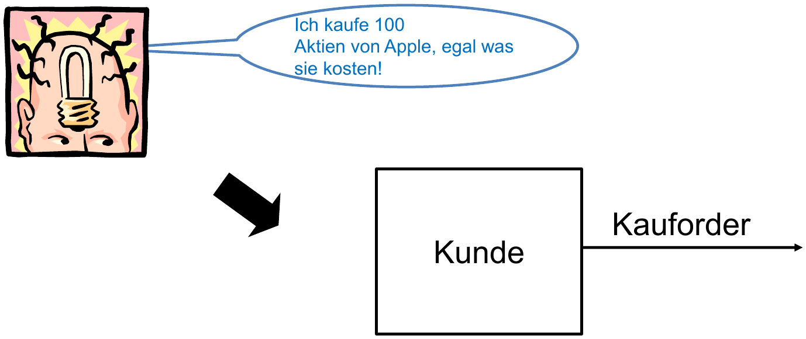
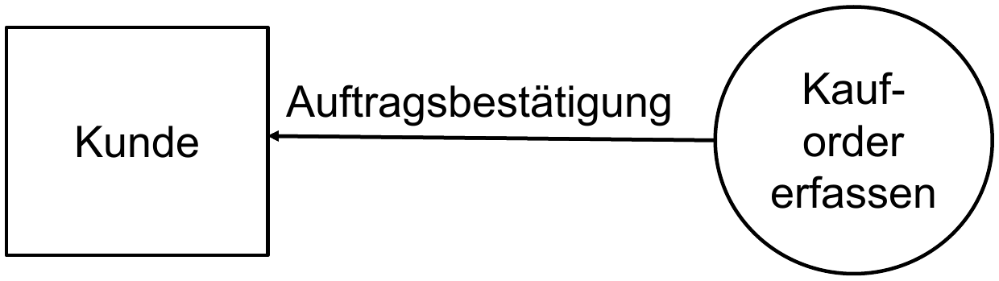
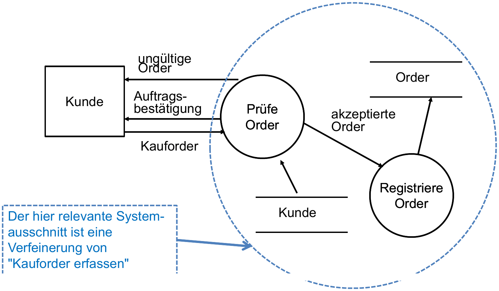

# Was ist der Zweck von Informationssystemen?

Systeme existieren, um Dienstleistungen für Dritte anzubieten. Diese Dienste sind die Reaktion auf ein Ereignis, das außerhalb des Systems aufgetreten ist.

Beispiel für ein Ereignis:
Ein Kunde will 100 Apple-Aktien kaufen.
(NB: Ein Kunde ist jemand, der bereits mit der Bank in Geschäftsbeziehung steht)

## Ereignisse bekommen einen eindeutigen Namen – Kunde erteilt Kauforder

Ich kaufe 100 Aktien von Apple, egal was sie kosten!

> Merke:
> Jedes Ereignis produziert einen eindeutigen Datenfluss.
> Durch den Inhalt des Datenflusses identifiziert das System, welches Ereignis eingetreten ist.

## Das System reagiert - Ereignisreaktion

> Merke:
> Eine Reaktion ist die Zusammenfassung aller Aktivitäten, die auf ein Ereignis reagieren.

## Das vollständige Ereignisreaktionsmodell für das Ereignis Kunde gibt Kauforder.

Der hier relevante Systemausschnitt ist eine Verfeinerung von "Kauforder erfassen"

## Ein typisches Muster für ein ERM

> Merke:
> In einem Ereignisreaktionsmodell (ERM) wird die Reaktion des Systems immer von Nachbarsystemen und Datenspeichern eingegrenzt!

Quelle: systems-engineering/origin/WDS125 - Systems Engineering (BäM)/08 LE 5_ Essenzielle Modellierung - Paradigma der ereignisorientierten Zerlegung/Folien der Lerneinheit/06.RE-ERM.pdf, Folien 4–8
