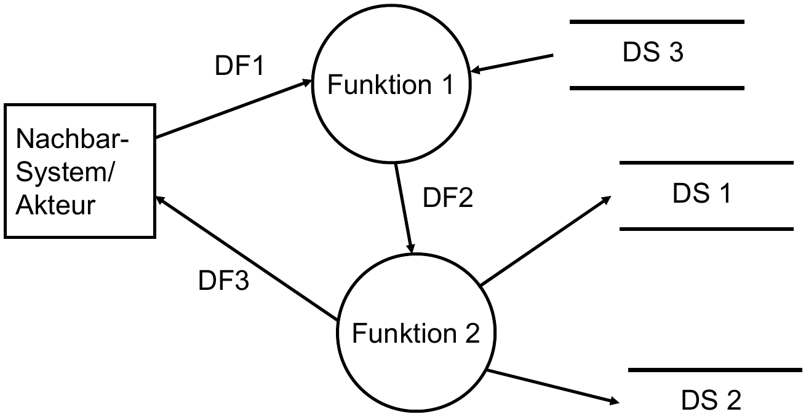
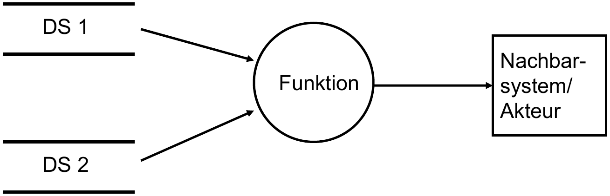

# Muster für ein externes Ereignis

## Muster für ein zeitliches Ereignis

## Denken Sie daran – Essenz, Essenz, Essenz!! Wir sind immer noch in der Problemdomäne und wollen das wahre Problem verstehen (nicht die IT-Probleme)

Die essentielle Sicht zeigt das System als eine Menge von implementierungsunabhängigen Anforderungen.

Beispiel:

- Im Ereignis Kunde gibt Kauforder wird die Order zuerst geprüft und anschließend registriert.
    - Funktionen: prüfe Order, registriere Order.
    - Daten: Kundendaten, Orderdaten.
    - Die Daten werden anschließend von anderen Ereignissen benötigt. Bsp.: Zeit für Börsenschluss.
- Wie das Ereignis technisch funktioniert ist uninteressant (nicht essentiell).

Quelle: systems-engineering/origin/WDS125 - Systems Engineering (BäM)/08 LE 5_ Essenzielle Modellierung - Paradigma der ereignisorientierten Zerlegung/Folien der Lerneinheit/06.RE-ERM.pdf, Folien 15–17
