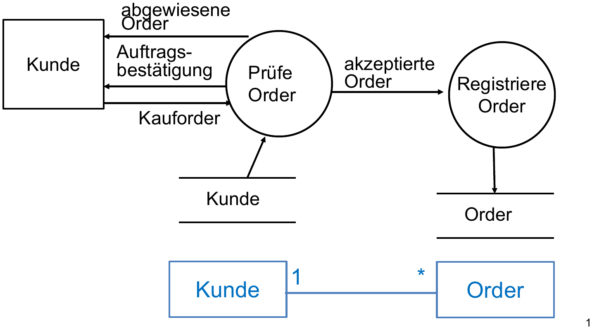

# Exkurs: Entwickeln eines Datenmodells/Klassenmodells

Quelle: systems-engineering/origin/WDS125 - Systems Engineering (BäM)/08 LE 5_ Essenzielle Modellierung - Paradigma der ereignisorientierten Zerlegung/Folien der Lerneinheit/06.RE-ERM.pdf, Folie 18
