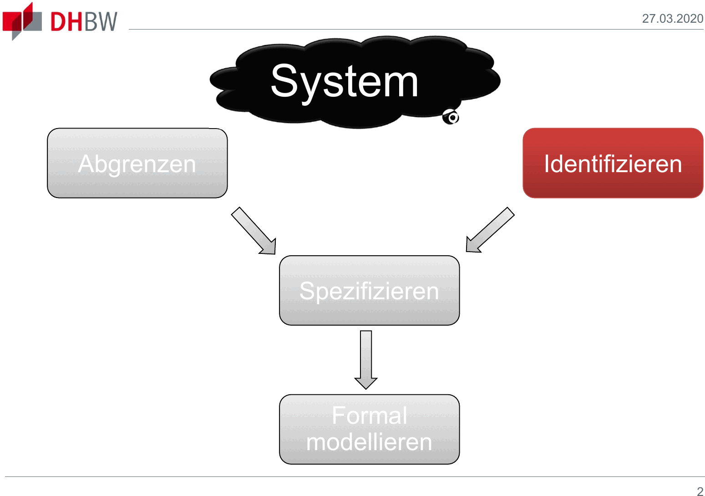
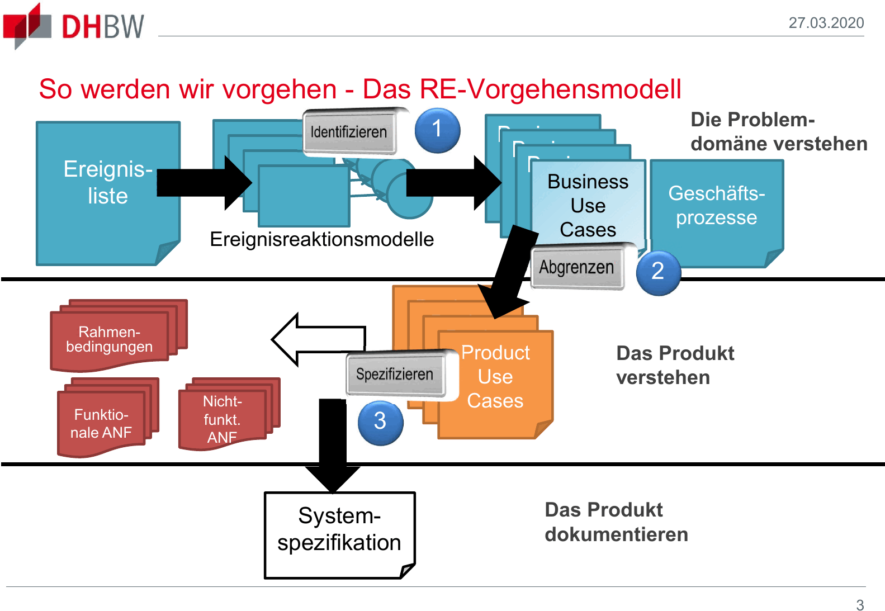
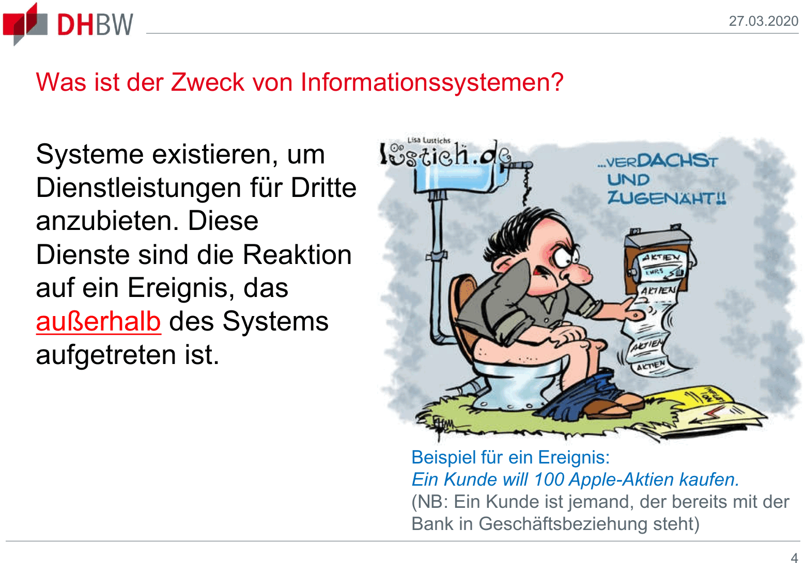
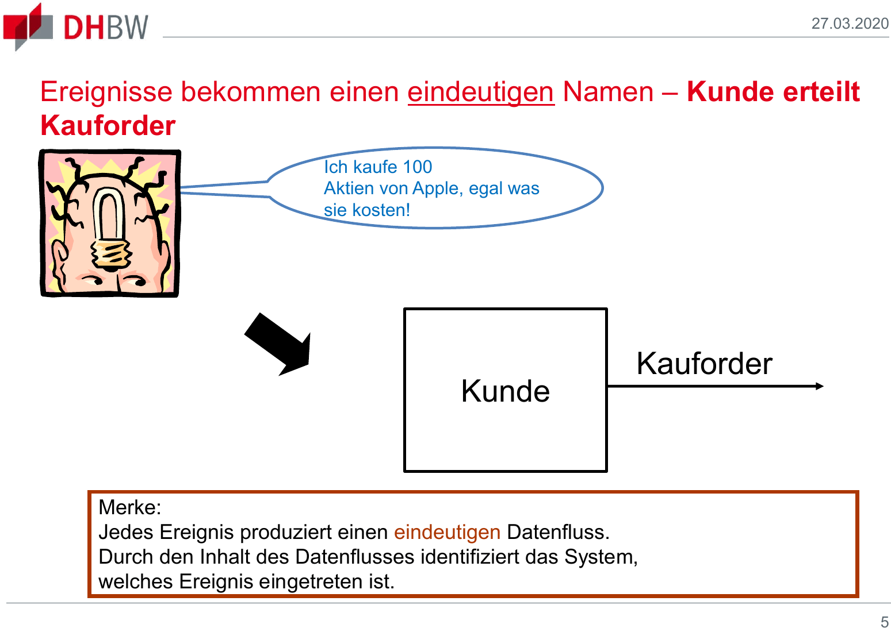
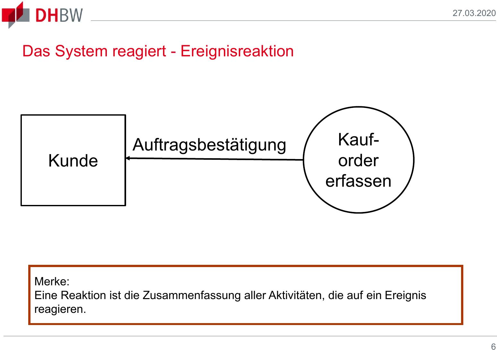
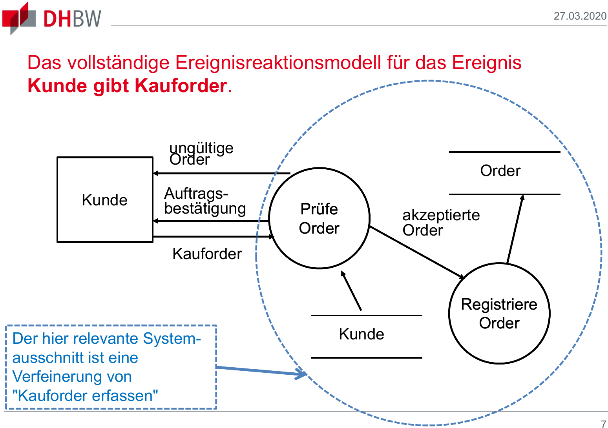
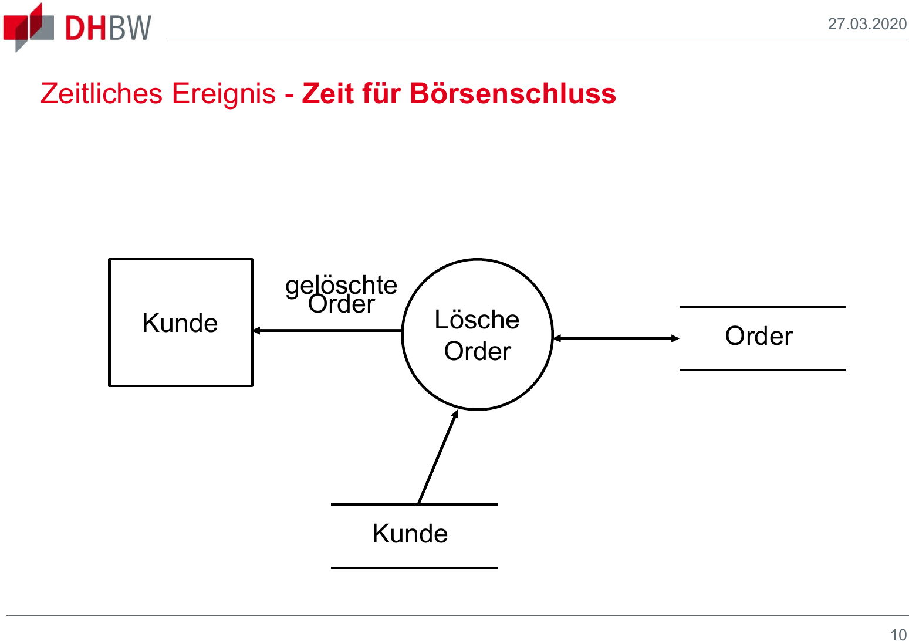
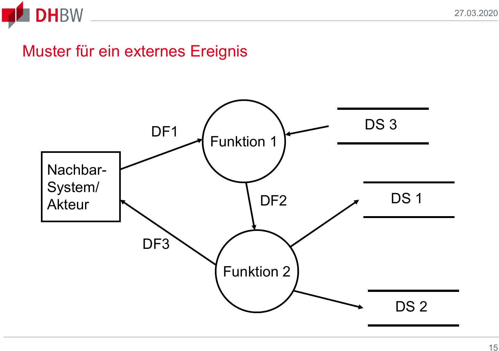
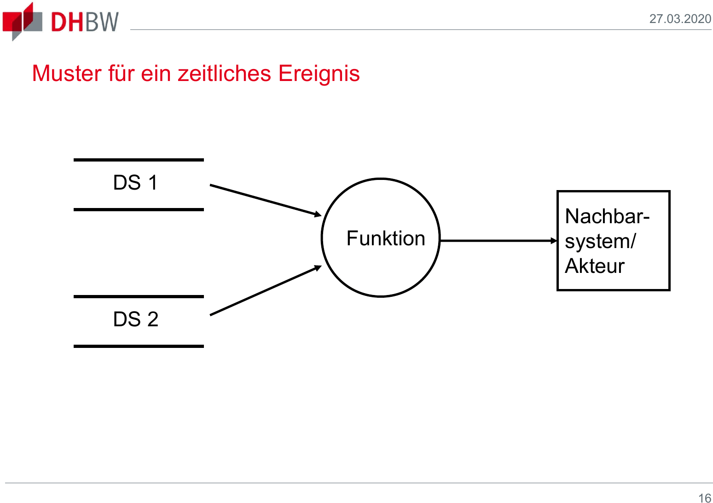
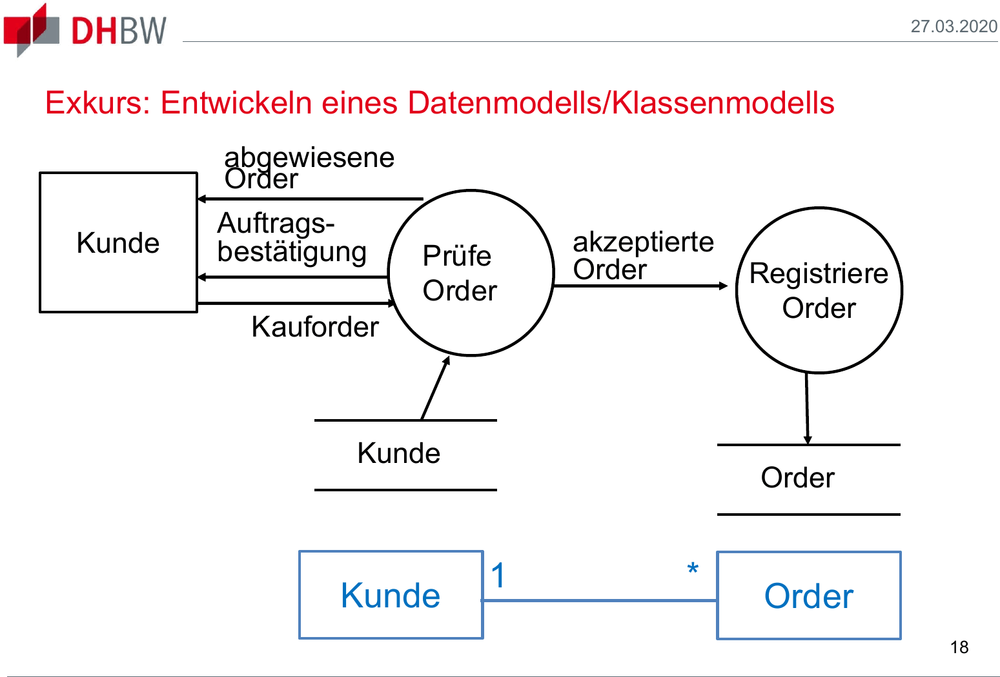

# Ereignisse, Ereignisreaktionsmodelle Ereignislisten

## So werden wir vorgehen - Das RE-Vorgehensmodell

## Was ist der Zweck von Informationssystemen?

Systeme existieren, um Dienstleistungen für Dritte anzubieten. Diese Dienste sind die Reaktion auf ein Ereignis, das außerhalb des Systems aufgetreten ist.

Beispiel für ein Ereignis:
Ein Kunde will 100 Apple-Aktien kaufen.
(NB: Ein Kunde ist jemand, der bereits mit der Bank in Geschäftsbeziehung steht)

## Ereignisse bekommen einen eindeutigen Namen – Kunde erteilt Kauforder

Ich kaufe 100 Aktien von Apple, egal was sie kosten!

> Merke:
> Jedes Ereignis produziert einen eindeutigen Datenfluss.
> Durch den Inhalt des Datenflusses identifiziert das System, welches Ereignis eingetreten ist.

## Das System reagiert - Ereignisreaktion

> Merke:
> Eine Reaktion ist die Zusammenfassung aller Aktivitäten, die auf ein Ereignis reagieren.

## Das vollständige Ereignisreaktionsmodell für das Ereignis Kunde gibt Kauforder.

Der hier relevante Systemausschnitt ist eine Verfeinerung von "Kauforder erfassen"

## Ein typisches Muster für ein ERM

> Merke:
> In einem Ereignisreaktionsmodell (ERM) wird die Reaktion des Systems immer von Nachbarsystemen und Datenspeichern eingegrenzt!

## Erkennen von zeitlichen Ereignissen

Zeitliche Ereignisse werden durch das Eintreten eines vorgegebenen Zeitpunktes ausgelöst.

Das Ereignis endet, wenn es einen oder mehrere Datenflüsse nach Außen abgegeben hat.

Beispiel:

- Die Kauforder konnte nicht am gleichen Börsentag platziert werden.
- Zeitliches Ereignis: Ende des Börsentages.
- Reaktion: Order löschen, Kunden informieren.

## Zeitliches Ereignis - Zeit für Börsenschluss

## Denken Sie daran – Essenz, Essenz, Essenz!! Wir sind immer noch in der Problemdomäne und wollen das wahre Problem verstehen (nicht die IT-Probleme)

Die essentielle Sicht zeigt das System als eine Menge von implementierungsunabhängigen Anforderungen.

Beispiel:

- Im Ereignis Kunde gibt Kauforder wird die Order zuerst geprüft und anschließend registriert.
    - Funktionen: prüfe Order, registriere Order.
    - Daten: Kundendaten, Orderdaten.
    - Die Daten werden anschließend von anderen Ereignissen benötigt. Bsp.: Zeit für Börsenschluss.
- Wie das Ereignis technisch funktioniert ist uninteressant (nicht essentiell).

## Namensregeln

Ereignisse werden im Kontext des Systems gesucht.

Externer Ereignisname = Name des Nachbarsystems + Grund für den Datenfluss.

- Kunde gibt Kauforder.

Zeitlicher Ereignisname = Zeit für + auszuführende Tätigkeit.

- Zeit für Börsenschluss (soll heißen: Bei Ende Börsenhandel noch offene Kaufordern löschen).
- Zeit für das Löschen abgelaufener Order

## Ereignisliste – dient der Sammlung aller relevanten Ereignisse, für die das System einen Dienst ausführen können muss

| Ereignisname | Zugehörige Datenflüsse |
| --- | --- |
| Kunde gibt Kauforder | Kauforder (I) Auftragsbestätigung (O) Ungültige Order (O) |
| Zeit für Börsenschluss | Gelöschte Order (O) |
| ... | ... |

I – Input des Systems (eingehender Datenfluss); O – Output des Systems (ausgehender Datenfluss)

## Zusammenhang zwischen Ereignisliste und ERM

> Merke:
> Zu jedem nicht-trivialen Ereignis aus der Ereignisreaktionsliste wird ein eigenes Ereignisreaktionsmodell erstellt!

## Muster für ein externes Ereignis

## Muster für ein zeitliches Ereignis

## Denken Sie daran – Essenz, Essenz, Essenz!! Wir sind immer noch in der Problemdomäne und wollen das wahre Problem verstehen (nicht die IT-Probleme)

Die essentielle Sicht zeigt das System als eine Menge von implementierungsunabhängigen Anforderungen.

Beispiel:

- Im Ereignis Kunde gibt Kauforder wird die Order zuerst geprüft und anschließend registriert.
    - Funktionen: prüfe Order, registriere Order.
    - Daten: Kundendaten, Orderdaten.
    - Die Daten werden anschließend von anderen Ereignissen benötigt. Bsp.: Zeit für Börsenschluss.
- Wie das Ereignis technisch funktioniert ist uninteressant (nicht essentiell).

## Exkurs: Entwickeln eines Datenmodells/Klassenmodells

Quelle: systems-engineering/origin/WDS125 - Systems Engineering (BäM)/08 LE 5_ Essenzielle Modellierung - Paradigma der ereignisorientierten Zerlegung/Folien der Lerneinheit/06.RE-ERM.pdf, Seiten 1–18
