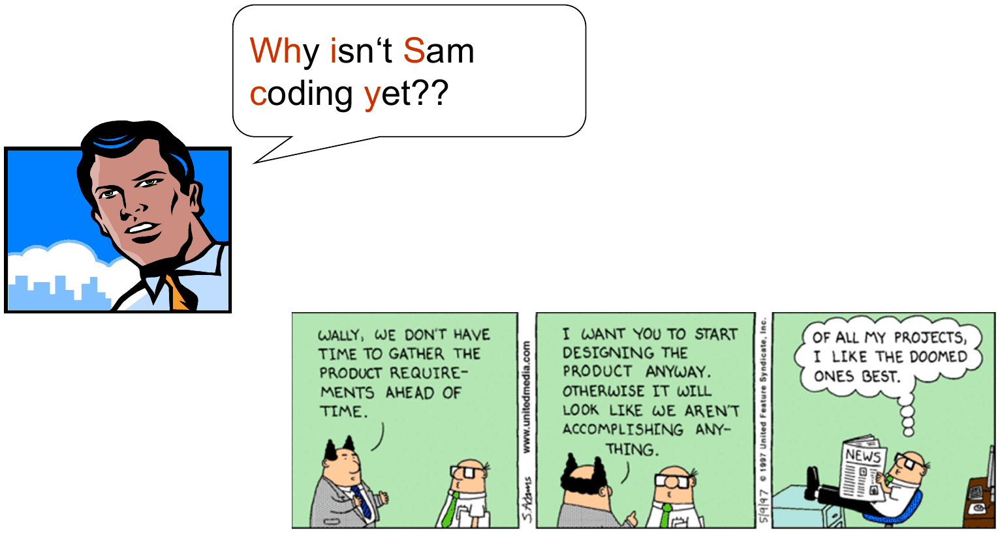

# Top Ten-Risiken und was man dagegen tun kann

1. **Personelle Defizite:** Hochtalentierte Mitarbeiter einstellen; Teams zusammenstellen
2. **Unrealistische Termin- und Kostenvorgaben:** Detaillierte Kosten- und Zeitschätzungen mit mehreren Methoden; Produkt an Kostenvorgaben orientieren; Inkrementelle Entwicklung; Wiederverwendung von Software; Anforderungen streichen
3. **Entwicklung von falschen Funktionen:** Benutzerbeteiligung; Prototypen; Frühzeitiges Benutzerhandbuch
4. **Entwicklung der falschen GUI:** Benutzerbeteiligung; Prototypen; Aufgabenanalyse
5. **„Vergolden“:** Anforderungen streichen; Prototypen; Kosten/Nutzen-Analyse; Entwicklung an Kosten orientieren
6. **Kontinuierliche Anforderungsänderungen:** Hohe Änderungsschwelle; Inkrementelle Entwicklung (Änderungen auf später verschieben)
7. **Defizite bei extern gelieferten Komponenten:** Leistungstest; Inspektionen; Kompatibilitätsanalyse
8. **Defizite bei extern erledigten Aufträgen:** Prototypen; Frühzeitige Überprüfung; Verträge auf Erfolgsbasis
9. **Defizite in der Echtzeitleistung:** Simulation; Leistungstest; Prototypen; Tuning
10. **Überforderung der Softwaretechnik:** Technische Analyse; Kosten/Nutzen-Analyse; Prototypen

## Was sind Prozessmodelle?

Jede Softwareentwicklung erfolgt in einem organisatorischen Rahmen, der Aufbau-, insbesondere aber Ablauforganisation eines Entwicklungsprojekts definiert.

Prozessmodelle beschreiben einen solchen Rahmen.

Prozessmodelle bestehen aus definierten Aktivitäten, die definierte Ergebnisse (Produkte) liefern.

## Ein typischer Rahmen: WHISCY-Syndrom

Why isn‘t Sam coding yet??

## Konsequenz des WHISCY-Syndroms

Ein typisches Prozessmodell: „code & fix“...

- ❶ Schreibe ein Programm
- ❷ Finde die Fehler und behebe sie
- ❸ Wiederhole ❶ und ❷ bis das Programm stabil ist
- ❹ Gehe nach den Schritten ❶ bis ❸ davon aus, dass es ein tolles Programm geworden ist!

## Nachteile von code & fix

- Nach der Behebung von Fehlern wird das Programm so umstrukturiert, dass weitere Fehlerbehebungen immer teurer werden.
  - Entwurfsphase notwendig
- Anforderungen des Anwenders (fachliche Funktionen, Ergonomie) kommen zu kurz
  - Analysephase notwendig
- Fehler sind schwer zu finden, da Tests schlecht vorbereitet sind und Änderungen unzureichend durchgeführt werden.
  - Testphase notwendig

**Fazit:** Wir brauchen ein besseres Prozessmodell als „code & fix“!

## Inhalt eines Prozessmodells

- Reihenfolge des Arbeitsablaufs
- Jeweils durchzuführende Aktivitäten
- Definition der Teilprodukte einschließlich Layout und Inhalt
- Fertigstellungskriterien für Teilprodukte
- Notwendige Mitarbeiterqualifikationen
- Verantwortlichkeiten und Kompetenzen

Wir haben es also mit Arbeitszerlegung und –synthese anhand von organisatorischen Referenzmodellen zu tun!

Quelle: systems-engineering/origin/WDS125 - Systems Engineering (BäM)/06 LE 3_ Prozessmodelle - _Elefanten isst man am Stück_/Folien der Lerneinheit/03.RE-Prozessmodelle.pdf, Folien 2–7
