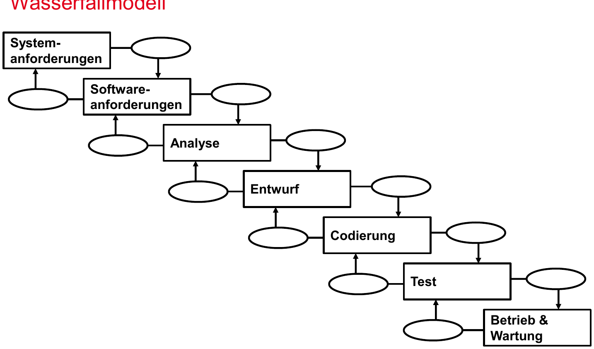
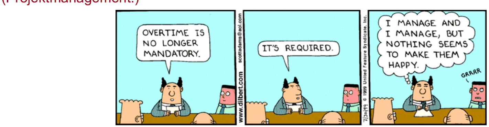

# Wasserfallmodell

## Merkmale

- Jede Aktivität ist in der richtigen Reihenfolge und vollständig durchzuführen.
- Am Ende jeder Aktivität steht ein fertiggestelltes Dokument, d.h. das Wasserfallmodell ist ein dokumentengetriebenes Prozessmodell.
- Der Entwicklungsablauf ist sequentiell, d.h. jede Aktivität muss beendet sein, bevor die nächste anfängt.
- Das Prozessmodell orientiert sich am top-down-Vorgehen.
- Es ist einfach, verständlich und benötigt wenig Managementaufwand.
- Eine Anwender-/Auftraggeberbeteiligung ist nur in der Definitionsphase vorgesehen, die restlichen Phasen erfolgen intern.

## Nachteile

- Es ist nicht immer sinnvoll, alle Entwicklungsschritte vollständig abzuarbeiten.
- Es ist nicht immer sinnvoll, alle Entwicklungsschritte sequentiell abzuarbeiten.
- Es besteht die Gefahr, dass die Dokumentation wichtiger wird als das eigentliche Produkt!
- Risikofaktoren werden möglicherweise nicht erkannt und berücksichtigt, da der einmal festgelegte Entwicklungsablauf starr durchgeführt wird.

Trotz dieser Nachteile hat das Wasserfallmodell wesentlich zu einer plan-, steuer- und kontrollierbaren Softwareentwicklung beigetragen (Projektmanagement!)

Quelle: systems-engineering/origin/WDS125 - Systems Engineering (BäM)/06 LE 3_ Prozessmodelle - _Elefanten isst man am Stück_/Folien der Lerneinheit/03.RE-Prozessmodelle.pdf, Folien 8–10
