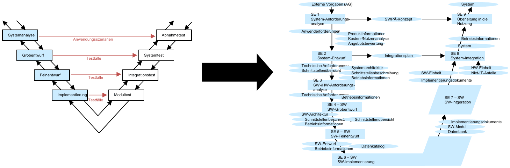
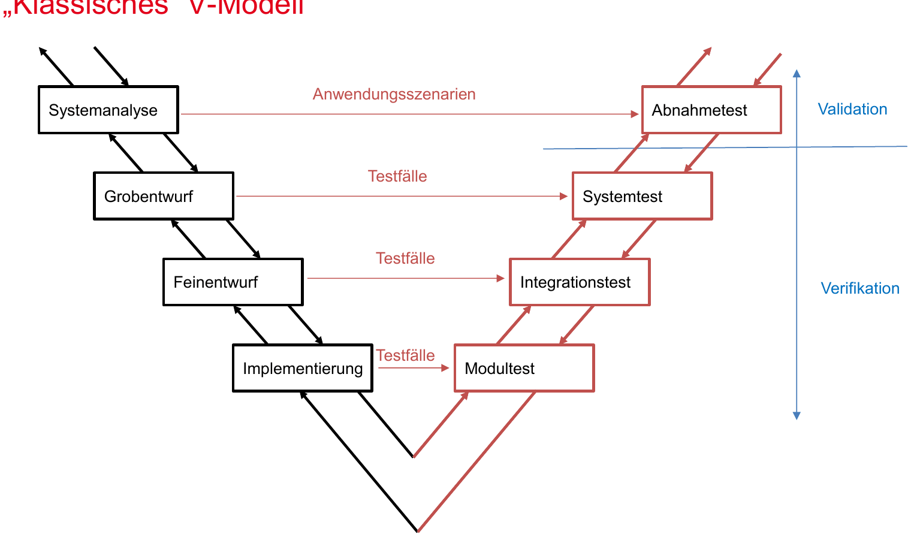
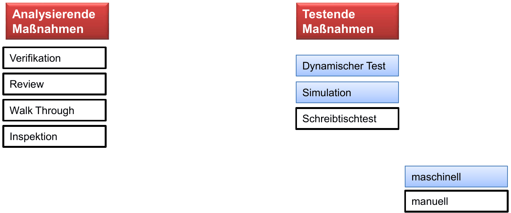
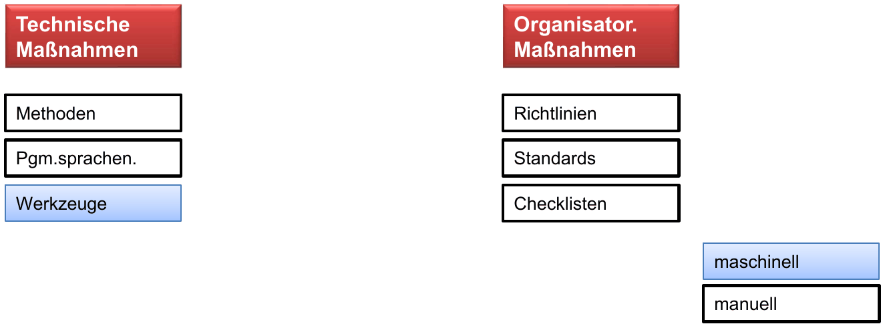

# Überblick - Zwei V-Modelle

- „Klassisches“ V-Modell als Erweiterung des Wasserfallmodells
- V-Modell 97 und XT des Bundes als Erweiterung des „klassischen“ V-Modells

## „Klassisches“ V-Modell

## Evaluation im V-Modell

**Verifikation**: „Wird ein korrektes Produkt entwickelt?“

- Überprüft die formale Richtigkeit und Konsistenz der Transformation zwischen je zwei Ergebnissen.
- Liegen die Ergebnisse in formalisierter Form vor, ist u.U. eine computergestützte, vollautomatische Verifikation möglich.

**Validation**: „Wird das richtige Produkt entwickelt?“

- Formale Korrektheit (➔Verifikation) bedeutet nicht, dass ein IS den Anforderungen des Anwenders tatsächlich entspricht.
- Die Validation nimmt daher aus Sicht des Anwenders eine Überprüfung dahingehend vor, ob das IS den Anforderungen entspricht.
- Findet immer mit Anwenderbeteiligung statt.

## 2 Arten von QS-Maßnahmen

**Analytische QS-Maßnahmen** (➲ v.a Produktqualität): Diagnostische Maßnahmen zur Messung des erreichten Qualitätsniveaus eines Prüflings (Produkt/Prozess).

**Konstruktive QS-Maßnahmen** (➲ v.a Prozessqualität): Methoden, Sprachen, Werkzeuge, Richtlinien, Standards und Checklisten, die dafür sorgen, dass das entstehende Produkt bzw. der Erstellungsprozess a priori bestimmte Eigenschaften aufweist.

Quelle: systems-engineering/origin/WDS125 - Systems Engineering (BäM)/06 LE 3_ Prozessmodelle - _Elefanten isst man am Stück_/Folien der Lerneinheit/03.RE-Prozessmodelle.pdf, Folien 11–15
