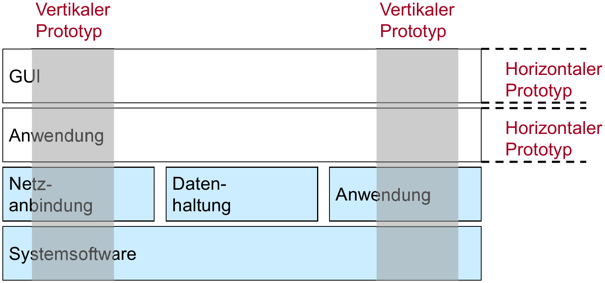
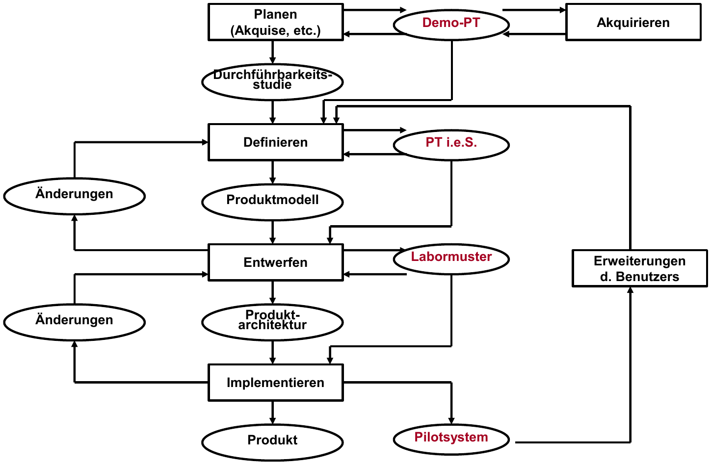

# Probleme traditioneller Prozessmodelle

- Traditionelle Modelle verlangen eine vollständige Spezifikation der Anforderungen zu Projektbeginn
- Oftmals ist eine wechselseitige Kooperation zwischen Entwicklern und Anwendern notwendig
- Für manche Problemstellungen sind alternative Lösungen möglich, die diskutiert werden müssen
- Die Realisierbarkeit mancher Anforderungen (z.B. Echtzeit) kann nur praktisch erprobt werden

## Was ist ein Prototyp?

Das Prototypen-Modell unterstützt auf systematische Weise die frühzeitige Erstellung ablauffähiger Modelle (Prototypen) des zukünftigen Informationssystems.

Drei Arten:

1. **Experimenteller Prototyp** (Labormuster)
2. **Explorativer Prototyp** (Demonstrationsprototyp, Prototyp i.e.S.)
3. **Evolutionärer Prototyp** (Pilotsystem)

Motto: „Redo until Right“

## Horizontale und vertikale Prototypen

## Prototypen-Prozessmodell

## Kreislauf des Verstehens

1. Der Anwender erzählt dem Systemanalytiker, wie er sich eine neue Funktion vorstellt.
2. Der Systemanalytiker schreibt das, was er verstanden hat, in seiner Darstellung nieder: Objektdiagramme, Ablaufpläne, Pseudocode etc. Die intellektuelle Leistung dabei ist, dass er die Vorstellungen des Anwenders strukturiert, Komplexität erkennt und durchdringt, die Konsistenz sichert.
3. Seinen Lösungsvorschlag übersetzt der Systemanalytiker in die Darstellung des Anwenders in dessen Sprache (z.B. eine Dialogbeschreibung).
4. Dieses Dokument oder der Prototyp zeigt er dem Anwender. Er wird überrascht feststellen, dass er vieles nicht oder nicht richtig verstanden hat, was ihm vorher völlig klar erschien.
5. Am Dokument für den Anwender werden jetzt Änderungen, Verbesserungen, Erweiterungen vorgenommen, um dann wieder bei Schritt 2 weiterzumachen.

## Regel

Merke:

Der *Kreislauf des Verstehens* ist der Schlüssel zu einer erfolgreichen Systemanalyse, an deren Ende eine erfolgreiche Systemspezifikation steht!

Beer, J.: Systemspezifikation, in: Siedersleben, J. (Hrsg.): Softwaretechnik. Praxiswissen für Softwareingenieure, 2., überarb. u. akt. Aufl., München/Wien 2003, S. 21-48.

## Bewertung

- ☑ Reduzierung des Entwicklungsrisikos
- ☑ Integration in andere Prozessmodelle möglich
- ☑ Geeignete Werkzeuge vorhanden
- ☑ Verbesserung der Planung und der Kreativität von Lösungen
- ☑ Einbezug des späteren Anwenders
- ☒ Höherer Entwicklungsaufwand
- ☒ Gefahr, dass „Wegwerf“-PT aus Zeitmangel doch Teil des Endsystems wird
- ☒ Verträge für SE berücksichtigen vielfach PT nicht
- ☒ Wird als Ersatz für fehlende Dokumentation betrachtet
- ☒ Grenzen und Restriktionen eines PT sind oft nicht bekannt

## Ein altes Problem...

Der typische Anwender:
I can‘t tell you what I want,
but I‘ll know it when I see it!

Quelle: systems-engineering/origin/WDS125 - Systems Engineering (BäM)/06 LE 3_ Prozessmodelle - _Elefanten isst man am Stück_/Folien der Lerneinheit/03.RE-Prozessmodelle.pdf, Folien 16–23
