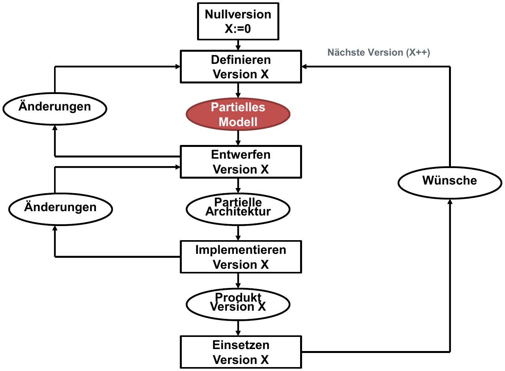

# Was bedeutet „evolutionär“?

- Ausgangspunkt beim evolutionären Modell sind die Kern- bzw. Muss-Anforderungen des Auftraggebers.
- Diese Anforderungen definieren den Produktkern.
- Nur dieser Produktkern wird entworfen und entwickelt.
- Das Kernsystem, auch Nullversion genannt, wird an den Auftraggeber ausgeliefert.
- Der Auftraggeber sammelt Erfahrungen mit der Nullversion und ermittelt daraus seine Produktanforderungen für eine erweiterte Version.
- Die Nullversion wird anschließend erweitert. Die neue Produktversion wird eingesetzt. Neue Anforderungen werden ermittelt...

## Evolutionäres Prozessmodell

## Merkmale des evolutionären Modells

- Das Informationssystem wird allmählich und stufenweise entwickelt.
- Pflegeaktivitäten werden ebenfalls als Erstellung einer neuen Version betrachtet.
- Gut geeignet, wenn der Auftraggeber seine Anforderungen noch nicht vollständig überblickt.
- Die Entwicklung ist code-getrieben, d.h. man konzentriert sich jeweils auf lauffähige Teilprodukte.

## Bewertung

- ☑ Auftraggeber erhält in kürzeren Zeitabständen ein einsatzfähiges Produkt, z.B. halbjährlich.
- ☑ Es kann mit dem PT-Modell kombiniert werden, insb. ist eine Pilotsystem-Entwicklung ähnlich wie eine evolutionäre Entwicklung.
- ☑ Der frühzeitige Einsatz einer eingeschränkten Produktversion erlaubt die Analyse der Auswirkungen auf die Geschäftsprozesse. Diese Erfahrungen lassen sich dann schnell in die nächste Version integrieren.
- ☑ Ein Produkt wird in einer Anzahl kleinerer Arbeitsschritte überschaubarer Größe entwickelt. Korrekturen der Entwicklungsrichtung sind damit möglich.
- ☑ Es gibt nicht nur einen Endtermin als „Big Bang“ sondern viele Zwischentermine mit einsatzfähigen Zwischenergebnissen.
- ☒ Es besteht die Gefahr, dass die Nullversion wichtige Kernanforderungen übersehen hat und deshalb die gesamte Architektur überarbeitet werden muss.
- ☒ Es besteht die Gefahr, dass die Nullversion nicht flexibel genug weiterentwickelbar ist.

Quelle: systems-engineering/origin/WDS125 - Systems Engineering (BäM)/06 LE 3_ Prozessmodelle - _Elefanten isst man am Stück_/Folien der Lerneinheit/03.RE-Prozessmodelle.pdf, Folien 24–27
