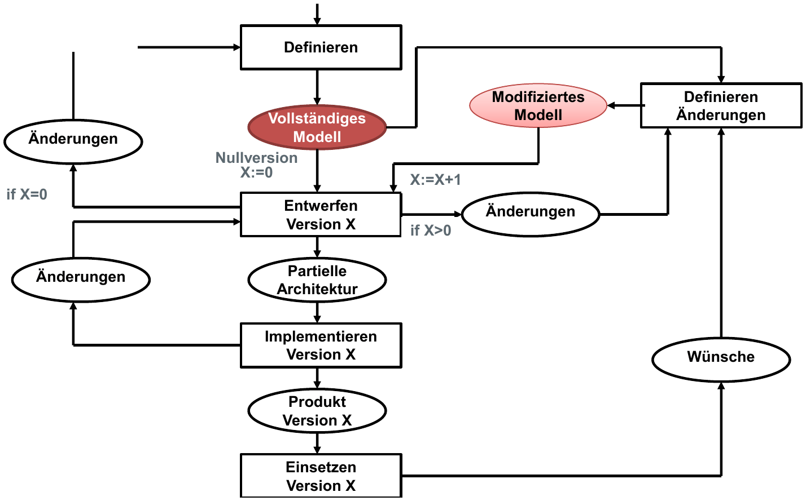

# Erweiterung: Inkrementelles Prozessmodell

- Die Nachteile des evolutionären Modells lassen sich dadurch beheben, dass nicht ein partielles sondern ein vollständiges Informationssystem modelliert wird.
- Analog zum evolutionären Modell wird dann nur ein Teil der Anforderungen umgesetzt.
- Da bei der inkrementellen Vorgehensweise bereits ein vollständiges Analysemodell vorliegt, ist sichergestellt, dass die inkrementellen Erweiterungen zum bisherigen System passen.

## Inkrementelles Prozessmodell

Quelle: systems-engineering/origin/WDS125 - Systems Engineering (BäM)/06 LE 3_ Prozessmodelle - _Elefanten isst man am Stück_/Folien der Lerneinheit/03.RE-Prozessmodelle.pdf, Folien 28–29
