# Prozessmodelle

## Top Ten-Risiken und was man dagegen tun kann

1. Personelle Defizite
   - Hochtalentierte Mitarbeiter einstellen
   - Teams zusammenstellen
2. Unrealistische Termin- und Kostenvorgaben
   - Detaillierte Kosten- und Zeitschätzungen mit mehreren Methoden
   - Produkt an Kostenvorgaben orientieren
   - Inkrementelle Entwicklung
   - Wiederverwendung von Software
   - Anforderungen streichen
3. Entwicklung von falschen Funktionen
   - Benutzerbeteiligung
   - Prototypen
   - Frühzeitiges Benutzerhandbuch
4. Entwicklung der falschen GUI
   - Benutzerbeteiligung
   - Prototypen
   - Aufgabenanalyse
5. „Vergolden“
   - Anforderungen streichen
   - Prototypen
   - Kosten/Nutzen-Analyse
   - Entwicklung an Kosten orientieren
6. Kontinuierliche Anforderungsänderungen
   - Hohe Änderungsschwelle
   - Inkrementelle Entwicklung (Änderungen auf später verschieben)
7. Defizite bei extern gelieferten Komponenten
   - Leistungstest
   - Inspektionen
   - Kompatibilitätsanalyse
8. Defizite bei extern erledigten Aufträgen
   - Prototypen
   - Frühzeitige Überprüfung
   - Verträge auf Erfolgsbasis
9. Defizite in der Echtzeitleistung
   - Simulation
   - Leistungstest
   - Prototypen
   - Tuning
10. Überforderung der Softwaretechnik
    - Technische Analyse
    - Kosten/Nutzen-Analyse
    - Prototypen

## Was sind Prozessmodelle?

Jede Softwareentwicklung erfolgt in einem organisatorischen Rahmen, der Aufbau-, insbesondere aber Ablauforganisation eines Entwicklungsprojekts definiert.

Prozessmodelle beschreiben einen solchen Rahmen.

Prozessmodelle bestehen aus definierten Aktivitäten, die definierte Ergebnisse (Produkte) liefern.

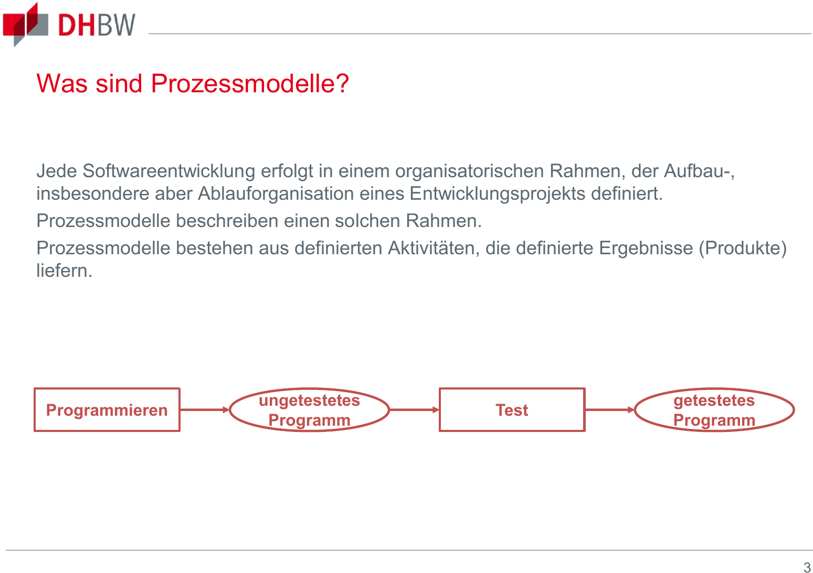

## Ein typischer Rahmen: WHISCY-Syndrom

Why isn‘t Sam coding yet??

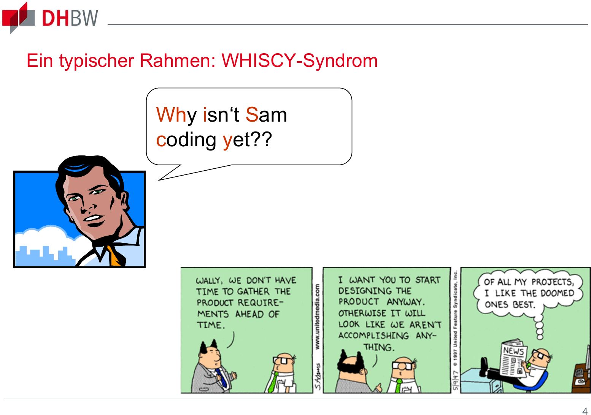

## Konsequenz des WHISCY-Syndroms

Ein typisches Prozessmodell: „code & fix“...

- ❶ Schreibe ein Programm
- ❷ Finde die Fehler und behebe sie
- ❸ Wiederhole ❶ und ❷ bis das Programm stabil ist
- ❹ Gehe nach den Schritten ❶ bis ❸ davon aus, dass es ein tolles Programm geworden ist!

## Nachteile von code & fix

- Nach der Behebung von Fehlern wird das Programm so umstrukturiert, dass weitere Fehlerbehebungen immer teurer werden.
  - Entwurfsphase notwendig
- Anforderungen des Anwenders (fachliche Funktionen, Ergonomie) kommen zu kurz
  - Analysephase notwendig
- Fehler sind schwer zu finden, da Tests schlecht vorbereitet sind und Änderungen unzureichend durchgeführt werden.
  - Testphase notwendig

**Fazit**

Wir brauchen ein besseres Prozessmodell als „code & fix“!

## Inhalt eines Prozessmodells

- Reihenfolge des Arbeitsablaufs
- Jeweils durchzuführende Aktivitäten
- Definition der Teilprodukte einschließlich Layout und Inhalt
- Fertigstellungskriterien für Teilprodukte
- Notwendige Mitarbeiterqualifikationen
- Verantwortlichkeiten und Kompetenzen

Wir haben es also mit Arbeitszerlegung und –synthese anhand von organisatorischen Referenzmodellen zu tun!

## Wasserfallmodell

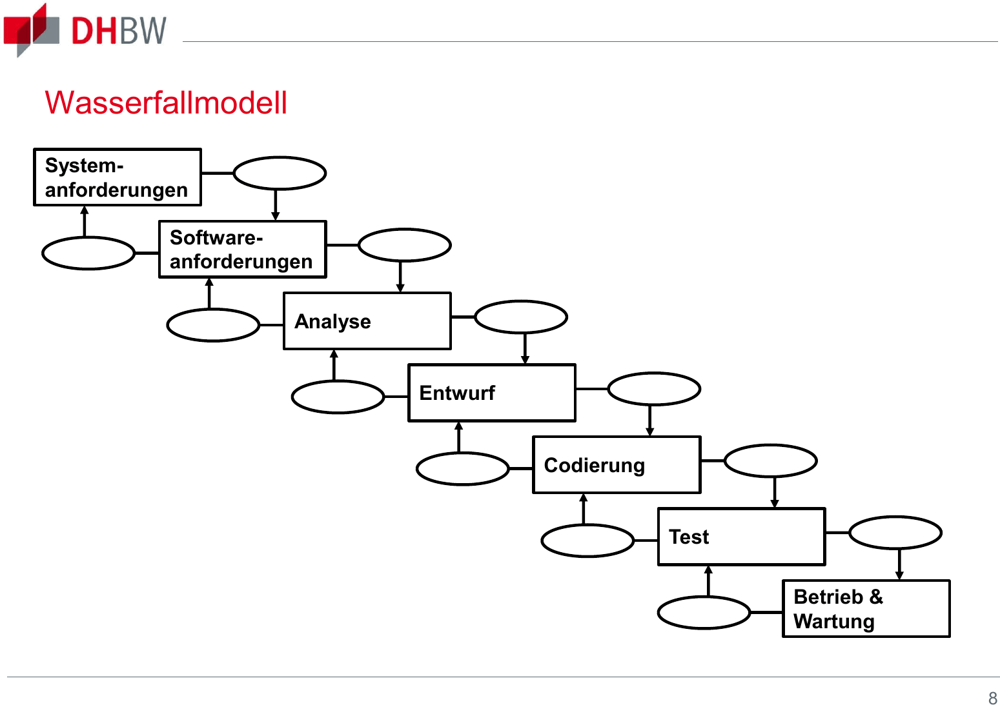

## Merkmale

- Jede Aktivität ist in der richtigen Reihenfolge und vollständig durchzuführen.
- Am Ende jeder Aktivität steht ein fertiggestelltes Dokument, d.h. das Wasserfallmodell ist ein dokumentengetriebenes Prozessmodell.
- Der Entwicklungsablauf ist sequentiell, d.h. jede Aktivität muss beendet sein, bevor die nächste anfängt.
- Das Prozessmodell orientiert sich am top-down-Vorgehen.
- Es ist einfach, verständlich und benötigt wenig Managementaufwand.
- Eine Anwender-/Auftraggeberbeteiligung ist nur in der Definitionsphase vorgesehen, die restlichen Phasen erfolgen intern.

## Nachteile

- Es ist nicht immer sinnvoll, alle Entwicklungsschritte vollständig abzuarbeiten.
- Es ist nicht immer sinnvoll, alle Entwicklungsschritte sequentiell abzuarbeiten.
- Es besteht die Gefahr, dass die Dokumentation wichtiger wird als das eigentliche Produkt!
- Risikofaktoren werden möglicherweise nicht erkannt und berücksichtigt, da der einmal festgelegte Entwicklungsablauf starr durchgeführt wird.

Trotz dieser Nachteile hat das Wasserfallmodell wesentlich zu einer plan-, steuer- und kontrollierbaren Softwareentwicklung beigetragen (Projektmanagement!)

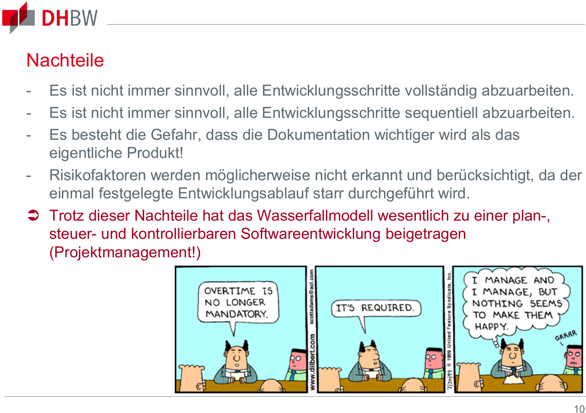

## Überblick - Zwei V-Modelle

„Klassisches“ V-Modell als Erweiterung des Wasserfallmodells

V-Modell 97 und XT des Bundes als Erweiterung des „klassischen“ V-Modells

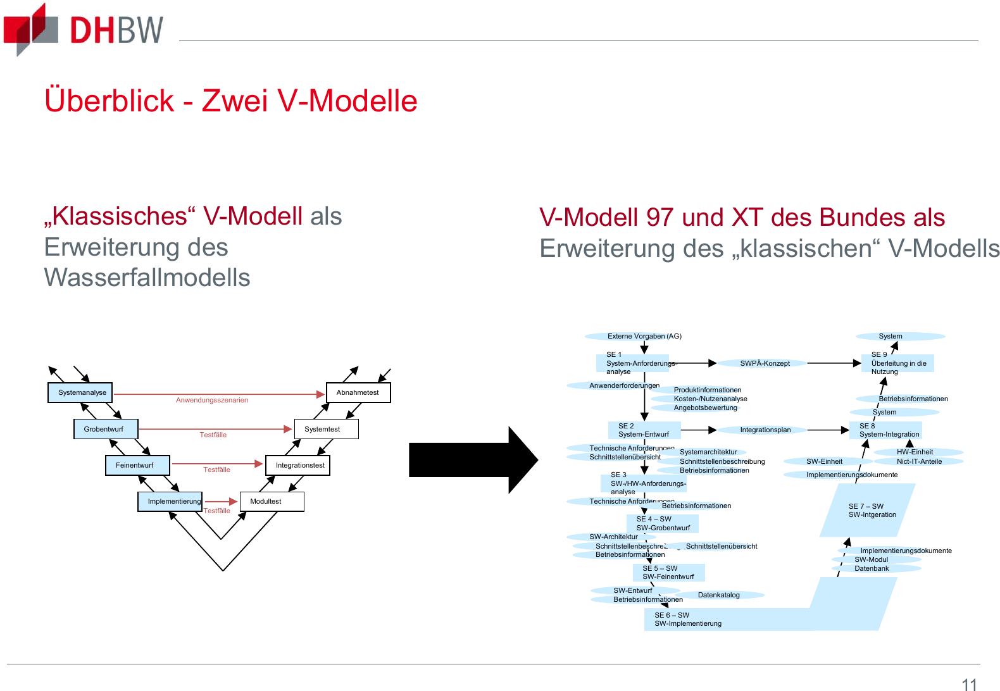

## „Klassisches“ V-Modell

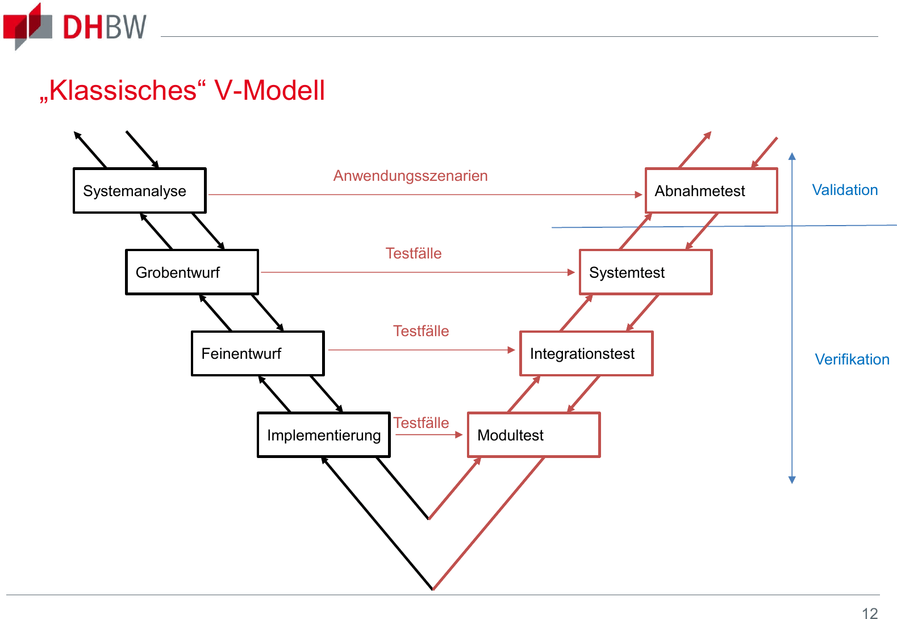

## Evaluation im V-Modell

**Verifikation**: „Wird ein korrektes Produkt entwickelt?“

- Überprüft die formale Richtigkeit und Konsistenz der Transformation zwischen je zwei Ergebnissen.
- Liegen die Ergebnisse in formalisierter Form vor, ist u.U. eine computergestützte, vollautomatische Verifikation möglich.

**Validation**: „Wird das richtige Produkt entwickelt?“

- Formale Korrektheit (➔Verifikation) bedeutet nicht, dass ein IS den Anforderungen des Anwenders tatsächlich entspricht.
- Die Validation nimmt daher aus Sicht des Anwenders eine Überprüfung dahingehend vor, ob das IS den Anforderungen entspricht.
- Findet immer mit Anwenderbeteiligung statt.

## 2 Arten von QS-Maßnahmen

Analytische QS-Maßnahmen (➲ v.a Produktqualität)

- Diagnostische Maßnahmen zur Messung des erreichten Qualitätsniveaus eines Prüflings (Produkt/Prozess).

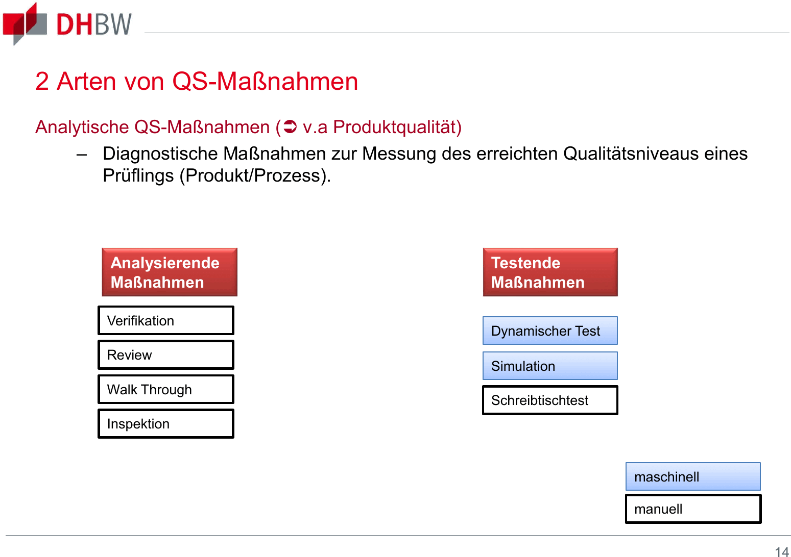

## 2 Arten von QS-Maßnahmen

Konstruktive QS-Maßnahmen (➲ v.a Prozessqualität)

- Methoden, Sprachen, Werkzeuge, Richtlinien, Standards und Checklisten, die dafür sorgen, dass das entstehende Produkt bzw. der Erstellungsprozess a priori bestimmte Eigenschaften aufweist.

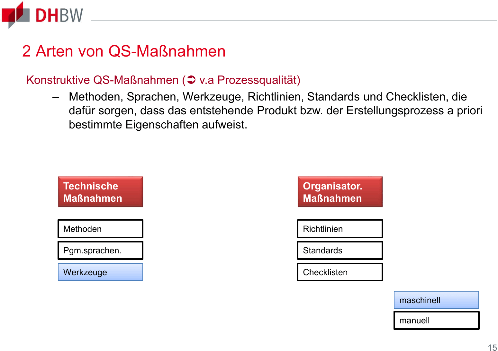

## Probleme traditioneller Prozessmodelle

- Traditionelle Modelle verlangen eine vollständige Spezifikation der Anforderungen zu Projektbeginn
- Oftmals ist eine wechselseitige Kooperation zwischen Entwicklern und Anwendern notwendig
- Für manche Problemstellungen sind alternative Lösungen möglich, die diskutiert werden müssen
- Die Realisierbarkeit mancher Anforderungen (z.B. Echtzeit) kann nur praktisch erprobt werden

## Was ist ein Prototyp?

Das Prototypen-Modell unterstützt auf systematische Weise die frühzeitige Erstellung ablauffähiger Modelle (Prototypen) des zukünftigen Informationssystems.

Drei Arten:

1. **Experimenteller Prototyp** (Labormuster)
2. **Explorativer Prototyp** (Demonstrationsprototyp, Prototyp i.e.S.)
3. **Evolutionärer Prototyp** (Pilotsystem)

Motto: „Redo until Right“

## Horizontale und vertikale Prototypen

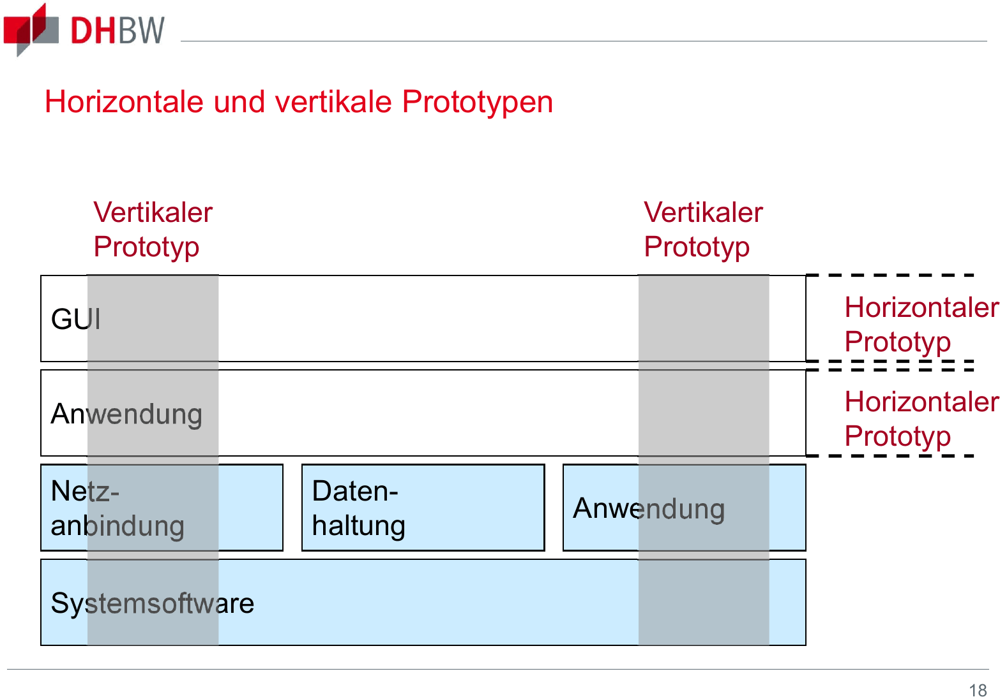

## Prototypen-Prozessmodell

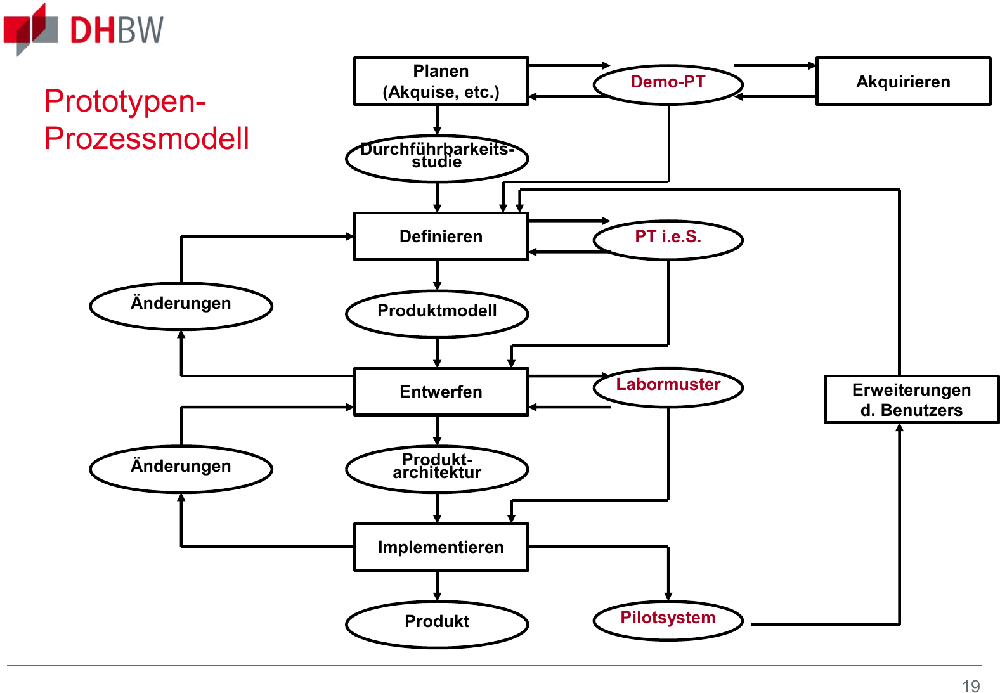

## Kreislauf des Verstehens

1. Der Anwender erzählt dem Systemanalytiker, wie er sich eine neue Funktion vorstellt.
2. Der Systemanalytiker schreibt das, was er verstanden hat, in seiner Darstellung nieder: Objektdiagramme, Ablaufpläne, Pseudocode etc. Die intellektuelle Leistung dabei ist, dass er die Vorstellungen des Anwenders strukturiert, Komplexität erkennt und durchdringt, die Konsistenz sichert.
3. Seinen Lösungsvorschlag übersetzt der Systemanalytiker in die Darstellung des Anwenders in dessen Sprache (z.B. eine Dialogbeschreibung).
4. Dieses Dokument oder der Prototyp zeigt er dem Anwender. Er wird überrascht feststellen, dass er vieles nicht oder nicht richtig verstanden hat, was ihm vorher völlig klar erschien.
5. Am Dokument für den Anwender werden jetzt Änderungen, Verbesserungen, Erweiterungen vorgenommen, um dann wieder bei Schritt 2 weiterzumachen.

## Regel

Merke:

Der *Kreislauf des Verstehens* ist der Schlüssel zu einer erfolgreichen Systemanalyse, an deren Ende eine erfolgreiche Systemspezifikation steht!

Beer, J.: Systemspezifikation, in: Siedersleben, J. (Hrsg.): Softwaretechnik. Praxiswissen für Softwareingenieure, 2., überarb. u. akt. Aufl., München/Wien 2003, S. 21-48.

## Bewertung

- ☑ Reduzierung des Entwicklungsrisikos
- ☑ Integration in andere Prozessmodelle möglich
- ☑ Geeignete Werkzeuge vorhanden
- ☑ Verbesserung der Planung und der Kreativität von Lösungen
- ☑ Einbezug des späteren Anwenders
- ☒ Höherer Entwicklungsaufwand
- ☒ Gefahr, dass „Wegwerf“-PT aus Zeitmangel doch Teil des Endsystems wird
- ☒ Verträge für SE berücksichtigen vielfach PT nicht
- ☒ Wird als Ersatz für fehlende Dokumentation betrachtet
- ☒ Grenzen und Restriktionen eines PT sind oft nicht bekannt

## Ein altes Problem...

Der typische Anwender:
I can‘t tell you what I want,
but I‘ll know it when I see it!

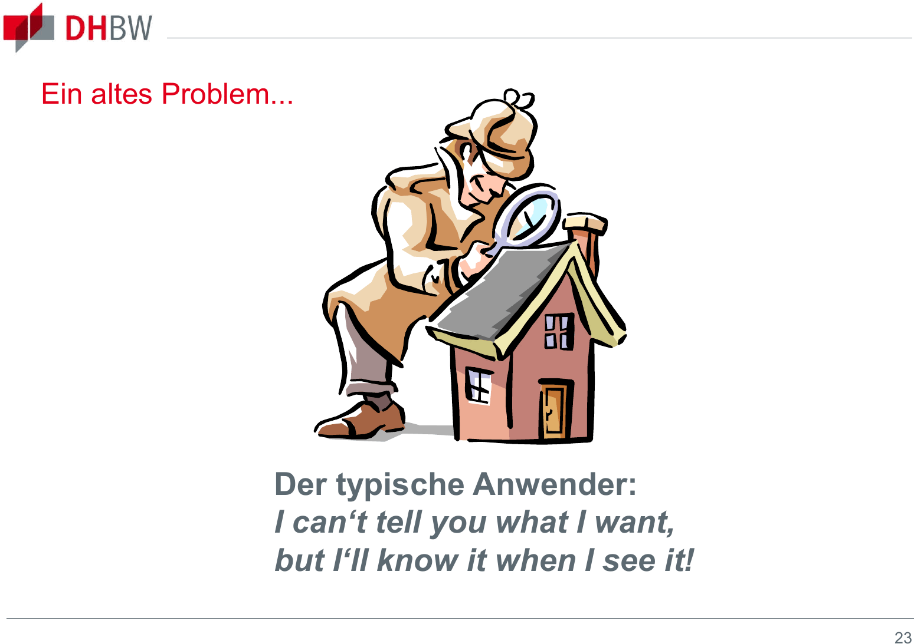

## Was bedeutet „evolutionär“?

- Ausgangspunkt beim evolutionären Modell sind die Kern- bzw. Muss-Anforderungen des Auftraggebers.
- Diese Anforderungen definieren den Produktkern.
- Nur dieser Produktkern wird entworfen und entwickelt.
- Das Kernsystem, auch Nullversion genannt, wird an den Auftraggeber ausgeliefert.
- Der Auftraggeber sammelt Erfahrungen mit der Nullversion und ermittelt daraus seine Produktanforderungen für eine erweiterte Version.
- Die Nullversion wird anschließend erweitert. Die neue Produktversion wird eingesetzt. Neue Anforderungen werden ermittelt...

## Evolutionäres Prozessmodell

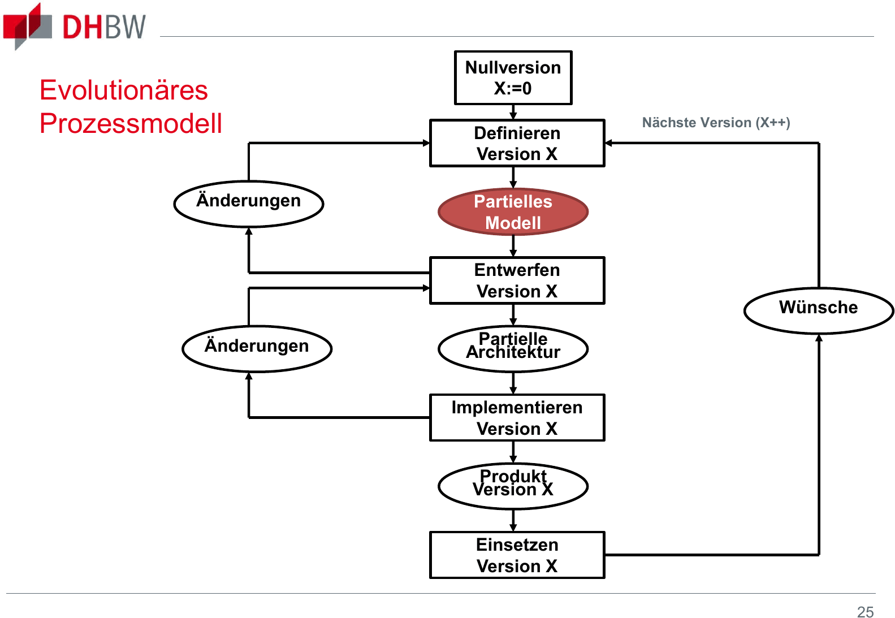

## Merkmale des evolutionären Modells

- Das Informationssystem wird allmählich und stufenweise entwickelt.
- Pflegeaktivitäten werden ebenfalls als Erstellung einer neuen Version betrachtet.
- Gut geeignet, wenn der Auftraggeber seine Anforderungen noch nicht vollständig überblickt.
- Die Entwicklung ist code-getrieben, d.h. man konzentriert sich jeweils auf lauffähige Teilprodukte.

## Bewertung

- ☑ Auftraggeber erhält in kürzeren Zeitabständen ein einsatzfähiges Produkt, z.B. halbjährlich.
- ☑ Es kann mit dem PT-Modell kombiniert werden, insb. ist eine Pilotsystem-Entwicklung ähnlich wie eine evolutionäre Entwicklung.
- ☑ Der frühzeitige Einsatz einer eingeschränkten Produktversion erlaubt die Analyse der Auswirkungen auf die Geschäftsprozesse. Diese Erfahrungen lassen sich dann schnell in die nächste Version integrieren.
- ☑ Ein Produkt wird in einer Anzahl kleinerer Arbeitsschritte überschaubarer Größe entwickelt. Korrekturen der Entwicklungsrichtung sind damit möglich.
- ☑ Es gibt nicht nur einen Endtermin als „Big Bang“ sondern viele Zwischentermine mit einsatzfähigen Zwischenergebnissen.
- ☒ Es besteht die Gefahr, dass die Nullversion wichtige Kernanforderungen übersehen hat und deshalb die gesamte Architektur überarbeitet werden muss.
- ☒ Es besteht die Gefahr, dass die Nullversion nicht flexibel genug weiterentwickelbar ist.

## Erweiterung: Inkrementelles Prozessmodell

- Die Nachteile des evolutionären Modells lassen sich dadurch beheben, dass nicht ein partielles sondern ein vollständiges Informationssystem modelliert wird.
- Analog zum evolutionären Modell wird dann nur ein Teil der Anforderungen umgesetzt.
- Da bei der inkrementellen Vorgehensweise bereits ein vollständiges Analysemodell vorliegt, ist sichergestellt, dass die inkrementellen Erweiterungen zum bisherigen System passen.

## Inkrementelles Prozessmodell

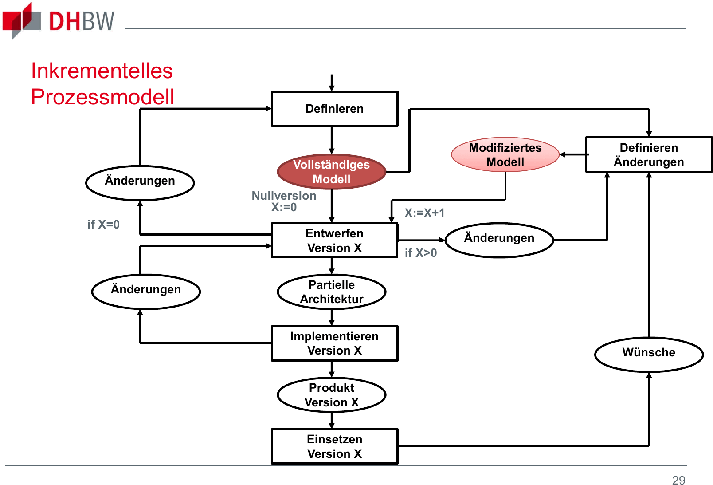

## Zusammenfassung der Prozessmodelle

| Modell | Primäres Ziel | Fokus | Benutzerbeteiligung | Merkmale |
| --- | --- | --- | --- | --- |
| Wasserfallmodell | minimaler Managementaufwand | Dokumente | gering | sequentiell, volle Breite |
| V-Modell | maximale Qualität | Dokumente | gering | sequentiell, volle Breite, QS |
| Prototypen-Modell | Risikominimierung | Code | hoch | nur Teilsysteme (horiz./vert.) |
| Evolutionäres Modell | minimale Entwicklungszeit | Code | mittel | sofort: nur Kernsystem |
| Inkrementelles Modell | min. Entwicklungszeit Risikominimierung | Code | mittel | Volle Definition; dann zunächst Kernsystem |

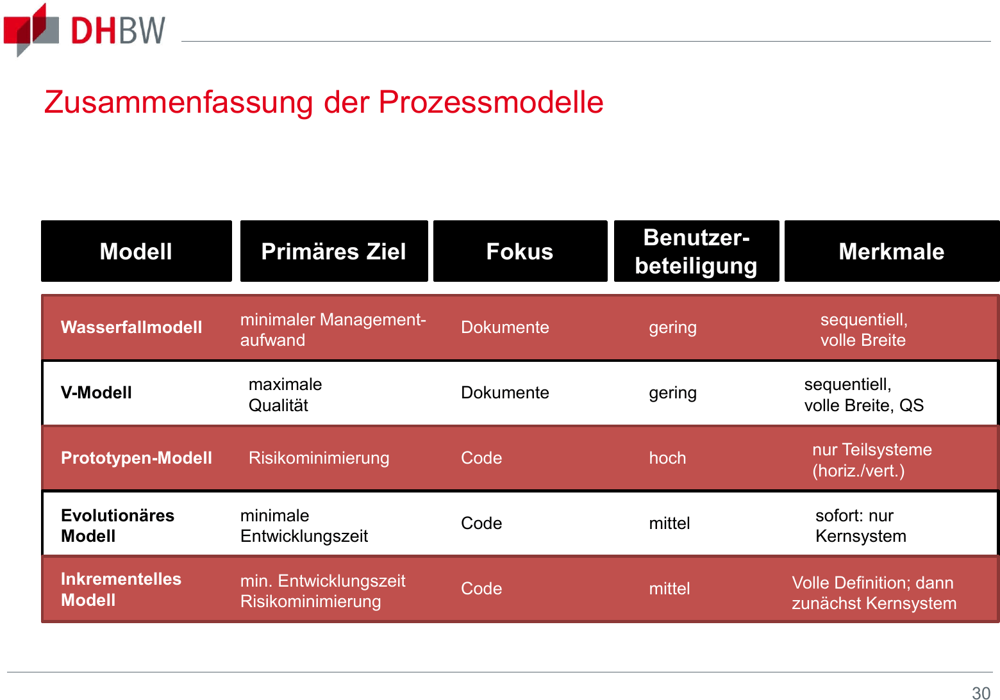

Quelle: systems-engineering/origin/WDS125 - Systems Engineering (BäM)/06 LE 3_ Prozessmodelle - _Elefanten isst man am Stück_/Folien der Lerneinheit/03.RE-Prozessmodelle.pdf, Seiten 1–30
